# HFY-PLN-002 BRD2: harrisonfamily.us becomes a two-way family archive

**Plan:** HFY-PLN-002 (predecessor HFY-PLN-001, feature HFY-FTR-013)
**Inputs:** io's verbatim intent DOC-2CFAE07B546C (`pln002-intent.md`), the requirement trace list (`pln2/requirements.md`, R-01..R-42 and D-01..D-03), the discovery digest (`pln2/digest.md`), the PLN-001 BRD (DOC-7CBCCC1521DD) and rulings HFY-R1..R77, io's research DOC-E61DCBFAFA5F (visualization) and DOC-926937A24A07 (chat) with their verification DOC-363B23B01410, the live state of HFY-TSK-090 and HFY-TSK-091, and six domain designs: [sync](./sync.md), [editing](./editing.md), [social](./social.md), [surfaces](./surfaces.md), [viz](./viz.md), [chat](./chat.md).
**Machine-readable task list:** [`tasks.json`](./tasks.json): 207 tasks (200 work tasks plus 7 wave objectives `wave-W0`..`wave-W6`; 47 of them added by the plan review and 7 by the 2026-10-13 intake, Appendix C). Beyond the domain task schema, each task also carries `parent` (its wave objective), `origin` (the domain design it came from, `integration`, `review` for tasks added by the plan review, or `intake` for tasks added by the 2026-10-13 intake), `deploy_target` (`app-stack-change-set`, `site-ci`, `chat-worker`, `io-mac`, `infra-script`, `kit-release` or `none`), `release_group` (section 10.3), and `components` and `test_plan` (section 10.4).
**Status:** draft for io's acceptance, revised after the plan review (four lenses: privacy-security, sync-integrity, intent-fidelity, delivery). Every review issue and its resolution is listed in Appendix B; the 2026-10-13 intake of the verified research, io's chat rulings and live state is in Appendix C; the binding amendments to the domain designs are in section 11. This document edits no repository and creates no record; HFY-TSK-090 and HFY-TSK-091 ran separately and appear here as live state.
**Privacy:** this document holds structure and counts only. It contains no real person's name, date or contact detail. Example ids (`I9001`, `I8000`) are fictional or reserved-block numbers. The one real id is io's own principal, `<gramps-id>` (HFY-R75), named in Q2-01 because the admin and MCP role bindings depend on it; it is an identifier, not a name, date or contact detail, and no handoff prints it.

---

## 0. Purpose and north star

io's north star, verbatim from DOC-2CFAE07B546C:

> "but with the recent upgrades in a post enceladus world, the north star is now bi-directional gramps <-> website. the cloud data backend becomes the new source of truth, and we need a solution for local gramps running on my machine to consume the updates in a well engineered and highly robust way, with extensive error handling."

**What this BRD does.** It merges six domain designs into one plan with:
- one set of decisions;
- one data model;
- one privacy model;
- one task graph.

Where the domains disagreed, this document decides and records the reason (section 4.3 and Appendix A).

**What the plan delivers:**
1. **Cloud as source of truth.** The cloud record store in `hfy-app` becomes canonical. io's desktop Gramps syncs with it both ways through a Gramps addon that never sends a date of birth or contact detail, and never applies a change without a preview, a verified backup and a single undo entry (R-03, R-04, R-05, R-19).
2. **Member editing.** Members edit their own information directly. They propose everything else through Gramps-parity editors and a relationship wizard built for older relatives. Admins approve (R-06 to R-09, R-24).
3. **A social layer.** It adds an in-app inbox, record follows, comment photos and their graduation into Gramps, contributions, and moderation (R-01, R-02, R-10 to R-13, R-25 to R-28, R-32).
4. **New surfaces.** They are "me" and the settings gear, on this day, the /about/ call to action, profile links, access requests and photo tags, plus site tagging that round-trips to Gramps (R-14 to R-17, R-20, R-21, R-23, R-29 to R-31, R-42).
5. **A research-first family tree.** A card navigator that works on a phone first, then lifelines, faces and a whole-family poster on desktop, then a map of the family's journeys (R-22; io's verified research, Q2-13).
6. **`@io-kit/chat`.** A Gmail-Chat-faithful webchat, built as a kit and running on Cloudflare (R-33 to R-41).
7. **The universal guard.** A contact-info guard on every write path (R-18).
8. **Derived fixes.** The live privacy leak residuals, the export defects and the data hygiene (D-01, D-02, D-03).

**Numbers that shape the design** (from discovery, counts only):
- The tree holds about 536 Gramps objects: 231 people, 57 families, 169 events, 37 places, 32 media, 6 notes, 2 sources and 2 citations.
- About 40 members are active.
- 1 comment and 0 posts exist in production.
- 32 photo regions sit on 23 photos.
- 14 of 29 record media files are Dropbox online-only placeholders.
- 4 of 169 events carry a day and a month.

---

## 1. Scope and non-goals

### 1.1 In scope

| Area | Requirements | Design |
|---|---|---|
| Cloud source of truth, desktop sync addon, renderer, redaction v1, media sync, ID policy, retirement of the `--delete` publish | R-03, R-04, R-05, R-19, R-31 (data), D-01, D-02, D-03 | [sync.md](./sync.md) |
| Proposals and approval queue, Gramps-parity editors, own-record rules, relationship wizard, edit-path guard | R-06, R-07, R-08, R-09, R-24, R-18 | [editing.md](./editing.md) |
| Inbox (notify kit), producers, follows, contributions, person page layout and caps, comment photos, graduation, moderation | R-01, R-02, R-10..R-13, R-25..R-28, R-32 | [social.md](./social.md) |
| Nav and settings, on this day, about CTA, profile links, access requests, photo tag display | R-14..R-17, R-20, R-21, R-23, R-29, R-30, R-42 | [surfaces.md](./surfaces.md) |
| Visualization overhaul: graph data, `/tree/`, the outline and the Family Card Navigator (MVP), C-lite lifelines, faces, kinship and the desktop big-tree poster (v2), Journeys (v3) | R-22 | [viz.md](./viz.md) |
| `@io-kit/chat` and its harrisonfamily install on Cloudflare | R-33..R-41 | [chat.md](./chat.md) |
| Integration work no domain owned: the shared R-18 detector and its use on today's write paths, web photo tagging, moderation answers in chat, the on-this-day store source, the privacy and terms publication | R-18, R-31, R-32, R-14 | this BRD, sections 5, 6.7 and Appendix A |

### 1.1a Beyond io's words (io can strike any of these at acceptance; Q2-17)

These features are not in io's words. Each has a one-line reason; io accepts or strikes each one in the Q2-17 lines of the handoff, and a struck item is removed by the task that flips it.

| Addition | Reason | Task |
|---|---|---|
| On-this-day 'hide this' control | Lets a family hide a painful anniversary without an admin | `surf-onthisday-api`, `surf-onthisday-island` |
| On-this-day past-posts archive tier | Gives the module content on days with no dated event (with moderation and birthday filtering) | `surf-onthisday-api` |
| Admins can clear a member's profile links | Removes an abusive or contact-channel link quickly | `surf-links-api` |
| Platform fields reject share and short links | A share link can carry a tracking id or point somewhere else | `surf-links-validator` |
| The website field rejects shorteners, IP literals and local hosts | io asked only that it reject the supported sites; these are the same kind of disguised link | `surf-links-validator` |
| App-icon badge with the unread count | Comes with the notify kit on installed iPhones | `kit-notify-inbox-react`, `hfy-inbox-ui` |
| Admin moderation queue page `/me/moderation/` | Admins otherwise cannot find what they hid | `hfy-moderation-queue-page` |
| Admin sync status page and the Gramps gramplet | Visibility of the sync for io; both default-off or desktop-only | `sync-admin-status-page`, `sync-gramplet` |
| Signed-out entry lines to `/join/` on `/`, `/about/` and `/contact/` | The R-23 entry point for word-of-mouth visitors; it ships only under `accessRequests` (the signed-out /about/ CTA variant is cut) | `surf-join-page` |

### 1.2 Non-goals

- **Gramps internals.** No Gramps Web API facade and no live Gramps DB backend (ARCH-A and ARCH-D are rejected, sync.md section 3). No direct SQL against io's live Gramps database file, ever; read-only SQL against a fresh copy is allowed only for the interim graph build (`viz-graph-builder --from-gramps-copy`, run by io in `viz-graph-publish`; review DL-32).
- **Data that never enters the cloud.** No birth day or month for anyone, living or deceased, on any birth-like event (Birth, Baptism, Bless, Christen, Adult Christening, Stillbirth, custom birth types and any event at a person's `birth_ref_index`), on citations of those events or on birth names. No addresses, contact URLs, street-level or home-like places (Street, Building, Number, Farm, custom 'home' types), postal codes below the administrative level, coordinates finer than 2 decimals, LDS ordinances, SSN/ID/AGE/TIME attributes, Gramps-private objects, or objects that only private objects reference (Q2-02, D2-32).
- **Desktop-only operations on the web (pending io, Q2-15).** By default merges, Reorder IDs, Check and Repair, Organize Tags, Sort Events, Gramps IDs, private flags, LDS, `group_as`/`sort_as`/`display_as`, the place title and non-Gregorian/Julian calendars for members stay in the desktop (DEC-E8). If io approves Q2-15, admins get web deletes of Person, Family, Event, Place, Source, Citation and Media objects (`edit-admin-delete`, W6), and likely duplicates are flagged for io's desktop merge. io decides the list; it is not a locked non-goal.
- **No MCP decide tool for proposals, and no MCP chat** (DEC-E5, CHAT-D11 scope).
- **No delegation.** Members cannot edit on behalf of others in v1 (DEC-E14).
- **No chat extras.** No reactions, photos, GIFs or attachments (io's words), and no receipts, "last seen", invisible or off the record: each is either not in the original Gmail Chat or conflicts with io's rules (invisible breaks R-39 pacing; off the record breaks R-35 server storage). No chat history search (the roster search that R-36 needs stays), sounds or block in chat, and no in-chat moderation tools (chat.md section 3.3). The verified original Gmail Chat behaviours are imitation, not extras, and ship on (Q2-16): docked chat windows with pop-out, the title-bar and tab flash on new messages, typed-emoticon conversion, the typing and 'has entered text' states, sparse 'sent at' lines, Enter to send with no Send button, `q` to focus search, and idle after 15 minutes. Auto-open on incoming messages, post-creation policy changes and chat web push ship off unless io approves them.
- **No public view of the tree.** No signed-out tree, and no third-party tile, geocoding or analytics calls (viz.md section 2). The v3 basemap is a self-hosted PMTiles extract under `map/` (public OpenStreetMap-derived data, no family data).
- **No new storage structures.** No new DynamoDB GSI, no new S3 site data prefix and no new CloudFront behavior. The Cloudflare Worker route `/chat/ws*`, `/chat/v1/*` is the single new edge path (section 3.4). The one later exception is v3's public basemap prefix `map/` (no family data; gate G-map, `viz-v3-basemap`).
- **No change to the living-person rule.** `isLiving` stays `death_ref_index == -1` everywhere (D2-08). A combined `probably_alive` rule belongs to a later privacy/living plan.
- **Backlog items.** "Sign out on every device" stays in the backlog (surfaces.md section 3.1). Moving the Eleventy source into the repo stays a follow-up (HFY-R46). Facebook Login stays out (PLN-001 section 3.2).

### 1.3 PLN-001 decisions and rulings this plan supersedes or amends

| Item | Change | Why |
|---|---|---|
| PLN-001 BRD section 3.2: "Gramps write-back of any kind" and "end-user editing of genealogy metadata" are out of scope; gates-based moderation is deferred | Superseded | io's PLN-002 intent asks for exactly these (R-03..R-09, R-32). |
| PLN-001 tenet "Gramps as the source of truth" and D-10 "no change to the S3 person/family/event JSON contract" | Amended (R-SYNC-a): from cutover the cloud store is canonical. S3 JSON is a rendered projection, and its contract is kept additively (new fields only; `sourcePath` dropped). | R-03 |
| D-10 and edge-and-origin-design ("one CloudFront distribution fronts everything") | One exception: a Cloudflare Worker route for `/chat/ws*` and `/chat/v1/*` ahead of CloudFront on the same host | io: "chat on cloudflare" (HFY-R77, 2026-10-13); locked, not an io question |
| Kit rule L-09 "the realtime channel carries signals only" | Dated note: `@io-kit/chat` carries message bodies on its socket (CHAT-D4); feeds keep signals only | Rides on io's transport decision |
| HFY-R74 clause 1 ("the family tab is the member's own page") | Superseded: "me" opens the own page; "family" opens `/tree/` once `familyViz` is on. `/private/` stays the own-page redirect. | io's R-20 |
| HFY-R58 sentence (Cognito accounts only at `/auth/link`) | Superseded **only if io approves Q2-12** | Non-Google approved members cannot sign in otherwise |
| D-13 / HFY-R15 arc for io-kit tasks | **Decided (HFY-R15; 2026-10-13 intake, superseding the review's DL-04 `code_only` call):** io-kit tasks run `github_pr_deploy` on `comp-io-kit` (`deploy_target` `kit-release`). The deploy evidence is the Release job that publishes the exact version after the orchestrator merges the 'chore: version packages' PR (carrying the task's CCI); the live evidence is CodeArtifact listing it. A kit task closes only when its version is published. | A merged kit PR publishes nothing by itself, so install tasks could otherwise start before their package exists; HFY-R15 names this arc for comp-io-kit |
| HFY-R42/R58 client flag override (`?hfy_flags`) | Amended: the override stays UI-only for every principal except the `uat` group; the server honours a preview only for `uat` principals (`api-feature-gate`, D2-28) | A member could otherwise use a dark route weeks before its audit |
| PLN-001 D-08 harrisonfamily notify types | Extended additively with the PLN-002 types (section 2, D2-15) | R-10..R-13 |

---

## 2. Decisions

### 2.1 Locked decisions (safe defaults; binding on acceptance)

| ID | Decision | Sources |
|---|---|---|
| D2-01 | **Source of truth.** From cutover, the redacted, versioned Gramps-6 JSON store in `hfy-app` is canonical: - `REC#<Class>#<handle>/HEAD` holds the current version of each object. - `SYNC#LOG/<seq>` is append-only and serves as change log, version history, outbox and audit trail. - `SYNC#HEAD` holds the sequence counter, the kill switch, the tree binding and the ID counters. S3 JSON is written only by renderers. | SYNC-01, R-SYNC-a |
| D2-02 | **One write path.** Every genealogy write from any origin goes through `applyBatch()`: desktop push, self-edit, admin edit, proposal approval, relationship apply, photo graduation, site tagging, moderation markers and access-request creates. - **Transaction:** one TransactWriteItems with a per-op `base_version` (If-Match), a dense `seq`, a `SYNC#BATCH` receipt, the `GID#` guard, one `AUDIT#records:<batch_id>`, the server validator, and caller "extra" items (proposal state, contribution ops, comment updates). - **Interfaces:** editing's `records.apply` and social's `syncOps.apply` are thin wrappers over it. - **After commit:** no record-change hook runs in the request. Record-change notifications are produced once, from the render outbox `SYNC#RENDERED` (live passes only), with dedupe key `rec:<seq>:<subject>` and subjects computed from the store's backrefs. Proposal producers still run after commit in the caller. - **Hooks (review DL-18):** `store-apply-core` exports a commit-hook registry. Registered contributors add items inside the batch's own transaction; the self_edit and tag contribution ops come only from the contributor that `hfy-record-change-fanout` registers, so no caller adds them and counters stay transactional. `afterCommit` runs exactly once per committed batch with its origin, and each caller proves that with a spy test. - **Store gate:** `applyBatch()` refuses every origin with 503 `sync_paused` while `writes_enabled` is false, and every origin except the seed session with 503 `store_not_seeded` until the seed completes. | SYNC-01, editing section 5.1, social section 10; review SI-20, SI-36, DL-09 |
| D2-03 | **Desktop sync.** - **Code:** the `hfy_sync` Gramps Tool addon (GUI and CLI) in `harrisonfamily/gramps/`, running in Gramps' bundled Python, with a stdlib core shared with the renderer. - **Phasing:** ARCH-C first (full snapshot every sync plus op-batch push), then ARCH-B (change feed and gramplet). - **Conflicts:** never resolved automatically, except list order when both sides reordered (logged). The GUI resolves field by field; the CLI parks conflicts. An open conflict pins its path until resolved (section 11.1). - **Destructive operations:** deletes need step-up (`amr mfa` within 300 s), with mass-delete guards both ways. - **Identity:** a synced person's gramps_id is immutable by default, and merges leave an `IDALIAS#` plus a `mergedInto` stub. Person IDs are permanent: a deleted, withdrawn or merged person's `GID#` item is retired, never deleted, and reuse returns 409 `gramps_id_retired`. Person merges stay held (`merges_enabled` false) until `merge-alias-redirect` and `identity-merge-rekey` ship, and a member principal is never merged away. | SYNC-04, 08, 09, 10, 12; review SI-02, SI-11 |
| D2-04 | **Desktop auth.** An OAuth 2.1 PKCE loopback public client, `hfy-sync-desktop`, on the existing HFY authorization server, with the refresh token in the macOS Keychain. Authorization comes from a new `gramps-owner` group in `config/groups.json`, never from token claims. | SYNC-05 |
| D2-05 | **Rendering and retirement of the legacy publish.** - **Renderer:** `hfy-sync-render` (Python, triggered by the stream filtered to `SYNC#LOG`, modes off, shadow and live) does a full deterministic render and writes only keys that changed. - **Guards:** a privacy re-check on every output and a mass-delete guard. - **At cutover (deny first, then live):** a bucket-policy deny on Put and Delete for `person/*.json`, `family/*`, `event/*`, `note/*`, `place/*` and `media/*.json`, plus a deny on Delete for `media/*`, applies to every principal except the renderers, hfy-api (media binaries only) and `hfy-data-breakglass`. `person/index.html` and the other public shell files stay deployable by CI. - **Rollback:** `RENDER_MODE=off`, which freezes the live files. A legacy republish is a last resort only (a desktop pull first, break-glass with `--no-delete`, moderation hides re-applied by script). - **Legacy scripts:** the Dropbox scripts refuse to run without `--legacy-break-glass`. | SYNC-06, 07 (extended: media Delete deny, graph role); review SI-05, SI-15, SI-24, DL-01 |
| D2-06 | **Media.** - **Keys:** blobs stay at `media/<handle><ext>`, uploaded by presigned PUT with a signed SHA-256. `R_MEDIA_PREFIX` = `media/`. - **Paths:** `Media.path` never leaves the Mac. - **Comment and post photos:** re-encoded to JPEG in the browser (orientation baked in, EXIF stripped). The server does not trust the browser: it binds each upload key to its uploader (`UPLOAD#`), chooses the file name itself, and refuses 400 `photo_has_location` when the stored bytes carry location metadata; graduation re-checks before the copy and refuses moderated items. The desktop re-checks GPS on download. - **Rects:** MediaRef rects are exact integers 0..100, and `[0,0,100,100]` and floats are rejected by the server; the projection normalises `[0,0,100,100]` to null and holds degenerate or float rects. MediaRefs are addressed `ref#n` plus a base content hash, on the web and in the sync merge alike. - **Updates:** a changed blob is uploaded to `media/.staging/` and moved into place only after its Media op commits. | SYNC-11, SOC-D12, SOC-D17; review PS-10, SI-22, SI-31, SI-33 |
| D2-07 | **D-02 order.** The export fixes land first in the live out-of-repo ETL (W0, `d02-etl-quick-fixes`), so members benefit now. The renderer then ports the already-fixed transforms with byte parity. | Integration (replaces sync `render-defect-fixes`) |
| D2-08 | **Living rule.** `isLiving` stays `death_ref_index == -1` in the renderer, the graph (rule L) and on this day, until a dedicated privacy/living plan. | SYNC-15, viz section 5.2 |
| D2-09 | **One R-18 detector.** - **Modules:** `shared/privacy-guard.mjs`, pure ESM that runs in Lambda, the edge, the browser and the Worker, plus `gramps/hfygramps/scanner.py`, both checked against one shared vector file. - **Server-side on every write path.** The client mirror is UX only. - **No override.** The error stays until the text is removed. - **Matched text** is never echoed and never logged. | Integration of sync `privacy-scanner-core`, editing `privacy-guard-module`, surfaces `contact-guard`, chat `contactGuard`, social guard hooks |
| D2-10 | **Shared modules.** Pure validators live in repo-root `shared/`. They are staged into the api and auth zips and bundled by the islands and the chat Worker. | surfaces section 2.2 |
| D2-11 | **Transactions and IAM.** One `transact()` v2: Update, ConditionCheck, ClientRequestToken, TransactionConflict retry with token reuse, and counter, merge and size helpers. One IAM task adds `dynamodb:ConditionCheckItem`. | sync, social, surfaces (merged) |
| D2-12 | **Admin signal.** One `GET /api/me` returns `{id, label, admin, can.*, badges}`, computed on the server. Later fields (`ownRecord`, `editing`) are additive. No client infers admin from `can.delete`. | SOC-D16, surfaces section 2.3, editing section 7.1 |
| D2-13 | **Editing model.** - **R-09 as stated:** on the own record, only the birth date (year; including adding, removing or retyping the Birth event and anything that changes which event is the birth), given names (first and middle), surnames (last) and parents (`parent_family_list` and the parent-family ChildRefs) are proposals. Spouse and children are proposals because io calls them relationship proposals (R-24); this is an interpretation. Adding, removing or retyping the own Death event stays a proposal because it changes the living classification (D2-08); this is an interpretation listed in Q2-15. Everything else on the own record is direct: title, suffix, call, nick, famnick, name type, name date, own-only name citations, gender, alternate-name types, and own-only events (Burial, Cremation, Probate, Will, Cause of Death and the rest), notes, facts and associations. - **Metadata proposals:** members may propose every record-metadata field, including tag assignment from existing tags; an unmatched metadata pointer resolves to proposal (still closed to direct writes), never to admin-only, except the Q2-15 rows. - **Mixed submissions** are split in one transaction, after a dry-run confirmation. - **Proposals never expire.** They rebase three-way, and an overlap moves them to stale. - **Destructive approvals and destructive admin direct edits** need `auth_time` within 900 s. - **No new custom type strings** from members (DEC-E10; listed in Q2-15). - **Notes** keep styled tags outside the edited span (DEC-E11). - **The `HFY_EDITING` server switch** returns 404 while off. - **Visibility:** the proposer, admins and the members whose own page is targeted. The edit bundle's `pending[]`, the 'waiting for review' chip, proposal-thread contribution events and mention or reply notifications respect the same circle. - **Submit and amend checks:** `checkObjects()` runs over the full resulting state before any `PROP#` write, so a refused birth date is never stored in a proposal. - **Read precision:** record and edit APIs reduce non-birth dates to the year for non-admins, except on the viewer's own-only events (Q2-04b); a Date edited from a reduced view keeps the stored day and month unless the op sets them. - **Admin edits** apply directly. | DEC-E3, E4, E6, E7, E9, E10, E11, E15, E16, E17; review IF-01, IF-02, IF-04, PS-01, PS-08, PS-09, PS-22 |
| D2-14 | **Approval queue.** It reuses the `@io-kit/gates` 0.1.2 contract unchanged (adapter plus `useGateInbox` plus a family-friendly `ProposalCard`). There is no MCP decide tool. | DEC-E1, DEC-E5 |
| D2-15 | **Notifications.** - **Kit:** the inbox lives in `@io-kit/notify` 0.5.0 (server) and 0.6.0 (client). - **Delivery:** persist first, push optional, and only while `inboxV1` is on (`featureOn`, `api-feature-gate`). Unread items are kept until read; the 90-day TTL starts on read. - **Bulk:** 'mark all read' plus a select mode with 'mark selected read'. - **Refresh:** polling every 60 s while visible, plus the service-worker message and a BroadcastChannel message. - **One owner:** `hfy-inbox-delivery-api` owns `TEMPLATE_REGISTRY` and the producers; other domains call them. - **Naming:** proposal rejection is `proposal_declined`. - **Push-only types:** `chat_message` and `new_family_post` (`inbox:false`). | SOC-D2, D3, D4, D19; integration; review IF-14, IF-15, DL-10 |
| D2-16 | **Record follows.** Follows are explicit only. The followed person is not told. Repeat updates coalesce per record, and more than 3 in a batch become one digest. Seeds and imports are silent (`SYNC#SESSION.seed=true` or `import:true`). A non-silent batch of more than 50 subjects becomes one digest per recipient plus one `record_updated_mine` per owner, never a refusal. Notifications come from the render outbox (D2-02). A withdraw is silent and deletes the follows of that subject. | SOC-D18; review IF-17, SI-20, PS-06 |
| D2-17 | **Contributions.** - **Weight 1 each:** a post, a comment, each photo, an accepted proposal, a self-edit (at most 1 per record per day), a tag, and a photo graduated to a record. - **Not counted:** desktop pushes, reactions, edits of posts or comments, moderation and approvals. - **Record chip:** '0 contributions' shows on member pages; the chip is hidden only on records that are not members. - **Graduation target:** a person's gallery only (Family and Event galleries stay desktop); an interpretation io confirms in Q2-17. - **MCP comments** count, stamped `via:mcp`. - **Deletes** revoke the credit. - **Counters** change inside the write's own transaction. - **The "X in the past Y ZZZZ" window** comes from a pure, golden-tested rule. | SOC-D5..D9 |
| D2-18 | **Person page.** - **Layout:** comments and contributions sit 50/50 from 64rem and stack below that. - **Caps:** 448 px under 43rem and 576 px from 43rem. Clipped items are inert. - **"Show older":** first reveals clipped items, then fetches the next page. - **Record notes** ship in full with the person JSON and are only clipped on render; posts, comments and contributions are paged. This is a stated exception to R-28's download limit (Q2-17). - **Comments** are newest first under `contribV1`. | SOC-D10, D11 |
| D2-19 | **Moderation.** - **Actions:** hide, unhide, request changes (hidden until the author edits) and ask a question. - **Record notes, media refs and media:** a `MOD#` overlay (`note:`, `mediaref:` and `media:` targets) applied everywhere a member can read it: every rendered key (person, family, event, note and media JSON, `media/index.json`, `search-index.json`), the graph and face crops, the records API, the edit bundle and MCP `hfy_records_get`. Admins and the record owner see hidden items through the records API. - **Recipients for record items:** the page owner when they are a member, otherwise io (gramps-owner); the requested update goes through a proposal or the desktop. - **Copies:** post moderation goes through content `commit()`, so every IDX copy changes in one transaction. On this day applies `canView` and moderation to its archive tier. - **Answers in chat:** a "reply in chat" deep link to a direct chat with the asking admin, shown only while chat is live. The link pre-fills, and never sends, 'about your question on my {item}: ' plus the item path. | SOC-D13; integration (`hfy-moderation-record-targets`, `moderation-chat-reply`); review PS-07, PS-23, IF-10, IF-11 |
| D2-20 | **Nav.** - **Composition:** `nav.js navItems()` builds the bar from the flags. - **Links:** "me" opens the own page, and the gear opens the `/me/` hub. "Family" leaves the bar until `familyViz`, then opens `/tree/`. - **`/private/`** stays the own-page redirect, and `familyUrl()` is not repointed (SURF-D3 wins over viz section 10 step 3). - **Flip order:** `navMe` may flip before `familyViz`. - **Interpretations (Q2-17):** the gear opens a new `/me/` hub rather than today's 'me' destination, and 'family' leaves the bar until it can open `/tree/`. If io strikes the hub, the gear links to `/me/notifications/`. | SURF-D1..D3, VIZ-D7; review IF-20 |
| D2-21 | **On this day.** - **Tier ladder:** day, then ±3 days, then milestone years, then past-year posts, then a prompt to add a date. - **Index:** `OTD#INDEX` lives in DynamoDB behind the session API and is rebuilt lazily. - **Birth dates:** day and month are never used. - **Sources:** the year tier comes from the interim adapter (after D-02); the day and week tiers come from the store, per Q2-04. - **Phrasing:** "turns N" only for people classed as living, at 100 or younger. | SURF-D4, D5 |
| D2-22 | **Profile links.** - **Storage:** member-owned `PLINKS#` items, not Gramps Url. - **Placement:** a labelled 'links' section on the person page (an h2, the chips, and 'edit links' for the owner); editing lives on `/me/links/`. - **Rejected:** short and share links; LinkedIn company pages and legacy `/pub/` addresses (only `/in/` is accepted; P2-R17); contact-channel links in every field. - **Website field:** rejects every platform host (R-17). | SURF-D6..D9 |
| D2-23 | **Access requests.** - **Intake:** on the auth edge, behind an `ACCESS_REQUESTS` kill switch. - **Email:** verified by code first. - **Abuse protection:** Turnstile, a honeypot, layered limits and a Cloudflare-aware client IP. - **Admin notifications** carry no PII. - **Approvals** (link, new, revoke, allowSecondEmail) need step-up (`auth_time` within 900 s) and a required 'confirmed with this person outside the site' checkbox recorded in the audit. `link` refuses people who are not living. `allowSecondEmail` is gramps-owner only, notifies every existing email of that member, and takes effect after 72 h unless the member objects (or at once if they confirm). - **Admin view:** the requester's email is masked (first character plus domain), with no copy button; every message to the requester is a system template. - **Email channel:** separate SES configuration sets for access-request and Cognito mail, bounce and complaint feedback with the suppression list on, a distinct MAIL FROM subdomain, and code sending stops (503) while a bounce or complaint alarm fires. | SURF-D10, D12, D19, D22, D23; review PS-13, PS-25, IF-06 |
| D2-24 | **Photo tags.** - **Audience:** visible to every signed-in member. - **Hover card:** the Gramps tag data: the area (rect in words), MediaRef attributes, MediaRef notes (guarded) and citation titles. The relationship to the page's person, if shown, is a separate line labelled as the site's. - **Data contract:** `mediaGallery[].tags[] = {grampsId, name, rect, isPrimary, attributes, notes, citations, source}`. - **Web tagging** writes Gramps MediaRef rects through the edit pipeline: your own tags directly, other people's as proposals. MediaRefs are addressed `ref#n` plus a base content hash, the same key as the sync merge. | SURF-D20, D21; integration (`tag-editor-ui`); review IF-09, SI-22 |
| D2-25 | **Visualization.** - **Data:** static gated `person/graph.json` plus `media/faces/` (no API). The input is Gramps JSON lines; the projection is an allowlist. v2 adds, additively, a `layout` block that d3-dag 1.2.2 precomputes at build time and `photoEdges` (`viz-graph-v2-data`). - **Concept (Q2-13 default, io's verified research):** MVP Concept A, the Family Card Navigator, a framework-free `<family-navigator>` web component; v2 C-lite lifelines and Faces plus a desktop big-tree poster; v3 Journeys on maplibre-gl 6.14.0, pmtiles 4.5.0 and @protomaps/basemaps 5.7.2 over a self-hosted maxzoom-11 PMTiles extract (section 6.5). - **Geocoding:** offline, at build time, from GeoNames cities1000 plus admin1 and admin2, with an override table, Natural Earth or Census Gazetteer centroids and the CC BY credit; the coordinates go back into Gramps or a reviewed `places.geo.json` outside the repo. - **Licences:** family-chart is not embedded, Olli is a pattern only, and `client-license-gate` fails any client bundle with GPL, AGPL or EPL code. - **Rules:** generations follow viz.md section 5.4 and face crops section 5.5. There is no viz kit package. - **Graphviz SVGs** are legacy: not renderer-owned, frozen at cutover, retired by `viz-v2-retire-graphviz`. Cloud-created people get the tree link instead. | VIZ-D1..D4, D6, D8..D12; sync section 11.5 (absorbs `tree-svg-ownership`); DOC-E61DCBFAFA5F; DOC-363B23B01410 sections 2 and 4 |
| D2-26 | **Chat.** - **Platform (locked):** Cloudflare Workers plus one `ChatHub` Durable Object per stack, on a same-host route. io decided "chat on cloudflare" on 2026-10-13 (HFY-R77); it is not an io question. The account already has Workers Paid, which chat requires (Workers Free caps Durable Object requests at 100k a day). The zone harrisonfamily.us is on the Free plan and has no Worker routes today. Cost: about $5-7 a month in total (DOC-363B23B01410 section 4.4). - **Durable Object rules (verified):** every class in `new_sqlite_classes`; sockets through `acceptWebSocket` with tags and per-socket state in `serializeAttachment` (16 KB maximum); `setWebSocketAutoResponse` for ping; storage alarms, never `setTimeout`; presence persisted in SQLite; the pacing check, seq assignment and INSERT in one block with no awaited I/O; a `locationHint` on the first `get()`. - **Socket:** carries payloads (L-09 note). - **Retention:** a 30-day view enforced on every read; stored indefinitely in the hub plus a DynamoDB `CHAT#` archive mirror. - **Push:** content-free, through the service-authenticated `/api/chat/push` route (the hub cannot use the session-only notify routes); every push shows a notification, because iOS revokes silent pushes; the ack never waits on a push. - **iOS:** no Background Sync, so the outbox flushes on foreground, and the client reconnects on `visibilitychange`. - **Deploys:** through a `@io-kit/ci` `cloudflare-worker` target with a token scoped to Workers Scripts:Edit only (90-day TTL; gate G-cf-token). The two routes are created once by the orchestrator with a separate short-lived token, and CI only verifies them read-only. The GitHub production environment is restricted to main with io as the required reviewer. An unchanged bundle makes no Cloudflare write, and Worker changes deploy through a `chat-worker/**` path filter or `workflow_dispatch` in an io-chosen window. - **Cookies:** the Worker forwards only `x-chat-uid` and `x-chat-exp` to the hub, never the Cookie header, and Workers logs record no headers or frame text. - **Fidelity (Q2-16):** the verified original Gmail behaviours default on; auto-open, post-creation policy changes and chat web push default off; reactions, media, attachments, invisible, off the record, receipts and last seen are never offered. | CHAT-D1..D4, D6, D7, D9..D20; review PS-16, PS-18, IF-05, IF-12, DL-11; DOC-363B23B01410 sections 2 and 4 |
| D2-27 | **Kit releases.** One package per PR with a changeset, and exact pins (no `^` anywhere): - notify 0.5.0, then 0.6.0; - comments 0.2.0, then 0.3.0; - content 0.3.0 (after the D-12 donors pass); - schema_form 0.4.0; - gates 0.1.2 (install only); - chat 0.1.x (new); - the ci `cloudflare-worker` target; - a tokens patch only if the viz ADR needs one. **Release discipline:** each kit task runs `github_pr_deploy` on `comp-io-kit` (HFY-R15) and closes only when its exact version is published (deploy evidence: the Release job; live evidence: CodeArtifact); `hfy-kit-pins-exact` removes the api's ranges before any bump; HFY moves content 0.1.x to 0.3.0 in its own task (`install-content-kit`) after the donor gate (`kit-content-d12-donors`); the orchestrator merges a 'version packages' PR at most once per wave unless an install task is blocked, and posts one note to the bump-bot target owners before each release. | SOC-D20, editing section 10, chat section 16, VIZ-D10; review DL-04, DL-05, DL-06 |
| D2-28 | **Flags.** Every new surface ships default-off (HFY-R8) and flips after its D-11 audit and io's approval. The server side is the security boundary: the stack switches (`HFY_EDITING`, `ACCESS_REQUESTS`, `CHAT_ENABLED`/`CHAT_OPEN_TO`, `SYNC_API_ENABLED`, `writes_enabled`, `RENDER_MODE`, `changes_feed`) for the high-risk surfaces, and `api-feature-gate` for every other PLN-002 route: `requireFeature(name)` reads the deployed flags file (cached 60 s, fails closed) and returns 404 unless the flag is on or the caller is in the `uat` group. Persist-first inbox writes use `featureOn('inboxV1')`. `?hfy_flags` is UI-only except for `uat` principals, whose preview header the server honours. | HFY-R8, R42, R67; review PS-12, DL-10 |
| D2-29 | **One table.** Everything stays in `hfy-app` (PK/SK plus GSI1 overloading), with no GSI2. The TTL attribute is `ttl`. Audit keys are typed (`AUDIT#<type>:<id>`). | Section 4 |
| D2-30 | **Transaction budget.** Every writer calls `assertTxnSize`. A proposal whose approval transaction would exceed 100 actions is refused at **submit** with 422 `proposal_too_large`, never at approval. `applyBatch` takes at most 24 ops per batch. | Integration (sync section 4.1, editing section 5.2) |
| D2-31 | **One privacy and terms amendment.** Every domain's rows go into one amendment for io (Q2-07). It is published by `privacy-terms-publish` before any flip it covers. It discloses presence, account visibility, Turnstile, inbox retention, photos with location refused, proposal visibility, the Q2-04b outcome and how to ask for removal (with the 35-day backup tail). | Integration; review PS-19, PS-05 |
| D2-32 | **Redaction v1 final scope (one rule source).** `redaction-v1.json` exports one `isBirthLike(event, tree)` predicate: Birth 12, Adult Christening 14, Baptism 15, Bless 18, Christen 22, Stillbirth 45, custom birth types and any event at any person's `birth_ref_index`, for everyone, living or deceased. The projection, `validator-js`, the edit guard and the renderer import it; nobody keeps a local list. Day and month mean `dateval[0]`, `[1]`, `[4]`, `[5]` and any `text` other than a bare year. Citation dates of birth-like events and birth-name dates carry no day or month. The desktop also reduces any Date of any class that equals a local full DOB, keeps day and month local on events that were ever birth-like (`birthlike_sticky`), holds birth-linked media and PDFs until io releases them, excludes Farm and home-like custom places, keeps postal codes below the administrative level local, rounds coordinates to 2 decimals, and drops objects that only private objects reference (private by association). | Review PS-01, PS-02, PS-03, PS-06, PS-15, SI-16, SI-19 |
| D2-33 | **Removal after the fact.** `privacy-expunge` removes a record value, a proposal, a chat message or an upload from every cloud copy (log, snapshots and their noncurrent versions, render shadow, IDX copies, the chat mirror, upload versions), dry-run by default, step-up to apply, audited with counts only. A withdraw tombstones the head at once and expunges its history after a 72-hour grace (so a mistaken mass withdraw can be resurrected). PITR keeps a 35-day tail, which the privacy text and the runbook disclose. | Review PS-05, SI-18 |
| D2-34 | **Read-side views.** Every member-facing read of a record (records API, edit bundle, MCP `hfy_records_get`) goes through `publishView` (Q2-04b date precision) and `applyModOverlay` (hidden items removed for non-owners). `pending[]` lists only proposals the viewer may see. | Review PS-07, PS-08, PS-09, SI-17 |
| D2-35 | **Delivery rules.** Every task has a `deploy_target` and a `release_group` (section 10.3). A code dependency is satisfied when its PR is merged; a task whose ACs need production state (flip, audit, seed, cutover, UAT, smoke) needs its dependencies closed. An app-stack task closes when its release-group change set executes; a library task with no deployed caller closes on a green CI run; an io-kit task (`kit-release`) closes when the Release job publishes its version and CodeArtifact lists it. Change sets are built from origin/main HEAD on `harrisonfamily-app` and show no Remove action; every later template change is parameter-only (`app-stack-sync-infra` adds every W2/W3 parameter). Island PRs merge through a train (section 10.2). Every work task also lists its `components` and a `test_plan` (section 10.4), and the orchestrator re-runs the touched suites on the rebased head before merge. Disk space: a task's worktree is removed as soon as its PR merges, and `df` is checked before every workflow (10.2 item 18). | Review DL-02, DL-03, DL-12, DL-14, DL-19; HFY-R15; 2026-10-13 intake |
| D2-36 | **Sync safety additions.** An open conflict pins its path; push ops send `P(lift(M, L))` with `base_version = C.version`; a tombstone on an object with desktop-only data is a conflict; a composite date conflict offers 'take the website year and keep my day and month' as the default; the GUI refuses to apply while a Gramps edit window is open; restore is an addon action that restores the matching sidecar; the tree binding is dbid plus a tree marker plus a similarity guard; deletes and withdraws share a server-side budget; store recovery is store-scoped and never swaps `TABLE_NAME`. Details in section 11.1. | Review SI-01, SI-03, SI-04, SI-06..SI-10, SI-12 |

### 2.2 io decisions (only those that need io)

io answers on one decision sheet, [`decisions-for-io.md`](./decisions-for-io.md), which the W0 handoff `io-policy-decisions` carries, with a one-line reply: 'defaults ok', or 'Qn: <answer>' for each change (Q6 takes 'strike <letter>'). The sheet is one page of plain words (under 800 words): 11 items ordered by how soon each blocks work (W0 and W1 first), each with one sentence, a one-line reason, the default as what happens on 'defaults ok', and what it blocks as a wave or feature. The Sheet column maps its items to these IDs. Overlapping questions are merged on the sheet: Q2-09 and Q2-12 (Q1); Q2-18, Q2-04, Q2-04b and Q2-17 line 3 (Q2); Q2-02, Q2-11 and Q2-17 line 5 (Q3); Q2-01 and Q2-10 (Q5); Q2-17 lines 4 and 6-13 (Q6); Q2-03 and Q2-17 line 2 (Q7); Q2-13 and Q2-14 (Q9); Q2-15 and Q2-17 line 1 (Q11). Two items repeat questions already put to io in chat, with their defaults: Q2-08 (what 'online' means for pacing, sheet Q4) and Q2-18 (deceased ancestors' birth dates, sheet Q2). Not asked: Q2-05 is resolved (moot), Q2-06 is a recommendation line at the foot of the sheet, and the chat transport is locked (HFY-R77). Each question keeps its own gate task (`q2-01-approvers` … `q2-15-web-parity`; Q2-18 is recorded by `q2-02-redaction` and restated by `q2-04-otd-dates`), which closes on io's answer, so a deferred answer blocks only its own dependants (review DL-07). Q2-13 and Q2-14 are recorded by `viz-research-intake`, `viz-v2-time` and `viz-v3-journeys`; the Q2-16 answer is the starting set that `hfy-chat-uat` confirms or adjusts; each Q2-17 line is recorded before the flip that uses it.

| ID | Sheet | Question | Recommended default | Blocks | Source |
|---|---|---|---|---|---|
| Q2-01 | Q5 | Who are the website admins (proposal approvers, moderators, access-request approvers) in `config/admins.json`? It is empty today. | At minimum io's own principal: the `hfy-admin` member of `config/groups.json`, corrected to `<gramps-id>` by HFY-R75 (the handoff says 'your own principal' and prints no id). io may add named relatives. MCP's `hfy-admin` stays separate and is used only for deletes. | Gate `q2-01-approvers`: every flip with an admin role: `edit-flag-flip`, `hfy-social-flip-1` (R-10 recipients), `hfy-social-flip-2`, `surf-flag-flips` (access requests) | DEC-E2, SOC-D14, SURF-D14; HFY-R75 |
| Q2-02 | Q3 | Redaction policy v1: exactly what never goes to the cloud? | sync.md section 5 as amended by section 11.1, with the strict scope: 1. **Birth:** birth-like events carry no day or month for anyone, living or deceased: Birth 12, Baptism 15, Bless 18, Christen 22, Adult Christening 14, Stillbirth 45, custom types matching the birth regex, and any event referenced at any person's `birth_ref_index`. Citations of those events and birth-name dates carry no day or month either, and any Date equal to a local full DOB is reduced. 2. **Contact data:** no addresses, no Location street, locality, postal or phone fields, no e-mail or contact-channel URLs, no street, building, number or farm places and no custom home-like place types (their references are re-pointed to the nearest kept ancestor), no postal codes below the administrative level, and coordinates rounded to 2 decimals. 3. **Gramps-private** objects stay local, and so do objects that only private objects reference. 4. **Local-only fields:** LDS ordinances and SSN, ID, AGE and TIME attributes. 5. **Free text** with contact or DOB patterns is held back. The DOB heuristic also runs on members' posts, comments and chat (an extension of R-19 to member text; the error says 'we only keep the birth year on the site.'). 6. **Photos** with EXIF GPS, birth-linked media and PDFs are held until io releases them. 7. **Non-birth dates** are stored at full precision but published year-only (and see Q2-04b). The 'living or deceased' clause of item 1 is asked first and on its own as Q2-18 (sheet Q2); the sheet's Q3 carries the rest, with Q2-11 and Q2-17 line 5. | Gate `q2-02-redaction`: `redaction-policy-v1`, `edit-record-schemas`, `edit-guard-wiring`, then `projection-py`, `validator-js` and `seed-and-shadow` | SYNC-02, DEC-E12 (amended: everyone) |
| Q2-03 | Q7 | How do objects created in the cloud get a Gramps ID? | Reserve the number block 8000-8999 per class (I8000, F8000, …) and mint the ID in the transaction at create or approval. IDs are permanent. Desktop creates inside the block are refused. This supersedes DEC-E13 and SURF-D17 ("the cloud never mints"). If io declines, the desktop assigns IDs: the first assignment (empty to an ID) is allowed once, from desktop origin only, under the GID guard, and fires `completeAccessRequest`; the renderer gives a person no file until assignment. | Gate `q2-03-id-block`: `store-id-policy` (minting or assignment), `relationship-compiler`, `proposal-decision-api`, `surf-access-admin-api` | SYNC-03 (irreversible once minted) |
| Q2-04 | Q2 | May on this day use the day and month of **non-birth** events (deaths, marriages, graduations), served only through the session-checked API? | Yes, for non-birth events. A birth day or month is never used. Person JSON stays year-only (HFY-R76). | Gate `q2-04-otd-dates`: `surf-onthisday-store-source` (day and week tiers only; the year tier ships either way) | Integration of SYNC-02 item 7 and R-14 |
| Q2-04b | Q2 | May members read day-precise **non-birth** dates (deaths, marriages, residences) through the record and edit APIs and MCP `hfy_records_get`? | No, except admins and the member's own-only events. Other members see the year, as on the site today (HFY-R76); a Date edited from a reduced view keeps the stored day and month. | Gate `q2-04b-record-dates`: `records-read-api`, `edit-api-core` | Review PS-08, SI-17 |
| Q2-05 | not asked (moot) | If S3 versioning is or was on, permanently delete the pre-scrub noncurrent versions of the scrubbed `person/` and `event/` keys? | **Resolved (moot), not asked.** Bucket versioning on `harrisonfamily-frontend` is not enabled (HFY-TSK-090), so no noncurrent versions exist and there is nothing to purge. | Nothing: gate `q2-05-version-purge` closes at import with the HFY-TSK-090 evidence | SYNC-13; HFY-TSK-090 |
| Q2-06 | foot (recommendation) | Recommendation line, not a question: what happens to the real-data copies in io's Dropbox (old checkout, workspace folders)? | Neither by agents. Protect them with ignore rules and the CI guard, and recommend that io moves them out of Dropbox. The line sits at the foot of the sheet and needs no answer. | Nothing (recommendation only) | SYNC-14 |
| Q2-07 | Q8 | Approve the privacy and terms amendment? | The drafted text covers: - suggested changes (unreviewed claims are kept, declined ones are retained) and who can see them; - inbox retention (unread kept until read, 90 days after read); - moderation (the moderator's note is shown to the author); - contribution counts; - photo graduation into the family record; - photos with location data are refused (the browser removes it before upload, the server checks); - profile links; - access-request retention (code 15 min, ticket 60 min, pending 90 days, decided 30 days); - chat (Cloudflare as a processor, 30-day view, indefinite server retention, content-free push); - presence: while you have the site open, every family member can see that you are online or idle, on your page and in chat; there is no invisible mode; - who has an account is visible to members; - Turnstile (Cloudflare) on the join page; - the Q2-04b outcome; - how to ask for something to be removed from the cloud, including the 35-day backup tail. | Gate `q2-07-privacy-terms`: `privacy-terms-publish`, which gates every flip it covers | SOC-D15, SURF-D15, editing, CHAT-D9; review PS-19 |
| Q2-08 | Q4 | What does "online" mean for chat presence and the R-39 pacing rule? | At least one live socket (idle counts), or within 20 s of the last close. A locked phone goes offline in about 20 s, so most phone-to-phone direct chats are paced. Presence is always on: while a member has the site open (desktop tabs keep the socket while hidden), every member sees them online or idle on their page and in chat, with no invisible mode, and the chat roster shows who has an account. io's approval covers this explicitly. io confirms the feel at UAT. | Gate `q2-08-chat-online`: `chat-kit-server-core`, `hfy-chat-uat`, then `hfy-chat-flip` | CHAT-D5; review PS-19 |
| Q2-09 | Q1 | The email channel for access requests: an SES domain identity, its From address and display name? | An SES identity for harrisonfamily.us in us-west-2, with DKIM and DMARC in Cloudflare DNS, production access, plain text, no tracking and no links. Cognito moves onto it with its own configuration set; access-request mail uses a separate configuration set and a distinct MAIL FROM subdomain, with bounce and complaint feedback and the suppression list on, so abuse cannot pause password-reset mail. The sender is a no-reply address on the site's own domain with the site's name as its display name (the sheet's default); io may name another. | Gate `q2-09-ses`: `surf-ses-turnstile-ops`, then the access-request e2e and flip | SURF-D11; review PS-25 |
| Q2-10 | Q5 | Move approved-access grants into DynamoDB `ALLOW#` items through a composite resolver? | Yes. A DynamoDB entry wins over the S3 file, whether active or revoked. io's file and publisher keep working unchanged. | Gate `q2-10-allowlist-ddb`: `surf-allowlist-ddb`, then the chat directory, the access-request edge and admin flows | SURF-D13 |
| Q2-11 | Q3 | Living people's current city: (a) store a requester's city and state as a Residence event; (b) show living people's Residence events in the v3 Journeys map? | (a) Yes, at city and state level only, with the year moved. (b) No: drop them at build time, so there is no "where everyone lives now" map. | Gate `q2-11-living-city`: (a) `surf-legacy-form-schema` (Residence mapping); (b) `viz-v3-journeys` | SURF-D16, VIZ-D5 |
| Q2-12 | Q1 | Let approved members without Google set a first password through the forgot-password code? | Yes. This supersedes the HFY-R58 sentence. | Gate `q2-12-first-password`: `surf-first-password` (otherwise it closes as superseded and the copy becomes Google-only) | SURF-D18 |
| Q2-13 | Q9 | Which visualization approach is adopted? | The verified research recommendation (DOC-E61DCBFAFA5F as corrected by DOC-363B23B01410), within the viz.md section 4.1 invariants: 1. **MVP:** Concept A, the Family Card Navigator, a framework-free web component (no third-party tree library; family-chart is not embedded). 2. **v2:** C-lite lifelines and Faces, plus a desktop big-tree poster precomputed with d3-dag 1.2.2. 3. **v3:** Journeys on maplibre-gl 6.14.0 (not v5, because of CVE-2026-85061), pmtiles 4.5.0 and @protomaps/basemaps 5.7.2, with a PMTiles extract at maxzoom 11, a Cloudflare Cache Rule and versioned files. 4. **Geocoding:** GeoNames cities1000 plus admin1 and admin2, an override table and the CC BY credit; Natural Earth or the Census Gazetteer for centroids; coordinates written back to Gramps or a reviewed `places.geo.json`. 5. **Licences:** Olli is a pattern only (AGPL transitive dependency); a CI licence gate for client bundles; `data-navigator@3.0.0` if a runtime library is needed. The fallback is the hourglass plus the focus navigator. Asked on the sheet (item Q9, with Q2-14); `viz-research-intake` records the answer in the ADR, and io's approval of the ADR's layouts and size budgets is a go-ahead (below). | `viz-page-shell` and every later viz UI task | VIZ-D1; DOC-363B23B01410 sections 2 and 4 |
| Q2-14 | Q9 | Era bands and their copy in the v2 lifelines, and the chapter copy of the v3 Journeys map? | Ship decades only, and add era bands or chapter titles only from an io-approved copy list. Asked on the sheet with Q2-13 (item Q9); the copy list itself is approved in `viz-v2-time` and `viz-v3-journeys`. | The era-band AC of `viz-v2-time` and the chapter AC of `viz-v3-journeys` only | VIZ-D12 |
| Q2-15 | Q11 | Web parity exclusions and own-record interpretations: which Gramps operations stay desktop-only, should admins delete objects on the web, and which extra own-record fields stay proposals? | Desk list as in section 1.2 stays desktop-only; **yes** to admin-only web deletes of Person, Family, Event, Place, Source, Citation and Media objects (step-up, mass-delete budget, ID retirement) plus a 'possible duplicate' queue for io's desktop merge; on the own record, spouse and children (R-24) and the own Death event stay proposals; members choose only existing custom type strings (DEC-E10). | Gate `q2-15-web-parity`: `edit-admin-delete`, `edit-flag-flip` (policy rows must match) | Review IF-01, IF-03, IF-04 |
| Q2-16 | Q10 | Chat fidelity: keep or cut each Gmail Chat behaviour? | io asked to "obsessively imitate the UX and functionality" of the original Gmail chat, with "simple/basic is always better" and "NO BELLS AND WHISTLES": behaviours the original verifiably had are imitation, not bells. **On:** docked chat windows (moles) [S] with pop-out [I]; the title-bar flash on a new message [S] (the flashing itself [I]) with the tab-title flash while the tab is hidden [I]; typed-emoticon conversion [S]; the typing [S] and 'has entered text' [I] states; sparse 'sent at' lines [S]; Enter to send with no Send button [S]; `q` to focus search [I]; idle after 15 minutes [S]. **Off:** everything io excluded (reactions, photos, GIFs, attachments) and everything not in the original or against io's rules (invisible, off the record, read receipts, last seen: never offered); auto-open on incoming messages, changing a group's private/open policy after creation, and chat web push (a per-user setting that defaults off). [S] = verified in DOC-363B23B01410 section 3 I; [I] = inferred (not verified). | Asked on the sheet (item Q10); that answer is the starting set, and `hfy-chat-uat` records keep or cut for each item. Nothing blocks, because each item is a host option | io's words (R-33, R-41); review IF-05, IF-12; DOC-363B23B01410 section 3 I |
| Q2-17 | line 1 in Q11, 2 in Q7, 3 in Q2, 5 in Q3; lines 4 and 6-13 are Q6 (a)-(i) | Interpretations and additions beyond io's words: accept or strike each line | Accept each, recorded before the flip that uses it: 1. R-09 as stated in D2-13 (spouse, children and the own Death event as proposals); 2. desktop constraints on io: a synced person cannot be renumbered, Reorder IDs 'Change' mode is forbidden, deletes need a fresh sign-in, more than 10 deletes park in the CLI; 3. on this day usually shows 'this year in family history' (milestone years) until members add day-level dates, and birthdays never appear; 4. nav: the gear opens a new `/me/` hub, and 'family' leaves the bar until `/tree/`; 5. the DOB heuristic also checks posts, comments and chat; 6. request_changes: an item becomes visible again after any author edit (alternative: after admin re-review); 7. unread notifications are kept until read; 'bulk' means 'mark all read' plus a select mode; 8. '0 contributions' on member pages; 9. the join form asks gender male or female only, as the Legacy Form does; 10. links as a labelled section on the person page; 11. graduation targets a person's gallery only; 12. record notes ship in full with the page (only posts, comments and contributions are paged); 13. the 'beyond io's words' list in section 1.1a. | Line by line: `edit-flag-flip` (1), `seed-and-shadow` (2), `surf-flips-early` (3, 10, and 13 for its surfaces), `surf-flag-flips` (9, and 13 for the rest), `surf-nav-flip` (4), `privacy-guard-existing-paths` (5; its DOB refusal stays off until answered), `hfy-social-flip-1` (6, 7, 8, 12), `hfy-social-flip-2` (11) | Review IF-08, IF-14..IF-22, IF-26..IF-28, PS-23 |
| Q2-18 | Q2 | May the cloud keep the full birth date (day and month) of deceased ancestors, so on this day can mark their birthdays? (already put to io in chat) | **No.** No birth day or month reaches the cloud for anyone, living or deceased: Q2-02 item 1 and the D2-32 `isBirthLike` rule stand, on this day never uses a birth day or month (D2-21), and Gramps keeps the full dates. Today one deceased person's birth event carries a day and a month in Gramps (counts only), so the answer mostly governs dates added later. A 'yes' is recorded as a dated amendment of D2-21, D2-32 and `redaction-policy-v1` for deceased people only, before `redaction-policy-v1` or `surf-onthisday-store-source` is checked out. | Gate `q2-02-redaction` (recorded with Q2-02): `redaction-policy-v1`, `edit-record-schemas`, `edit-guard-wiring`; restated on `q2-04-otd-dates` for `surf-onthisday-store-source` | io's chat question (2026-10-13); D2-21, D2-32; Q2-02 item 1 |

**Sheet order** (soonest block first): Q1 W0 email setup (Q2-09, Q2-12); Q2 W1 privacy rules (Q2-18, Q2-04, Q2-04b, Q2-17 line 3); Q3 W1 privacy rules (Q2-02, Q2-11, Q2-17 line 5); Q4 W1 chat engine (Q2-08); Q5 W1 join requests (Q2-01, Q2-10); Q6 W1 menu (Q2-17 lines 4 and 6-13 as (a)-(i)); Q7 W2 adding people on the website (Q2-03, Q2-17 line 2); Q8 W2 privacy and terms text (Q2-07); Q9 W3 family tree (Q2-13, Q2-14); Q10 W5 chat launch (Q2-16); Q11 W6 editing launch (Q2-15, Q2-17 line 1). At the foot: Q2-06 (recommendation), Q2-05 (moot) and the chat transport (locked).

**io gates that are go-aheads rather than decisions** (HFY-R10 handoffs):
- G-prod: each release group, plus the app-stack change sets.
- The temporary spike route on the zone (`chat-cf-spike`).
- G-cf-token: the scoped Cloudflare token and `gh secret set`; the one-time creation of the two chat routes with a separate short-lived token.
- G-csp: the CloudFront response-headers policy (`site-csp-headers`), report-only first, and its later `worker-src 'self'` addition for the v3 map (`viz-v3-basemap`).
- G-map: the public basemap prefix `map/`, its versioned upload and the Cloudflare Cache Rule (`viz-v3-basemap`).
- The SES production-access request and the Turnstile widget.
- io's own D-02 refresh run.
- The seed push and the cutover.
- The visualization ADR (`viz-research-intake`): the layouts and size budgets for the concept io chooses on the sheet (Q2-13, item Q9).

---

## 3. Architecture overview

### 3.1 The picture

```mermaid
flowchart LR
  subgraph MAC["io's Mac (never in Dropbox, never in git)"]
    G["Gramps 6.0.6 SQLite tree"]
    ADD["hfy_sync addon<br/>projection P, 3-way merge,<br/>preview, verified backup, one DbTxn"]
    SIDE["sidecar state.sqlite,<br/>status.json, Keychain token"]
    G <--> ADD
    ADD --- SIDE
  end
  subgraph BR["Member browser or installed iPhone PWA"]
    ISL["Eleventy pages + React islands<br/>(every new surface default-off)"]
  end
  subgraph CFZ["Cloudflare zone harrisonfamily.us"]
    PX["proxy (all paths)"]
    TS["Turnstile (only /join/)"]
    CW["Worker route /chat/ws*, /chat/v1/*"]
    HUB["ChatHub Durable Object<br/>SQLite, hibernating sockets"]
    CW --> HUB
  end
  subgraph AWS["AWS us-west-2"]
    CFD["CloudFront<br/>static, /api/*, /auth/*, gated data, /uploads/*"]
    GATE["Lambda@Edge gate<br/>io_id verify, private no-store"]
    API["hfy-api (Node 22)<br/>sync, changes, proposals, records,<br/>inbox, moderation, contributions,<br/>links, on this day, chat service"]
    EDGE["hfy-auth-edge<br/>sign-in, OAuth for MCP and desktop,<br/>access-request intake"]
    DDB[("DynamoDB hfy-app<br/>PK/SK + GSI1, stream")]
    REN["hfy-sync-render (Python)<br/>full render, diff write, privacy re-check"]
    GR["hfy-graph-render (Node)<br/>graph.json + faces"]
    S3F[("S3 harrisonfamily-frontend<br/>site, rendered data, media, uploads")]
    S3S[("S3 harrisonfamily-sync<br/>snapshots, shadow render")]
    SES["SES (plain text, no links)"]
  end
  ADD -- "HTTPS bearer (PKCE): op batches, snapshots" --> PX
  ADD -- "presigned PUT/GET of media" --> S3F
  ISL -- "pages, /api, /auth, gated JSON" --> PX
  ISL -- "wss same origin, io_id cookie" --> CW
  PX --> CFD
  HUB -- "service JWT: directory, push, archive" --> PX
  CFD --> GATE --> S3F
  CFD --> API
  CFD --> EDGE
  API -- "applyBatch(): one TransactWriteItems" --> DDB
  EDGE --> DDB
  DDB -- "stream filtered to SYNC#LOG" --> REN
  REN --> S3F
  REN -- "async after a live pass" --> GR
  GR --> S3F
  API --> S3S
  EDGE --> SES
  API --> SES
```

### 3.2 Cloud source of truth (sync domain)

**The store.** It keeps one redacted Gramps-6 JSON head per object, keyed by handle (`REC#<Class>#<handle>/HEAD`):
- every change appends `SYNC#LOG/<seq>` in the same transaction;
- the log therefore doubles as version history, outbox and audit;
- `SYNC#HEAD` holds the dense seq, the kill switch `writes_enabled`, the tree binding and the cloud ID counters.

**Rendering.**
- The renderer rebuilds every renderer-owned S3 key from the store on each change, so stubs embedded across files never drift.
- The legacy `aws s3 sync --delete` publish is retired with a bucket-policy deny after a shadow parity review.

**Migration** (W5):
1. io installs the addon, binds the tree and seeds the store in one session.
2. Shadow render and a parity review against a legacy export staged at the same moment on io's Mac.
3. Bucket deny, with the renderers excepted (`person/*.json`, never the CI-owned shell files).
4. Live render: the first live pass ignores every manifest and writes every desired key.
5. Verify, prune the reviewed foreign keys, and turn on the legacy-script refusal guard.

**Rollback.** `RENDER_MODE=off` freezes the live files. A legacy republish is a last resort only (a desktop pull first, break-glass with `--no-delete`, moderation hides re-applied by script). Store damage is repaired store-scoped (`sync-store-recovery`), never by swapping `TABLE_NAME`.

### 3.3 The sync (desktop ↔ cloud)

**Outbound (desktop to cloud).** The addon computes the redaction projection P on the Mac. It then merges three ways, field by field, between:
- **base:** the sidecar;
- **P(local);**
- **cloud.**

Fields that exist only locally are owned by the desktop. A cloud change to a field that has a local refinement (a birth year when a local day and month exist, a city when the local place is street-level) is always a conflict, and so is a cloud change to the type, role or `birth_ref` of an event that is or was birth-like locally. An open conflict pins its path until it is resolved.

**Inbound (cloud to desktop).** The addon:
1. verifies a full snapshot (ARCH-C);
2. shows a dry-run preview;
3. takes a verified SQLite backup;
4. applies everything in **one** undoable DbTxn.

**Refusals.** It refuses to run when the tree is locked, open in the GUI (CLI) or bound to another tree, and the GUI refuses to apply while a Gramps edit window is open. It handshakes the schema and redaction versions, and writes `status.json` plus exit codes, because Gramps' `cli_tool` swallows exceptions.

**Error handling.** The catalog lists 52 desktop and 22 cloud failure modes (sync.md section 17 plus the rows added in section 11.1), each with a named test mapped by `sync-error-catalog-tests`, plus the operator runbook (sync.md section 19 as amended in section 11.1).

### 3.4 API and edge

**hfy-api** (Lambda Function URL behind CloudFront `/api/*`, `X-Origin-Verify`) gains route families:
- `/api/sync/*`: bearer auth, `gramps-owner`, step-up for deletes;
- `/api/records/*`: read-only, members, through `publishView` and the `MOD#` overlay;
- `/api/changes`, `/api/proposals/*`, `/api/relationships/*` (`HFY_EDITING`);
- inbox routes (notify kit);
- subscriptions, contributions, moderation, profile links, on this day, `/api/me`;
- three service routes for the chat hub (`/api/chat/directory`, `/push`, `/archive`; ES256 service JWT; not MCP tools).

Every route stays in the single `ROUTES` registry that derives `caps.json`, and MCP parity rows are added only where the domains say so (editing's four read and submit tools). Every PLN-002 route declares a feature (`api-feature-gate`) or a server switch; a caps test enforces it.

**hfy-auth-edge** gains:
- a second OAuth client (`hfy-sync-desktop`);
- the anonymous access-request routes behind `ACCESS_REQUESTS`;
- a DynamoDB-aware allowlist resolver;
- optionally, first-password provisioning (Q2-12).

**Edge layers.**
- **Cloudflare** proxies everything. A Worker route answers only `/chat/ws*` and `/chat/v1/*`, and every other path reaches CloudFront unchanged (spike-proven, then smoke-checked on every deploy).
- **CloudFront** keeps its behaviors. The gated data prefixes stay behind the Lambda@Edge `io_id` gate with `private, no-store` (HFY-R63, R65). No new behavior is added, and no new prefix until v3's public basemap prefix `map/` (default behavior, gate G-map); a response-headers CSP is attached to HTML pages (`site-csp-headers`).

### 3.5 Kits

| Kit | Change | Consumer |
|---|---|---|
| `@io-kit/notify` | 0.5.0: inbox store, persist-first delivery, inbox routes, NI suite. 0.6.0: `useInbox`, `NotificationBell`, `NotificationInbox`, SW message, badge | `hfy-inbox-delivery-api`, `hfy-inbox-ui` |
| `@io-kit/comments` | 0.2.0: attachments, desc order, paging slots. 0.3.0: moderation | `hfy-comments-photos-desc-api`, `hfy-moderation-*` |
| `@io-kit/content` | 0.3.0: moderation (D-12 donors pass first) | `hfy-moderation-*` |
| `@io-kit/schema_form` | 0.4.0: React-free `./core`, host widgets, `fieldAdornment` | editing |
| `@io-kit/gates` | 0.1.2 installed unchanged | `review-island` |
| `@io-kit/chat` (new) | protocol, server core, client, Cloudflare adapter, React UI, load harness, conformance suite | chat |
| `@io-kit/ci` | `cloudflare-worker` target (curl-only upload, routes, smoke, rollback) | `hfy-chat-worker-ci` |
| `@io-kit/tokens` | Viz tokens, only if the ADR needs them | viz |
| `@io-kit/shell` | No change (`Sheet` and `useBreakpoint` are reused) | all |

### 3.6 Realtime path

- **Chat** is the only true realtime channel. One same-origin WebSocket per page view goes to the `ChatHub` actor.
  - **Ordering:** a dense per-conversation `seq` with `cmid` idempotency, ack and gap fill.
  - **Presence** is bound to connections.
  - **Pacing:** the check, the seq assignment and the INSERT run in one block with no awaited I/O, and the ack follows the write.
  - **Session expiry:** make-before-break reconnect.
  - **Offline delivery:** Web Push, content-free, through the service-authenticated `/api/chat/push` route; every push shows a notification (iOS revokes silent pushes), and the ack never waits on it.
  - **Hibernation:** sockets, presence and timers survive eviction (tagged sockets, SQLite presence, storage alarms), and an iPhone reconnects on `visibilitychange`.
- **Notifications** are not realtime: 60 s polling while visible, plus a service-worker push message and a BroadcastChannel message. `useInbox.subscribe` is a seam for a later signal, for example from the chat socket. It is not built.
- **The renderer** reacts to the DynamoDB stream (a trigger only; the `SYNC#LOG` cursor is the truth), and the site shows changes within about 2 minutes.
- **The desktop** pulls on demand (ARCH-C), and later through the dense change feed (ARCH-B).

### 3.7 Who writes what (single choke points)

| Data | Single writer | Callers |
|---|---|---|
| Genealogy records | `applyBatch()` (`store-apply-core` + `validator-js`) | `sync-push-routes`, `edit-api-changes`, `proposal-decision-api`, `relationship-api`, `hfy-graduate-api`, `tag-editor-ui` (through `/api/changes`), `hfy-moderation-record-targets` (marker op), `surf-access-admin-api` (through proposals) |
| Rendered S3 data JSON | `hfy-sync-render` | Stream-triggered |
| `person/graph.json`, `media/faces/` | graph builder (interim, io-run) → `hfy-graph-render` | Renderer pass |
| Notification types and delivery | `hfy-notify-producers` (types and producers) over the `hfy-inbox-delivery-api` inbox store | Comments, posts, proposals, moderation, graduation, record changes, chat push |
| Contribution counters | `contrib.js` ops inside each write's transaction | Comments, posts, proposals, graduation; self-edits and tags only through the contributor `hfy-record-change-fanout` registers (review DL-18) |
| Allowlist grants | `allowlist-store.js` (`ALLOW#`) | `surf-access-admin-api`. io's S3 file is unchanged. |
| Chat messages | `ChatHub` (`ChatStore.append`) | The hub only; hfy-api stores an archive copy |

---

## 4. Unified data model

### 4.1 Principles

- **One table.** `hfy-app` has PK/SK, one index GSI1 (GSI1PK/GSI1SK) and the TTL attribute `ttl`. PITR and SSE are already on.
- **No GSI2.** Every access pattern below is either:
  - a single-partition GSI1 query: a state queue, a per-principal list, a per-record list, by gramps_id, or a history; or
  - a main item plus full IDX copies (the posts precedent).

  Adding an index to a Retain table needs a reviewed change set and a backfill, and the largest partition at family scale is in the thousands of items. This is revisited only if a GSI1 partition approaches 10 GB or sustained 1,000 WCU.
- **Typed prefixes.** Every PK starts with a typed prefix from the registry below. A new prefix needs a row here.
- **Typed audit keys.** `AUDIT#<type>:<id>` (for example `AUDIT#records:<batch_id>`, `AUDIT#proposal:<ulid>`), so batch ids, ULIDs and emails can never collide in the audit namespace. All audits keep GSI1 `AUDIT / <at>#<uid>` through the existing `auditItem()`.
- **Same-transaction outbox.** A write and its derived items (log, receipt, audit, contribution counters, index copies) commit together. Notifications go out after commit and never fail a write.
- **Budget.** At most 100 actions per transaction (D2-30).

### 4.2 Key registry

**Existing (PLN-001), unchanged except where noted**

| PK | SK | GSI1PK / GSI1SK | Notes |
|---|---|---|---|
| `THREAD#<subject>` | `C#<ulid>` | `COMMENTS` / `<ulid>` | Comments. Subject gains `proposal:<ulid>`. Items gain `attachments[]`, `moderation`, `contrib`. |
| Post main item + IDX copies | existing | `POSTS` / `<ulid>` and the existing IDX partitions | Items gain `moderation`, `contrib`, `attachments[].moderation`. |
| `SUB#…`, `PREF#…` | existing | — | Push subscriptions and preferences (notify kit) |
| `LINK#<email>`, refresh, passkey and JTI items | existing | existing | Auth kit stores |
| `RATE#<scope>#<sha256>` | `W#<window>#<start>` | — | Rate limits. New scopes `joincode`, `joinverify`, `joinsubmit`. |
| `AUDIT#<type>:<id>` | `<at>#<uid>` | `AUDIT` / `<at>#<uid>` | New ops: `records.batch`, `proposal.*`, `moderate`, `graduate`, `links.*`, `accessreq.*`, `allow.*`, `onthisday.hide`, `expunge` |

**Sync (record store)**

| PK | SK | GSI1PK / GSI1SK | ttl | Owner task |
|---|---|---|---|---|
| `REC#<Class>#<handle>` | `HEAD` | `RECS#<Class>` / `<gramps_id>#<handle>` | — | `store-apply-core` |
| `SYNC#LOG` | `<seq 12 digits>` | `RECHIST#<Class>#<handle>` / `<version 8 digits>` | — | `store-apply-core` |
| `SYNC#HEAD` | `META` | — | — | `store-apply-core` |
| `SYNC#BATCH#<batch_id>` | `META` | `SYNCBATCH` / `<at>#<batch_id>` | — (kept) | `store-apply-core` |
| `SYNC#SESSION#<id>` | `META` | — | +7 d (treated as expired at `opened_at` + 7 d, without waiting for TTL deletion) | `sync-routes` (`seed:true` on the bind session) |
| `GID#<Class>#<gramps_id>` | `META` | — | — (Person items are never deleted; see below) | `store-apply-core` |
| `IDALIAS#<Class>#<old_gramps_id>` | `META` | — | — | `addon-push`, `merge-alias-redirect` |
| `SYNC#CONFLICT#<ulid>` | `META` | `SYNCCONFLICT#<state>` / `<opened_at>#<ulid>` | — | `sync-routes` |
| `SYNC#CLIENT#<instance>` | `META` | — | — | `sync-routes` |
| `SYNC#RENDER` | `STATE` | — | — | `render-lambda` |
| `SYNC#RENDERED` | `<seq 12 digits>` | — | +400 d | `render-lambda` |
| `SYNC#UPLOAD#<handle>` | `<sha256>` | — | +1 h | `sync-routes` |

Head attributes: `class`, `handle`, `gramps_id`, `version`, `seq`, `deleted`, `schema:21`, `redaction:1`, `obj_json`, `hash`, `blob` (Media), `updated_at`, `updated_by`, `origin`, `expunged`. The `origin` value is one of `desktop | seed | self | admin | proposal | graduation | moderation | tag`.

`SYNC#HEAD` also holds `seeded` (false until the seed session completes), `merges_enabled` (false until `identity-merge-rekey`) and `tree_id`. `GID#Person#<id>` and `IDALIAS#` items are never deleted: a delete, withdraw or merge sets `{handle, retired:true, reason}`, and reuse returns 409 `gramps_id_retired`. Non-person `GID#` items are released on delete or renumber, because no identity is keyed by a non-person id; every renumber batch writes one item per distinct GID (claim, re-point or retire), so swaps commit in one transaction. `SYNC#CONFLICT#…` decisions store `{decision, cloud_version, cloud_value_hash}`. Expunged log entries keep `seq` and `hash` with `obj_json` null and `expunged:true`.

**Editing (proposals)**

| PK | SK | GSI1PK / GSI1SK | ttl | Owner task |
|---|---|---|---|---|
| `PROP#<ulid>` | `META` | `PROPQ#<state>` / `<ulid>` | — | `edit-api-core` |
| `PROP#<ulid>` | `IDX#BY` | `PROPBY#<principal>` / `<ulid>` | — | `edit-api-core` |
| `PROP#<ulid>` | `IDX#REC#<Class>:<handle>` | `PROPREC#<Class>:<handle>` / `<ulid>` | — | `edit-api-core` |
| `IDEM#<principal>#<sha256(key)>` | `META` | — | +24 h | `edit-api-core` (generic route receipt) |

States: `pending | needs_changes | stale | approved | declined | withdrawn | superseded`. The gates verdict `deny` maps to `declined`.

**Social**

| PK | SK | GSI1PK / GSI1SK | ttl | Owner task |
|---|---|---|---|---|
| `INBOX#<principal>` | `N#<ulid>`, `U#<ulid>`, `COUNT`, `G#<group>` | — | unread: none; read: +90 d after read | `kit-notify-inbox-server` (kit store) |
| `UPLOAD#<ulid>` | `META` (`owner`, `purpose`, `attached`) | — | +24 h until attached | `privacy-guard-existing-paths` (posts), `hfy-comments-photos-desc-api` (comments) |
| `RSUB#<principal>` | `REC#person:<gramps_id>` | `RECSUB#person:<gramps_id>` / `<principal>` | — | `hfy-record-subs-api` |
| `CONTRIB#<principal>` | `E#<ulid>` | `CONTRIBS` / `<ulid>` | — | `hfy-contrib-ledger` |
| `CONTRIB#<principal>` | `CAP#self_edit#<subject>#<YYYY-MM-DD>` | — | +2 d | `hfy-contrib-ledger` |
| `CSTAT#site` | `TOTAL`, `D#<date>`, `M#<month>`, `LINE` | — | D: +800 d; LINE: +2 h | `hfy-contrib-ledger`, `hfy-contrib-read-api` |
| `CSTAT#person:<principal>` | `TOTAL`, `M#<month>` | — | — | `hfy-contrib-ledger` |
| `MOD#<kind>:<id>` | `META` | `MODQ#open\|closed` / `<at>#<kind>:<id>` | — | `hfy-moderation-api-core`; record kinds `note:<handle>`, `mediaref:<personHandle>:<mediaHandle>`, `media:<handle>` |

**Surfaces**

| PK | SK | GSI1PK / GSI1SK | ttl | Owner task |
|---|---|---|---|---|
| `OTD#INDEX` | `V1` (or `V1#MM` shards) | — | — | `surf-onthisday-api` |
| `OTD#HIDDEN` | `META` | — | — | `surf-onthisday-api` |
| `PLINKS#<gramps_id>` | `META` | — | — | `surf-links-api` |
| `ACCESSREQ#<ulid>` | `META` | `ACCESSREQS#<state>` / `<ulid>` | pending +90 d; decided +30 d | `surf-access-request-edge` |
| `ACCESSREQEMAIL#<emailHash>` | `META` | — | follows request | `surf-access-request-edge` |
| `ACCESSCODE#<emailHash>` | `META` | — | +15 min | `surf-access-request-edge` |
| `ACCESSTICKET#<sha256(ticket)>` | `META` | — | +60 min | `surf-access-request-edge` |
| `ALLOW#<normalized email>` | `META` | `ALLOWSUB#` / `ALLOW#<email>` | — | `surf-allowlist-ddb` |

`emailHash = HMAC-SHA256(pepper, normalized email)`.

**Chat (archive mirror only; the store of record is the hub's SQLite)**

| PK | SK | GSI1 | ttl | Owner task |
|---|---|---|---|---|
| `CHAT#<convId>` | `META`, `E#<uid>#<epoch 4 digits>`, `M#<seq 10 digits>` | none | never (R-35) | `hfy-chat-api-service-routes` |

### 4.3 Collisions found between the domain designs, and the resolution

| Collision | Resolution |
|---|---|
| Record head SK `META` and an `obj` attribute (editing) versus `HEAD` and `obj_json` (sync) | `HEAD` and `obj_json`, as owned by the store. Editing's accessor returns the parsed object. |
| Change log `CHANGE#<seq>` (editing) versus `SYNC#LOG/<seq>` (sync) | `SYNC#LOG`. Per-record history comes through GSI1 `RECHIST#…`. |
| Audit per object `AUDIT#<Class>:<handle>` (editing) versus per batch (sync) | One `AUDIT#records:<batch_id>` per batch with before and after version lists. Per-object history comes from `RECHIST#`. |
| Idempotency `IDEM#` with a 24 h TTL (editing) versus `SYNC#BATCH` kept forever (sync) | Both, with distinct roles. `SYNC#BATCH` is the batch record and the receipt for desktop pushes, which may replay days later from the outbox. `IDEM#` is the HTTP receipt for every other idempotent route (changes, decisions, graduation). |
| Three `GET /api/me` definitions | One route (`api-me`), with additive fields |
| Three `transact()` extensions and two IAM changes for `ConditionCheckItem` | `api-txn-v2` and `app-iam-w1` |
| Proposal decline naming (`rejected` in editing, `proposal_declined` in social) | State `declined`, type `proposal_declined` |
| Who registers `proposal_*` and `chat_message` types | `hfy-inbox-delivery-api` owns `TEMPLATE_REGISTRY`. Chat and editing only call producers. |
| Cloud ID minting (sync mints from 8000-8999; editing and surfaces say the cloud never mints) | Q2-03. The default is to mint, with a documented fallback. |
| `R_MEDIA_PREFIX` placeholder `records/media/` (social) | `media/` with keys `media/<handle><ext>` (sync SYNC-11) |
| The `/private/` redirect target (viz: `/tree/`; surfaces: own page) | The own page (D2-20) |
| `mediaGallery[].region` (sync) versus `mediaGallery[].tags[]` (surfaces) | Both are emitted (`d02-etl-quick-fixes`, `render-core-port`) |
| `RSUB#` uses SK `REC#person:<id>`, while the store uses PK `REC#<Class>#<handle>` | No collision (PK versus SK), and kept for readability. Code must never query `begins_with(PK,"REC#")` across both. |
| SK reuse `E#` and `M#` in `CONTRIB#`, `CHAT#` and `CSTAT#` | Different partitions, so it is safe |

### 4.4 S3 layout

**`s3://harrisonfamily-frontend`** (existing, not stack-managed)

| Key | Writer before cutover | Writer after cutover | Served as |
|---|---|---|---|
| Site files (`11ty/` output, islands bundles) | CI deploy (excludes the data prefixes) | Same | Public static |
| `person/<gramps_id>.json`, `person/index.json`, `person/search-index.json` | Legacy ETL (D-02-fixed in W0) | `hfy-sync-render` | Gated, `private, no-store` |
| `family/<handle>.json`, `event/…`, `note/…`, `place/…`, `place/index.json`, `media/<handle>.json`, `media/index.json` | Legacy ETL | `hfy-sync-render` | Gated |
| `person/graph.json`, `media/faces/<id>-<sha8>.webp` | Graph builder via the legacy sync (`viz-graph-publish`, io-run) | `hfy-graph-render` | Gated |
| `media/<handle><ext>` (binaries) | Legacy ETL | Desktop presigned PUT; hfy-api graduation copy | Gated |
| `media/tree_<id>.svg` | Legacy ETL | Frozen; removed in W6 by break-glass | Gated |
| `uploads/posts/<ulid>/photo.<ext>`, `uploads/comments/<ulid>/photo.<ext>` (server-chosen names; client file names are ignored) | hfy-api presign | Same | Gated `/uploads/*`, nosniff plus sandbox CSP (HFY-R58) |
| `media/.staging/<handle>/<sha256>` | Desktop presigned PUT (updates) | Same; hfy-api moves it into place after the Media op commits | Not served |
| `map/<region>-<YYYYMMDD>.pmtiles`, `map/fonts/…`, `map/sprites/v4/…` (v3 only) | — | Orchestrator upload under G-map (`viz-v3-basemap`); the CI deploy excludes `map/*` | Public static (OpenStreetMap-derived basemap, no family data), cached by a Cloudflare Cache Rule |

At cutover (before `RENDER_MODE=live`), the bucket policy denies:
- Put and Delete on `person/*.json`, `family/*`, `event/*`, `note/*`, `place/*` and `media/*.json`;
- Delete on `media/*`.

The deny applies to every principal except `hfy-sync-render`, `hfy-graph-render`, hfy-api (media binaries only; it is not an exception to the `*.json` statements) and `hfy-data-breakglass` (created by `app-stack-sync-infra`). `person/index.html` and every other `PUBLIC_PERSON_FILES` key stay outside the deny, so CI keeps deploying the person shell; a test pins the deny patterns against `ci.manifest.yaml` deploy.exclude.

**`s3://harrisonfamily-sync`** (new; stack-managed, private, versioned, SSE-S3)
- `snapshots/<seq>.jsonl.gz` and `snapshots/latest.json`, expiring after 30 days.
- `render-shadow/<site key>`.
- Noncurrent versions of `snapshots/` and `render-shadow/` expire after 1 day, and expired delete markers are removed, so an expunge leaves no versioned copy behind.
- `render/manifest-shadow.json`, `render/manifest-live.json` (mode-scoped) and `render/reports/<seq>.json` (keys and counts only).

**Config bucket** (`config/`):
- `userGrampsID.json` (io's publisher), `admins.json` and `groups.json` (gains `gramps-owner`).
- No Lambda writes here.

**Audit assets** go under `s3://jreese-net/agent-documents/assets/<TASK>/` (HFY-R16).

### 4.5 Other stores

| Store | Content | Owner |
|---|---|---|
| Cloudflare Durable Object `ChatHub` SQLite | `conv`, `member` (epochs), `msg`, `readpos`, `presence`, `directory`, `push_outbox`, `archive_cursor` (chat.md section 7.1). Class never renamed or deleted. | chat |
| io's Mac, `~/Library/Application Support/hfy_sync/<dbid>/` | Sidecar `state.sqlite` (base, outbox, conflicts with the pinned path and its `base_json`, holds, `birthlike_sticky`, media_local, id_map, runs), `state.lock`, `status.json`, previews (pointers and projected values only), backups (each with its `<name>.sidecar.sqlite`), logs, cache. Also the Keychain item (restricted with `-T` to the Gramps bundle's Python) and `~/Pictures/hfy-sync-media/`. | sync |
| Browser | `localStorage`: `hfy:flags` (HFY-R42), `hfy:chat:panel`, `hfy:tree-view`. `sessionStorage`: `hfy:chat:v1:<uid>`, editor and wizard drafts, the join draft (never the code or ticket). Every access is wrapped in try/catch. | all |

---

## 5. Privacy model

### 5.1 The rules

1. **R-18, contact information.** Phone numbers, street addresses, e-mail addresses outside the sign-in email, and contact-channel links are never stored or exposed. A submission that contains one gets an error until the user removes it. There is no override.
2. **R-19, dates of birth.** No birth day or month reaches the cloud, for anyone, living or deceased, on any path. 'Birth-like' is one predicate, `isBirthLike(event, tree)` in `redaction-v1.json`, imported by the projection, the server validator, the edit guard and the renderer (D2-32). Citations of birth-like events and birth names carry no day or month either. The desktop keeps full dates. The sync refuses DOB data explicitly at three layers, and the desktop also scans inbound cloud data against its local DOBs.
3. **Inherited.**
   - Gramps-private objects stay local.
   - Photos with EXIF GPS are held.
   - Gated data is `private, no-store`.
   - Notifications carry no content by default.
   - Labels are never e-mails (HFY-R68).
   - Logs carry codes and counts only, proven by one captured-log test across every route family, the renderer and the Worker (`log-hygiene-suite`).
4. **Private by association.** An Event, Note, Media, Citation or Family whose referrers are all excluded or held is excluded too; a withdraw is silent and removes follows of that subject.
5. **Read precision and moderation on every read.** Member-facing record reads go through `publishView` (Q2-04b) and the `MOD#` overlay (D2-34).
6. **Removal.** Anything that reached the cloud can be expunged from every copy (D2-33).

### 5.2 One detector

The detector lives in `shared/privacy-guard.mjs` and `gramps/hfygramps/scanner.py` (`privacy-guard-core`).

- **Kinds:** `phone`, `email`, `street_address`, `po_box`, `contact_url` and `dob_heuristic`. The `dob_heuristic` window is 60 characters and covers partial dates (day and month with no year), ordinals, 'the Nth of Month', numeric m/d with two-digit years, and the keywords bday, b-day, birthdate, date of birth, d.o.b and 'DOB:'.
- **Tests:** at least 130 shared vectors, including at least 30 positive partial-DOB vectors and the negatives (years, ranges, page numbers, gramps ids, clock times, scores, plain dates without birth words).
- **Host matching:** by registrable-domain suffix, never by substring.
- **Error contract:** 422 `{error: "contact_info", errors: [{pointer, kind, span}]}`. The matched text is never in the body or a log. A DOB-only hit returns `dob_not_allowed` with the copy "we only keep the birth year on the site."
- **Copy:** DS voice, "this looks like a phone number or street address. we don't keep those on the site, so please remove it to continue."

### 5.3 Enforcement points across every write path

| Write path | Client (UX only) | Server (authoritative) | Store and render (defence in depth) | Tasks |
|---|---|---|---|---|
| Desktop push (Gramps → cloud) | Addon projection P: redaction v1, holds, exact-DOB scan of every Date and every free-text field against every local full birth date (day-and-month forms too, near a birth keyword or the person's name), the `birthlike_sticky` set, GUI "held back" section | `validator-js` inside `applyBatch()`: schema, privacy and integrity, with RFC 6901 pointers | `hfy-sync-render` re-checks every output file (no `sortValue`, no day or month in `date.text`, no `sourcePath`, detector), and the bucket deny | `projection-py`, `validator-js`, `render-lambda`, `cutover-live-render` |
| Member and admin record edits, proposals, amendments, decisions, relationship stubs, proposal comments | Bundled `edit-guard.js` highlights inline | `edit-guard-wiring`: every string leaf, structural never-rules (`isBirthLike`: `dateval[0,1,4,5]` and non-year text, citation and birth-name dates, never-in-cloud and home-like place types, coordinates), schema `additionalProperties:false`; `checkObjects()` at submit and amend before any `PROP#` write | `validator-js` in `applyBatch()`, then the renderer re-check | `edit-record-schemas`, `edit-guard-wiring`, `relationship-api` |
| Site photo tagging | Integer-percent rect rule | Field policy plus the validator's rect rule | Renderer | `tag-editor-ui` |
| Posts, comments, edits, MCP tools (today's paths) | Composer pre-check | `privacy-guard-existing-paths` | — | `privacy-guard-existing-paths` |
| Comment and post photos | Browser re-encodes to JPEG, which bakes in orientation and strips EXIF and GPS | Upload bound to its uploader (`UPLOAD#`), server-chosen file name, location-metadata refusal on the stored bytes (`photo_has_location`), HEAD verification of type; alt text guarded | Addon holds GPS photos on download | `hfy-comment-photos-ui`, `hfy-comments-photos-desc-api`, `privacy-guard-existing-paths`, `addon-media` |
| Photo graduation | — | Title and description guarded; JPEG only; location re-check before the copy; refused when the photo or comment is moderated; `validator-js` | Renderer | `hfy-graduate-api` |
| Inbound cloud data (cloud → desktop) | — | — | Addon scans every pulled object with `dob_exact`; a hit is not applied, is counted as a privacy incident and is offered a withdraw-and-expunge push | `addon-pull-apply`, `privacy-expunge` |
| Removal after the fact | — | `expunge.mjs` (step-up, audited, counts only) | Snapshots, shadow and noncurrent versions deleted; 35-day PITR tail disclosed | `privacy-expunge`, `sync-docs-runbook` |
| Moderation notes, decline reasons, proposal notes | Ask-form pre-check | Guard on the note. The private reason lives in the audit only. | — | `hfy-moderation-ask-api`, `proposal-decision-api` |
| Profile links | Shared validator | Validator plus detector on URL paths; contact-channel links rejected | — | `surf-links-validator`, `surf-links-api` |
| Access requests (anonymous) | Shared form validator | Edge: schema plus detector, birth year only, email kept only on the request and the allowlist entry | PII-free audit; TTLs | `surf-legacy-form-schema`, `surf-access-request-edge` |
| Chat text and group names | Client pre-check (same module) | Hub `contactGuard` | — | `hfy-chat-worker`, `hfy-chat-island` |
| On this day | — | Builder drops birth month and day by assertion; day-level only for non-birth events (Q2-04) | Person JSON stays year-only | `surf-onthisday-core`, `surf-onthisday-store-source` |
| Visualization graph | — | Allowlist projection plus `verify()` (detector, years only, no handles) | `--verify` on the published copy | `viz-graph-builder`, `viz-graph-publish` |
| Notifications | — | Push level 0 is content-free; `detail` never goes in a push; inbox `detail` is a guarded moderation note; chat pushes never carry text | — | `hfy-inbox-delivery-api`, `hfy-chat-api-service-routes` |

### 5.4 Read-side and exposure controls

- **The gate.** The Lambda@Edge gate guards the data prefixes, `private, no-store`. Variant probes return 404 through `HFYAppendIndex`. A removed member keeps access for up to 1 h (accepted, existing).
- **The records API, the edit bundle and MCP `hfy_records_get`** return the stored, redacted object through `publishView` (non-birth dates year-only for non-admins, except the viewer's own-only events; Q2-04b) and the `MOD#` overlay (hidden items removed unless the viewer is an admin or the record owner). `pending[]` lists only proposals the viewer may see.
- **Moderation.** Record items hidden by `MOD#` are omitted from every rendered key, the graph and the face crops for every member.
- **No third-party calls** from family pages. The `placehold.co` image fallback is removed in W0. The viz calls no third-party tile server or geocoder (the v3 basemap is a self-hosted extract). Turnstile loads only on `/join/`. Markdown in comments, posts and notes renders no `` (images only through attachments) and no `mailto:` links (an HFY SanitizePolicy), and a CloudFront CSP (`img-src 'self' data: blob:; connect-src 'self'`, plus Turnstile on `/join/` only, and `worker-src 'self'` from v3) enforces it (`site-csp-headers`).
- **What members can learn.** The chat directory and presence show which relatives have accounts (inherent to R-36 and R-37); the privacy amendment discloses this and io's Q2-08 answer covers it explicitly. The graph shows the whole tree's structure in one fetch; that is the same audience as the person files today. A member whose access is revoked loses every chat socket at the next directory refresh (CH-31).

### 5.5 D-01: the live leak and its closure

| Step | Status | Task |
|---|---|---|
| Immediate scrub: the ETL publishes years only (no `sortValue`; `date.text` blank when a day or month is present) | **Done** (HFY-TSK-090, HFY-R76): 282 live objects scrubbed (113 person, 169 event), the ETL patched, workspace-local scrubbed | — |
| Verify every live person and event file (0 / 0) and check bucket versioning | **Done** (HFY-TSK-090): 0 `sortValue` keys and 0 day-precise dates; versioning is not enabled, so there are no noncurrent versions to purge (Q2-05 moot) | — |
| Closeout: the stale local copies in `<project>/workspace/etl-output` and `<project>/workspace/harrisonfamily-frontend` (to io, Q2-06), and the orphan event file in S3 (removed with io's go-ahead) | W0 | `d01-scrub-closeout` |
| Structural prevention: projection, server validator, renderer re-check, bucket deny, year-only publishing test | W2-W5 | `projection-py`, `validator-js`, `render-lambda`, `cutover-live-render` |

### 5.6 D-03: data hygiene

`d03-gitignore-guard` (W0) adds three protections:
- ignore rules for every data directory and every Gramps or SQLite file;
- an allowlist-based CI and pre-commit guard;
- the removal of `export_workspace_samples.sh`.

io gets a paste-ready `.git/info/exclude` for the old Dropbox checkout. Nothing in io's Dropbox is moved or deleted by agents (Q2-06). Synthetic fixtures are the only family-shaped data in the repo.

---

## 6. Per-domain designs (summaries; the section files are authoritative except where this BRD integrates)

### 6.1 Sync: [sync.md](./sync.md)

**What it covers.** Cloud store and `applyBatch()`, redaction projection v1 (desktop) plus validator (server) plus renderer re-check, three-way field merge with lift and symmetry checks, the Gramps Tool addon (GUI and CLI), the PKCE desktop client, signed-SHA-256 media with exact rects, the 8000-8999 ID policy, the renumber and merge guards, the Python renderer with shadow and live modes, the bucket-policy retirement of the legacy publish, an error catalog and an operator runbook.

**Integration changes:**
- `render-defect-fixes` is replaced by `d02-etl-quick-fixes` (W0) plus a parity-only `render-core-port`.
- `privacy-scanner-core` becomes `privacy-guard-core`.
- `api-txn-update` becomes `api-txn-v2`.
- `tree-svg-ownership` is decided (D2-25) and documented in `sync-docs-runbook`.
- `store-apply-core` gains the record accessors editing needs and caller "extra" items.
- The renderer applies `MOD#` record overlays.
- The bucket deny also covers Delete on `media/*` and lists the graph renderer.

### 6.2 Editing: [editing.md](./editing.md)

**What it covers.** One pipeline: field policy, then EditOps (keyed list addressing, inverse, three-way rebase), then Gramps semantics, then the R-18/R-19 guard, then a partition into direct and review groups. The inventory spans every Gramps 6.0.6 editor field. Generated schemas enforce valid values. The proposals queue runs on the gates contract. A relationship wizard compiles intents into Gramps Family and ChildRef ops. MCP gets read and submit tools only. Everything sits behind `HFY_EDITING` plus three flags.

**Integration changes:**
- Editing consumes `store-apply-core` and `validator-js` (the "sync-cloud-store" and "sync-op-api" it referenced).
- `/api/me` moves to `api-me`.
- The R-10 producer and accepted-proposal contribution credit fold in from social.
- `edit-record-schemas` derives from `gramps-schema-export` instead of re-reading `get_schema()`.
- System proposals for access requests are added (`proposal-store-api`).
- The privacy and terms rows move to `privacy-terms-publish`.

### 6.3 Social: [social.md](./social.md)

**What it covers.** The notify kit inbox (0.5.0 and 0.6.0) with persist-first delivery, typed producers, record follows, the contributions ledger with in-transaction counters and the window rule, the person page social row with height caps and "older" paging, comment photos with browser normalization, admin graduation of a comment photo into a Gramps Media plus MediaRef, and moderation (hide, unhide, request changes, ask) with kit support in comments 0.3.0 and content 0.3.0.

**Integration changes:**
- `hfy-txn-update-check` is merged into `api-txn-v2`.
- `hfy-social-iam` is renamed `app-iam-w1`.
- `soc-io-moderators-terms` is merged into `io-policy-decisions`.
- `hfy-proposal-notify-contrib` is folded into `edit-api-changes` and `proposal-decision-api`, with the types and producers in `hfy-notify-producers`.
- Graduation uses `applyBatch()` and `media/`.
- Record-target moderation is implemented through the renderer.
- "Reply in chat" is added (`moderation-chat-reply`).

### 6.4 Surfaces: [surfaces.md](./surfaces.md)

**What it covers.**
- **Nav:** `nav.js`, "me" and the gear, the `/me/` hub.
- **On this day:** a tier ladder over a DynamoDB index.
- **The about CTA.**
- **Profile links:** with a shared validator.
- **Access requests:** email code first, Legacy Form S1 and S2, Turnstile, limits, SES, an admin queue, a DynamoDB allowlist, an optional first password.
- **Photo-tag display:** contained-rect geometry with hover, tap and keyboard support.

**Integration changes:**
- The nav and the hub move to W0, and `navMe` flips in W1 (`surf-nav-flip`). Both shipped dark in HFY-TSK-091 (PR #17, `navMe` off), so the flip awaits only io; the ordered `.hfy-bar__end` slots that HFY-TSK-091 did not add are `shell-bar-slots`. The gear badge moves to `surf-access-admin-ui`.
- `surf-api-me` is merged into `api-me`, and `surf-shared-modules` is renamed `shared-modules`.
- `surf-io-decisions` is merged into `io-policy-decisions`.
- `surf-photo-tags-ui` moves to W2 (the data is live after the W0 refresh).
- A record-store source for on this day is added (`surf-onthisday-store-source`).
- New-person approvals mint IDs under Q2-03.

### 6.5 Visualization: [viz.md](./viz.md)

**Research-first, and the research is in.** io's research DOC-E61DCBFAFA5F was verified claim by claim in DOC-363B23B01410 (77 visualization claims: 52 verified, 20 corrected, 5 refuted). Its recommendation, with the corrections, is the Q2-13 default; io approves it through the ADR in `viz-research-intake`.

**The phased concept (Q2-13 default):**
- **MVP: Concept A, the Family Card Navigator.** A framework-free `<family-navigator>` web component (our own code, no third-party tree library) shows one family at a time as large photo cards: the focus person, a parents strip, a tab per partner family and a row of children, with a bottom sheet for details. From 64rem it widens into a four-row card grid. There is no pan-and-zoom canvas; every swipe has a visible button, and arrow keys walk the family. Budget: 35 KB gzip of JS and 15 KB of CSS. The outline stays the accessible path and the no-JS fallback.
- **v2: C-lite lifelines and Faces, plus a desktop big-tree poster.** Per-person and per-family lifelines by decade, with the TimeNets fade for uncertain dates (era bands only from io-approved copy, Q2-14); 'pictured with' chips, a tagged-region photo viewer and a faces tab; and a whole-family poster for desktop whose layout d3-dag 1.2.2 precomputes at build time, so no layout code ships to the client. The 'how are we related' finder keeps its own flag.
- **v3: Journeys.** A map story on maplibre-gl 6.14.0 (never v5: CVE-2026-85061 affects every v5 release and has no backport), pmtiles 4.5.0 and @protomaps/basemaps 5.7.2, reading a self-hosted PMTiles extract at maxzoom 11 (about 0.29 GB, under Cloudflare's 512 MB cache limit) with versioned file names and a Cloudflare Cache Rule (gate G-map). It loads only on the map view (about 431 KB gzip), falls back to the outline's places list without WebGL2, and needs `worker-src 'self'` in the CSP.

**Geocoding (VIZ-D6 amended).** Offline and at build time, from GeoNames cities1000 plus the admin1 and admin2 codes: the country first, then the parent as admin1 or admin2, then the name or an alternate name, with a small override table. State and country centroids come from Natural Earth or the Census Gazetteer, because admin1CodesASCII has no coordinates. io writes the reviewed coordinates into Gramps, or approves a reviewed `places.geo.json` kept outside the repo. The credit 'Place coordinates: GeoNames (geonames.org), CC BY 4.0, modified' shows wherever coordinates are used.

**Licences.** family-chart is not embedded: its open-source edition is dormant, development moved to a paid fork, and it captures one-finger drag. Olli is a pattern only, because Olli 3.x pulls in AGPL ua-parser-js. `data-navigator@3.0.0` (MIT) is the runtime library if one is ever needed. `client-license-gate` (W1) fails any client bundle that contains GPL, AGPL, LGPL, EPL or SSPL code, or a package with no recognised licence and no reviewed override.

**Starts now.** The data prerequisites (graph builder, generation index, face crops, offline geocoding) are unchanged. v2 adds the layout block and the photo co-occurrence edges (`viz-graph-v2-data`).

**Integration changes:**
- `/private/` stays the own-page redirect.
- The `.gitignore` additions fold into `d03-gitignore-guard`.
- `viz-graph-cloud-source` becomes a Node function invoked by the Python renderer and listed in the bucket-deny exceptions.
- `viz-mvp-flip` follows `surf-nav-flip`.
- The v2 places layer is re-cut as v3 Journeys (`viz-v2-places` → `viz-v3-journeys`, with `viz-v3-basemap` and `viz-v3-flip`; Appendix A).

### 6.6 Chat: [chat.md](./chat.md)

**What it covers.**
- **The kit:** `@io-kit/chat` has a runtime-neutral core (membership epochs, a dense seq, race-free pacing, presence, typing, the 30-day visibility query), a transport-agnostic client, React UI faithful to Gmail Chat, a Cloudflare adapter, conformance and load tools.
- **The harrisonfamily install:** a `chat-worker/` with a committed bundle, three hfy-api service routes, a DynamoDB archive mirror, the `chat_message` push, one island, one page and profile presence.
- **Deploys:** through a new `@io-kit/ci` target with a scoped token.
- **Provenance:** the transport is locked: io decided "chat on cloudflare" on 2026-10-13 (HFY-R77), so it is not an io question. This BRD uses the rewritten chat.md section 25 task set, amended by the verified research (DOC-363B23B01410: the Durable Object rules, the service-authenticated push path, the iOS rules and the cost).

**Integration changes:**
- The R-18 detector comes from `privacy-guard-core`.
- `chat_message` is registered by the notifications owner with `inbox:false`.
- The directory reads the composite allowlist (`ALLOW#` plus the S3 file).
- The "online" definition is Q2-08.
- The Gmail-fidelity defaults follow io's words: the verified original behaviours ship on (Q2-16).
- The moderation hand-off is restored on the moderation side (`moderation-chat-reply`), because io's intent routes moderation answers into webchat.

### 6.7 Integration tasks (no domain owned them)

| Task | Why |
|---|---|
| `io-policy-decisions` | One handoff for every io policy question (section 2.2) |
| `privacy-guard-core` | One detector for every runtime (D2-09) |
| `privacy-guard-existing-paths` | R-18 is universal, and today's posts, comments and MCP paths have no guard |
| `privacy-terms-publish` | One amendment, published before the flips it covers |
| `tag-editor-ui` | R-31's web tagging editor had no owner |
| `surf-onthisday-store-source` | The store adapter for the day and week tiers had no owner |
| `moderation-chat-reply` | io: moderation answers "would be received in ... webchat" |
| `surf-nav-flip` | Delivers R-20 and R-21 early, independent of the visualization |
| `wave-W0` .. `wave-W6` | Wave objectives with exit criteria (parents of every task) |
| `q2-01-approvers` … `q2-15-web-parity` | One gate per io question, so a deferred answer blocks only its own dependants (review DL-07) |
| `api-feature-gate` | Server-side gate for every dark route and for persist-first inbox writes (review PS-12, DL-10) |
| `hfy-kit-pins-exact`, `kit-content-d12-donors`, `install-content-kit` | Pin discipline, the D-12 donor gate and the isolated content 0.3.0 upgrade (review DL-05, DL-06) |
| `store-id-policy` | Q2-03 minting or desktop assignment, split from `store-apply-core` (review DL-07, SI-23) |
| `privacy-expunge` | Removal from every cloud copy (review PS-05, SI-18) |
| `site-csp-headers` | Enforces 'no third-party calls' on HTML pages (review PS-11) |
| `sync-error-catalog-tests` | A named test per catalog row (review SI-21) |
| `sync-store-recovery` | Store-scoped recovery instead of a table swap (review SI-04) |
| `log-hygiene-suite` | One captured-log test across every route family, the renderer and the Worker (review PS-20) |
| `identity-merge-rekey` | Re-keys person-ID-keyed social data after a merge (review SI-11) |
| `edit-admin-delete` | Admin web deletes and the duplicate queue, per Q2-15 (review IF-03) |
| `person-page-mount-points` | One owner of the person-page hosts and events; later person-page tasks change islands only (review DL-13) |
| `ci-tests-lane` | The CI `tests:` key on Node 22 with CodeArtifact-free suites only (review DL-14, DL-30) |
| `viz-research-run` | io's research run as gate G-research, with a corrected, paste-ready prompt (review DL-21); done: DOC-E61DCBFAFA5F, verified by DOC-363B23B01410 |
| `client-license-gate` | A CI gate that fails any client bundle with GPL, AGPL, LGPL, EPL or SSPL code (the verified research found Olli 3.x pulls in AGPL) |
| `shell-bar-slots` | The ordered `.hfy-bar__end` slots of review DL-13, which HFY-TSK-091 did not add |
| `viz-graph-v2-data`, `viz-v2-faces`, `viz-v2-bigtree`, `viz-v3-basemap`, `viz-v3-flip` | The verified research's v2 and v3 cut (Q2-13 default) |
| `surf-flips-early`, `viz-v2-flips`, `viz-graphviz-retire-flip`, `sync-status-flip`, `tag-edit-flip` | Flips separated from build tasks and from slower bundles (review DL-16, DL-17, DL-35) |
| `cutover-guard-script`, `tag-edit-e2e` | Code and audit halves split from production operations and from the editing audit (review DL-35, DL-36) |
| `records-accessors`, `sync-push-routes`, `sync-pull-routes`, `render-ops-tooling`, `edit-api-changes`, `hfy-chat-worker-prod`, `surf-access-submit`, `hfy-notify-producers`, `editor-save-flow`, `tag-roundtrip-e2e`, `d02-etl-media-regions`, `d02-refresh-handoff` | 1-3 day pieces of oversized tasks; the first half keeps the original key (review DL-15) |

---

## 7. Waves, dependencies and gates

### 7.1 Wave objectives

Wave objectives are reporting groups (review DL-24). The only entry gates are each task's explicit `depends_on` edges and the named io gates in 7.2; the 'usually follows' column is not a gate, and no task depends on a `wave-W*` objective. Flip exits such as `navMe` live and `familyViz` live are reported, and the next wave never waits for them.

| Wave | Objective | Usually follows (not a gate) | Exit criteria (reported) |
|---|---|---|---|
| **W0** | Quick wins and the privacy scrub: nav rework (dark; done, HFY-TSK-091), gitignore protection, the D-01 closeout (the scrub is done, HFY-TSK-090), the D-02 export fixes in the live ETL; io decisions; the viz ADR from io's verified research (G-research done) and the chat research intake; the Cloudflare spike; the photo-pick probe | None. Starts at acceptance. | D-01 counts 0/0 (done, HFY-TSK-090) and its closeout (the stale local copies, the orphan event file); D-03 merged; D-02 fields live after io's refresh (`d02-refresh-handoff`); the io handoff delivered and every answered question's gate closed (open gates listed with what they block); viz ADR approved or pending (it does not block data work) |
| **W1** | Foundations: `shared/`, the detector, `transact()` v2, `/api/me`, the server feature gate, exact kit pins, IAM, the fixture tree, the Gramps schema, redaction rules (after Q2-02), field policy and the ops engine, the kit releases, the graph builder, the allowlist store, the about CTA; the **navMe flip** | The io gate of each io-gated item only | Kits published and listed in CodeArtifact; `navMe` live (non-blocking for W2) |
| **W2** | Core services: `applyBatch()` and the validator, the projection and merge engines, the sync infra stack (G-prod), the inbox delivery, contributions, the moderation core, comment-photo API, the guard on existing paths, the privacy and terms publication, graph publish, the chat adapter and service routes, the surfaces validators, photo-tag display | W1 | Store invariants proven; graph published behind the gate |
| **W3** | APIs and surfaces built dark: sync routes, renderer (off), addon skeleton, transport and dev harness; editing core and proposals; the social islands; links, on this day and access-request APIs; the chat Worker (UAT only); the viz page shell and outline | W2 | Every new route behind its server switch or `api-feature-gate` (404 unless flagged on or UAT); islands default-off; expunge tooling dry-run |
| **W4** | Desktop pull, push, media and GUI; proposal decisions, relationships, MCP, editor shell; record fan-out; graduation; record moderation; surfaces UIs; chat island and presence; viz MVP and **familyViz flip**; **early surfaces flips** (`aboutCta`, `photoTags`, `profileLinks`, the `onThisDay` year tier) | W3 | Addon e2e plus fault injection green; every sync catalog row has a named test; the CSP enforced; `familyViz` and the early surfaces flags live (non-blocking for W5) |
| **W5** | Migration (seed, shadow, **cutover**, first round trip); editor sections, wizard, review, **tag editor**; social flip 1 (with `moderationV1`); chat UAT and **flip**; viz v2 (lifelines, faces, kinship, the big-tree poster) and its flips | W4, plus G-prod for seed and cutover | The cloud is the source of truth; `inboxV1`, `commentPhotosV1`, `contribV1`, `moderationV1` and `chatV1` live; the log-hygiene suite green; store recovery dry-run on a non-prod copy |
| **W6** | Change feed and gramplet, admin sync page, merge aliases; **editing flip** and the separate **photoTagEdit flip**; **social flip 2** (record moderation); the **access-request and on-this-day day-tier flip**; the sync status flip; Graphviz retirement; viz v3 Journeys (`viz-v3-basemap`, G-map) and its flip | W5 cutover | Every R and D has closed-task evidence; person merges enabled only after the re-key; admin web deletes shipped or closed per Q2-15 |

### 7.2 Gates

| Gate | Where | Who |
|---|---|---|
| G-decisions | `io-policy-decisions` (one handoff) and its per-question gates `q2-01-approvers` … `q2-15-web-parity`; `viz-research-intake` (Q2-13), `viz-v2-time` and `viz-v3-journeys` (Q2-14), `hfy-chat-uat` (Q2-16), and the Q2-17 lines inside the flips that use them | io |
| G-prod | Every release-group change set RG-2..RG-7 (section 10.3), including the parameter-only flips (`SyncApiEnabled`, `RenderMode`, `HfyEditing`, `AccessRequests`, `ChatServicePublicKeys`) | io approval; the orchestrator deploys (HFY-R32) |
| G-research | Done: io's research is DOC-E61DCBFAFA5F, verified claim by claim in DOC-363B23B01410 (`viz-research-run` closes at import with both ids). The ADR, `viz-page-shell` and the rest of the UI lane wait only for io's Q2-13 approval in `viz-research-intake` | io (HFY-R10) |
| G-refresh | io runs the D-02 ETL refresh (`d02-refresh-handoff`, after `d02-etl-quick-fixes` and `d02-etl-media-regions`) and the interim graph publish (`viz-graph-publish`) | io (HFY-R10) |
| G-spike | Temporary route on the production zone (`chat-cf-spike`) | io go-ahead |
| G-cf-token | Scoped Cloudflare token (Workers Scripts:Edit, 90 days) plus `gh secret set`, and the one-time creation of the two chat routes with a separate short-lived token (`hfy-chat-worker-ci`) | io go-ahead |
| G-csp | CloudFront response-headers CSP, report-only first (`site-csp-headers`), and the later `worker-src 'self'` addition for the v3 map (`viz-v3-basemap`) | io go-ahead |
| G-map | The public basemap prefix `map/` (versioned PMTiles extract, fonts, sprites), its upload and the Cloudflare Cache Rule on the zone (`viz-v3-basemap`) | io go-ahead |
| G-ses | SES identity, DKIM/DMARC DNS, production access, Turnstile widget (`surf-ses-turnstile-ops`) | io |
| G-seed and G-cutover | `seed-and-shadow` (writes enabled, seed push; the G-seed approval explicitly covers setting `writes_enabled`), then `cutover-live-render` (the orchestrator-run execution: bucket deny, live render; the script and runbook come from `cutover-guard-script`) | io |
| G-flip | Each flag's D-11 audit (16 px inputs, 44 px targets, one control height per row, no horizontal scroll at 375, axe clean, installed iPhone PWA) plus io's UAT approval, then io's G-prod approval for the flip itself, both recorded verbatim and separately (review DL-25) | io |
| G-uat | io's UAT on production through `?hfy_flags` and the installed iPhone PWA, and the GUI screenshots of `addon-gui-preview` and `addon-pull-apply` (an io handoff or a computer-use step on a fixture copy); `prod-UAT` in a task's `test_plan` (10.4) | io |

### 7.3 Critical paths and parallel lanes (review DL-20)

Effort weights: medium = 2 working days, high = 3, and an io gate counts at its task weight; io's response time beyond that is extra. The figures are computed from `tasks.json` by the plan generator.

1. **Binding chain (36 working days plus io latency):** `d03-gitignore-guard` → `synthetic-fixture-tree` → `gramps-schema-export` → `store-apply-core` → `validator-js` → `sync-push-routes` → `sync-dev-harness-e2e` → `addon-push` → `addon-media` → `sync-error-catalog-tests` → `seed-and-shadow` → `cutover-live-render` → `edit-flag-flip` → `tag-edit-flip`.
   - io latency sits on this chain at `seed-and-shadow` (G-seed and the parity review), `cutover-live-render` (G-cutover), `edit-flag-flip` (G-prod and G-flip), `tag-edit-flip` (G-flip), and at the RG-4 change set (G-prod) that puts the sync routes in production before the seed.
   - **Top scheduling priority:** `store-apply-core`, `validator-js`, `sync-push-routes` (with `sync-routes` and `sync-pull-routes` beside it) and `sync-dev-harness-e2e`. The accessors moved to `records-accessors` and the Q2-03 branch to `store-id-policy`, so no io gate holds the store leg.
   - Longest by task count (14 tasks): `d03-gitignore-guard` → `synthetic-fixture-tree` → `gramps-schema-export` → `store-apply-core` → `records-accessors` → `records-read-api` → `edit-api-core` → `editor-island-shell` → `editor-save-flow` → `editor-person-sections` → `editor-other-records` → `edit-e2e-d11-audit` → `edit-flag-flip` → `tag-edit-flip`.
2. **The redaction-to-merge branch** (`q2-02-redaction` → `redaction-policy-v1` → `projection-py` → `merge-engine-py`) finishes around day 13 with 5 days of slack; it is not the binding constraint the first draft named.
3. **Lanes.** Earliest finish of each milestone in effort-days from acceptance, without io latency:

| Lane | Scope | Joins | Milestones (earliest finish, day) |
|---|---|---|---|
| L1 store and API (critical) | store, validator, sync routes, renderer, seed and cutover | — | `cutover-live-render` (32), `first-round-trip-uat` (34) |
| L2 desktop addon | projection → merge → skeleton → transport → pull, push, media, GUI | L1 at push and pull (`sync-dev-harness-e2e`) | `addon-gui-preview` (24) |
| L3 editing core | ops engine, semantics, relationship compiler, schemas, field policy → API → islands | L1 at `edit-api-core` and `edit-api-changes`; flips wait for cutover | `edit-flag-flip` (34), `tag-edit-flip` (36) |
| L4 social | notify, comments and content kits → APIs → islands → flips | L1 at cutover for flip 2 | `hfy-social-flip-1` (27), `hfy-social-flip-2` (34) |
| L5 surfaces | nav, links, on this day, about, photo tags, access requests | L1 at cutover for access requests and the day tiers | `surf-nav-flip` (6), `surf-flips-early` (14), `surf-flag-flips` (34) |
| L6 viz | graph data now; UI after the ADR (Q2-13; io's verified research is in); v2, then v3 Journeys | L1 at cutover for the cloud graph and the Graphviz retirement | `viz-mvp-flip` (13), `viz-v2-flips` (17), `viz-v3-flip` (24), `viz-graphviz-retire-flip` (34) |
| L7 chat | kit → Worker → island → load and soak → UAT → flip (plus the 72 h soak) | none | `hfy-chat-flip` (27) |
| L8 privacy and ops | io decisions, D-01, D-02, the existing-path guard, terms, SES | every flip | `d02-refresh-handoff` (7), `privacy-guard-existing-paths` (7), `privacy-terms-publish` (6), `surf-ses-turnstile-ops` (6) |

4. **Merge-serialization points.** Tasks that touch these files merge one at a time, each rebased on the last: `app-stack.yaml` (`app-iam-w1`, then `app-stack-sync-infra`; later changes are parameter-only, 10.2 item 8); the islands generated outputs (10.2 item 9); `person-page.js` (`person-page-mount-points`, then only the W6 Graphviz removal) and `shell.jsx` with its `.hfy-bar__end` slots (`shell-bar-slots`; 10.2 item 13); the api and islands `package.json` and lockfiles (install tasks, 10.2 item 10); `ROUTES`, caps and `parity/map.yaml` (every route task); `TEMPLATE_REGISTRY` and the islands `CATALOG` (`hfy-notify-producers` first); and `ci.manifest.yaml` with its rendered workflows (`ci-tests-lane` first, then `client-license-gate`, `render-core-port`, `hfy-chat-worker-ci`, `sync-error-catalog-tests` and `viz-v3-basemap`).

### 7.4 Task list by wave (generated from `tasks.json`)

<!-- WAVES:BEGIN -->

**W0** (27 tasks)

| key | repo | deploy | depends on | requirements |
|---|---|---|---|---|
| `io-policy-decisions` | none | none | none | R-07, R-10, R-14, R-18, R-19, R-23, R-32, R-35, R-37, R-39, R-03, R-08, R-09, R-33, R-22 |
| `q2-01-approvers` | none | none | io-policy-decisions | R-07, R-10, R-32, R-23 |
| `q2-02-redaction` | none | none | io-policy-decisions | R-19, R-18, R-14 |
| `q2-03-id-block` | none | none | io-policy-decisions | R-03, R-23, R-24 |
| `q2-04-otd-dates` | none | none | io-policy-decisions | R-14, R-19 |
| `q2-04b-record-dates` | none | none | io-policy-decisions | R-19, R-06, R-03 |
| `q2-05-version-purge` | none | none | none | D-01, R-19 |
| `q2-07-privacy-terms` | none | none | io-policy-decisions | R-13, R-35, R-23, R-01, R-02, R-16, R-37 |
| `q2-08-chat-online` | none | none | io-policy-decisions | R-37, R-39 |
| `q2-09-ses` | none | none | io-policy-decisions | R-23 |
| `q2-10-allowlist-ddb` | none | none | io-policy-decisions | R-23 |
| `q2-11-living-city` | none | none | io-policy-decisions | R-23, R-22 |
| `q2-12-first-password` | none | none | io-policy-decisions | R-23 |
| `q2-15-web-parity` | none | none | io-policy-decisions | R-08, R-06, R-09 |
| `d01-scrub-closeout` | none | none | none | D-01, R-19 |
| `d03-gitignore-guard` | harrisonfamily | site-ci | none | D-03 |
| `d02-etl-quick-fixes` | none | io-mac | none | D-02, D-01, R-19, R-14 |
| `d02-etl-media-regions` | none | io-mac | d02-etl-quick-fixes | D-02, R-29, R-30, R-31 |
| `d02-refresh-handoff` | none | io-mac | d02-etl-quick-fixes, d02-etl-media-regions | D-02, R-19, R-29, R-30 |
| `surf-nav-me` | harrisonfamily | site-ci | none | R-20, R-21 |
| `surf-settings-hub` | harrisonfamily | site-ci | surf-nav-me | R-21 |
| `viz-research-intake` | none | none | viz-research-run | R-22 |
| `viz-research-run` | none | none | none | R-22 |
| `chat-research-intake` | none | none | none | R-33, R-41 |
| `chat-cf-spike` | none | none | none | R-41, R-37 |
| `soc-upload-normalization-probe` | none | none | none | R-01, R-02 |
| `surf-ses-turnstile-ops` | none | none | q2-09-ses | R-23 |

**W1** (36 tasks)

| key | repo | deploy | depends on | requirements |
|---|---|---|---|---|
| `surf-nav-flip` | harrisonfamily | site-ci | surf-nav-me, surf-settings-hub | R-20, R-21 |
| `shared-modules` | harrisonfamily | site-ci | none | R-17, R-42, R-14, R-18 |
| `ci-tests-lane` | harrisonfamily | site-ci | d03-gitignore-guard | D-03, R-04 |
| `client-license-gate` | harrisonfamily | site-ci | ci-tests-lane | R-22 |
| `privacy-guard-core` | harrisonfamily | site-ci | shared-modules | R-18, R-19 |
| `synthetic-fixture-tree` | harrisonfamily | site-ci | d03-gitignore-guard | R-04, R-19, R-31 |
| `render-core-port` | harrisonfamily | site-ci | synthetic-fixture-tree, d02-etl-quick-fixes, ci-tests-lane, d02-etl-media-regions | R-03, D-02, R-31 |
| `redaction-policy-v1` | harrisonfamily | site-ci | synthetic-fixture-tree, q2-02-redaction | R-19, D-01, R-18 |
| `gramps-schema-export` | harrisonfamily | site-ci | synthetic-fixture-tree | R-03, R-05, R-06 |
| `edit-record-schemas` | harrisonfamily | site-ci | gramps-schema-export, q2-02-redaction | R-06, R-08, R-18 |
| `edit-field-policy` | harrisonfamily | site-ci | edit-record-schemas | R-09, R-08, R-06, R-07, R-31 |
| `edit-ops-engine` | harrisonfamily | site-ci | none | R-06, R-08 |
| `api-txn-v2` | harrisonfamily | change set RG-2 | none | R-03, R-25, R-26, R-32, R-23 |
| `app-iam-w1` | harrisonfamily | change set RG-2 | none | R-01, R-25, R-32, R-03 |
| `api-me` | harrisonfamily | change set RG-2 | none | R-21, R-23, R-32, R-09, R-07 |
| `api-feature-gate` | harrisonfamily | change set RG-2 | api-me | R-13, R-12, R-25, R-01, R-02, R-14, R-16, R-32 |
| `hfy-kit-pins-exact` | harrisonfamily | change set RG-2 | none | R-13, R-32 |
| `oauth-desktop-client` | harrisonfamily | change set RG-4 | none | R-05 |
| `kit-schema-form-core-widgets` | io-kit | kit-release | none | R-06, R-08 |
| `kit-notify-inbox-server` | io-kit | kit-release | none | R-13, R-10, R-11, R-12 |
| `kit-notify-inbox-react` | io-kit | kit-release | kit-notify-inbox-server | R-13 |
| `kit-comments-photos-order` | io-kit | kit-release | none | R-01, R-28 |
| `kit-comments-moderation` | io-kit | kit-release | kit-comments-photos-order | R-32 |
| `kit-content-moderation` | io-kit | kit-release | none | R-32 |
| `chat-kit-protocol` | io-kit | kit-release | chat-research-intake | R-33, R-34, R-40 |
| `chat-kit-server-core` | io-kit | kit-release | chat-kit-protocol, q2-08-chat-online | R-35, R-36, R-37, R-38, R-39, R-40 |
| `chat-kit-client` | io-kit | kit-release | chat-kit-protocol | R-39, R-40, R-41 |
| `viz-graph-builder` | harrisonfamily | site-ci | none | R-22, R-18, R-19 |
| `viz-generation-index` | harrisonfamily | site-ci | viz-graph-builder | R-22 |
| `viz-face-crops` | harrisonfamily | site-ci | viz-graph-builder | R-22, R-29, R-31 |
| `viz-geocode-offline` | harrisonfamily | site-ci | viz-graph-builder | R-22 |
| `surf-allowlist-ddb` | harrisonfamily | change set RG-3 | api-txn-v2, app-iam-w1, q2-10-allowlist-ddb | R-23 |
| `surf-edge-clientip` | harrisonfamily | change set RG-2 | none | R-23 |
| `surf-about-cta` | harrisonfamily | site-ci | none | R-15 |
| `person-page-mount-points` | harrisonfamily | site-ci | none | R-27, R-29, R-30, R-12, R-22, R-03 |
| `shell-bar-slots` | harrisonfamily | site-ci | surf-nav-me | R-20, R-21 |

**W2** (33 tasks)

| key | repo | deploy | depends on | requirements |
|---|---|---|---|---|
| `privacy-terms-publish` | harrisonfamily | site-ci | q2-07-privacy-terms | R-18, R-19, R-13, R-35, R-23, R-16, R-01, R-02, R-06 |
| `privacy-guard-existing-paths` | harrisonfamily | change set RG-2 | privacy-guard-core, app-iam-w1 | R-18 |
| `projection-py` | harrisonfamily | io-mac | redaction-policy-v1, privacy-guard-core, gramps-schema-export | R-19, R-05, R-18 |
| `merge-engine-py` | harrisonfamily | io-mac | projection-py | R-04, R-03 |
| `store-apply-core` | harrisonfamily | site-ci | api-txn-v2, gramps-schema-export | R-03, R-05, R-06 |
| `records-accessors` | harrisonfamily | site-ci | store-apply-core | R-03, R-06, R-08 |
| `validator-js` | harrisonfamily | site-ci | store-apply-core, privacy-guard-core, redaction-policy-v1 | R-19, R-05, R-31, R-18 |
| `store-id-policy` | harrisonfamily | site-ci | store-apply-core, validator-js, q2-03-id-block | R-03, R-23, R-24 |
| `app-stack-sync-infra` | harrisonfamily | change set RG-3 | app-iam-w1 | R-03, R-02 |
| `install-editing-kits` | harrisonfamily | site-ci | kit-schema-form-core-widgets, hfy-kit-pins-exact | R-06, R-07 |
| `edit-gramps-semantics` | harrisonfamily | site-ci | edit-ops-engine | R-08, R-24, R-06 |
| `edit-guard-wiring` | harrisonfamily | site-ci | privacy-guard-core, edit-ops-engine, q2-02-redaction, redaction-policy-v1 | R-18, R-19 |
| `relationship-compiler` | harrisonfamily | site-ci | edit-gramps-semantics, q2-03-id-block | R-24 |
| `hfy-inbox-delivery-api` | harrisonfamily | change set RG-3 | kit-notify-inbox-server, api-txn-v2, api-me, hfy-kit-pins-exact, api-feature-gate | R-13 |
| `hfy-notify-producers` | harrisonfamily | change set RG-3 | hfy-inbox-delivery-api | R-10, R-11, R-12, R-13, R-32 |
| `hfy-record-subs-api` | harrisonfamily | change set RG-3 | api-feature-gate, hfy-notify-producers | R-12, R-11 |
| `hfy-contrib-ledger` | harrisonfamily | change set RG-3 | api-txn-v2, app-iam-w1 | R-25, R-26, R-27 |
| `hfy-contrib-read-api` | harrisonfamily | change set RG-3 | hfy-contrib-ledger, api-feature-gate | R-25, R-26, R-27 |
| `hfy-comments-photos-desc-api` | harrisonfamily | change set RG-3 | kit-comments-photos-order, app-iam-w1, privacy-guard-existing-paths, hfy-kit-pins-exact, api-feature-gate | R-01, R-28, R-18 |
| `hfy-moderation-api-core` | harrisonfamily | change set RG-3 | kit-comments-moderation, kit-content-moderation, api-txn-v2, hfy-contrib-ledger, api-me, hfy-comments-photos-desc-api, install-content-kit, hfy-kit-pins-exact, api-feature-gate, hfy-notify-producers | R-32 |
| `hfy-moderation-ask-api` | harrisonfamily | change set RG-3 | hfy-moderation-api-core | R-32 |
| `chat-kit-cloudflare` | io-kit | kit-release | chat-kit-server-core | R-37, R-39, R-41 |
| `ci-kit-cloudflare-worker-target` | io-kit | kit-release | chat-cf-spike | R-41 |
| `chat-kit-react-conversation` | io-kit | kit-release | chat-kit-client, chat-research-intake | R-33, R-34, R-37, R-40 |
| `chat-kit-load-harness` | io-kit | kit-release | chat-kit-client, chat-kit-server-core | R-41 |
| `hfy-chat-api-service-routes` | harrisonfamily | change set RG-3 | surf-allowlist-ddb, app-stack-sync-infra, hfy-notify-producers | R-35, R-36, R-37 |
| `viz-graph-publish` | harrisonfamily | io-mac | viz-generation-index, viz-face-crops, viz-geocode-offline | R-22, R-19 |
| `surf-links-validator` | harrisonfamily | site-ci | shared-modules, privacy-guard-core | R-16, R-17, R-18 |
| `surf-legacy-form-schema` | harrisonfamily | site-ci | shared-modules, privacy-guard-core, q2-11-living-city | R-23, R-42, R-18, R-19 |
| `surf-onthisday-core` | harrisonfamily | site-ci | shared-modules | R-14, R-19 |
| `surf-photo-tags-ui` | harrisonfamily | site-ci | person-page-mount-points, d02-etl-media-regions | R-29, R-30 |
| `kit-content-d12-donors` | none | none | kit-content-moderation | R-32 |
| `install-content-kit` | harrisonfamily | change set RG-3 | kit-content-d12-donors, hfy-kit-pins-exact | R-32, R-18 |

**W3** (33 tasks)

| key | repo | deploy | depends on | requirements |
|---|---|---|---|---|
| `sync-routes` | harrisonfamily | change set RG-4 | store-apply-core, oauth-desktop-client, app-stack-sync-infra | R-04, R-05 |
| `sync-push-routes` | harrisonfamily | change set RG-4 | sync-routes, store-apply-core, validator-js, app-stack-sync-infra | R-05, R-04, R-03 |
| `sync-pull-routes` | harrisonfamily | change set RG-4 | sync-routes, store-apply-core, records-accessors, app-stack-sync-infra | R-04, R-03 |
| `records-read-api` | harrisonfamily | change set RG-4 | store-apply-core, q2-04b-record-dates, records-accessors | R-03, R-32 |
| `render-lambda` | harrisonfamily | change set RG-4 | render-core-port, store-apply-core, app-stack-sync-infra, records-accessors | R-03, D-02, R-19, R-32 |
| `render-ops-tooling` | harrisonfamily | site-ci | render-lambda | R-03, R-04 |
| `hfy-record-change-fanout` | harrisonfamily | change set RG-4 | hfy-record-subs-api, hfy-contrib-ledger, render-lambda, store-apply-core | R-11, R-12, R-26, R-31 |
| `addon-skeleton` | harrisonfamily | io-mac | projection-py, synthetic-fixture-tree | R-04 |
| `addon-transport-auth` | harrisonfamily | io-mac | addon-skeleton, oauth-desktop-client | R-04, R-05 |
| `sync-dev-harness-e2e` | harrisonfamily | site-ci | addon-skeleton, sync-push-routes, sync-pull-routes | R-04, R-05, R-03 |
| `edit-api-core` | harrisonfamily | change set RG-4 | store-apply-core, edit-field-policy, edit-record-schemas, install-editing-kits, api-me, records-read-api, q2-04b-record-dates, records-accessors | R-09, R-06, R-08 |
| `edit-api-changes` | harrisonfamily | change set RG-4 | edit-api-core, validator-js, edit-gramps-semantics, edit-guard-wiring, hfy-notify-producers | R-09, R-06, R-08, R-18, R-10 |
| `proposal-store-api` | harrisonfamily | change set RG-4 | edit-api-changes | R-06, R-23 |
| `hfy-inbox-ui` | harrisonfamily | site-ci | kit-notify-inbox-react, surf-nav-me, hfy-notify-producers, shell-bar-slots | R-13 |
| `hfy-follow-ui` | harrisonfamily | site-ci | hfy-record-subs-api, person-page-mount-points | R-12 |
| `hfy-comment-photos-ui` | harrisonfamily | site-ci | kit-comments-photos-order, hfy-comments-photos-desc-api, soc-upload-normalization-probe | R-01, R-18 |
| `hfy-person-sections-capped` | harrisonfamily | site-ci | hfy-comments-photos-desc-api, kit-comments-photos-order, hfy-comment-photos-ui, person-page-mount-points | R-27, R-28 |
| `hfy-person-contrib-ui` | harrisonfamily | site-ci | hfy-contrib-read-api, hfy-person-sections-capped, person-page-mount-points | R-26, R-27 |
| `hfy-feed-contrib-line` | harrisonfamily | site-ci | hfy-contrib-read-api | R-25 |
| `hfy-moderation-ui` | harrisonfamily | site-ci | hfy-moderation-ask-api, kit-comments-moderation, kit-content-moderation, hfy-comment-photos-ui, install-content-kit | R-32 |
| `hfy-moderation-queue-page` | harrisonfamily | site-ci | hfy-moderation-api-core, hfy-moderation-ui | R-32 |
| `surf-links-api` | harrisonfamily | change set RG-4 | surf-links-validator, api-feature-gate | R-16, R-17 |
| `surf-onthisday-api` | harrisonfamily | change set RG-4 | surf-onthisday-core, install-content-kit, privacy-guard-core, api-feature-gate | R-14 |
| `surf-access-request-edge` | harrisonfamily | change set RG-4 | surf-legacy-form-schema, surf-allowlist-ddb, surf-edge-clientip, app-stack-sync-infra | R-23, R-42, R-18 |
| `surf-access-submit` | harrisonfamily | change set RG-4 | surf-access-request-edge, surf-legacy-form-schema, hfy-notify-producers | R-23, R-42, R-18 |
| `chat-kit-react-shell` | io-kit | kit-release | chat-kit-react-conversation | R-33, R-36, R-37, R-38 |
| `hfy-chat-worker` | harrisonfamily | chat-worker | chat-kit-cloudflare, hfy-chat-api-service-routes, chat-cf-spike, privacy-guard-core | R-35, R-37, R-39, R-41, R-18 |
| `hfy-chat-worker-prod` | harrisonfamily | chat-worker | hfy-chat-worker, hfy-chat-api-service-routes | R-41, R-35, R-37 |
| `hfy-chat-worker-ci` | harrisonfamily | chat-worker | hfy-chat-worker, ci-kit-cloudflare-worker-target, hfy-chat-worker-prod, ci-tests-lane | R-41 |
| `viz-page-shell` | harrisonfamily | site-ci | viz-research-intake, viz-graph-builder, surf-nav-me, person-page-mount-points, viz-research-run | R-22, R-20 |
| `viz-outline-navigator` | harrisonfamily | site-ci | viz-page-shell | R-22 |
| `iokit-tokens-viz` | io-kit | kit-release | viz-research-intake | R-22 |
| `privacy-expunge` | harrisonfamily | change set RG-4 | store-apply-core, app-stack-sync-infra, hfy-chat-api-service-routes, hfy-comments-photos-desc-api, render-lambda, edit-api-changes | R-18, R-19, R-03, R-35 |

**W4** (27 tasks)

| key | repo | deploy | depends on | requirements |
|---|---|---|---|---|
| `addon-pull-apply` | harrisonfamily | io-mac | merge-engine-py, addon-transport-auth, sync-dev-harness-e2e | R-04, R-03 |
| `addon-push` | harrisonfamily | io-mac | merge-engine-py, addon-transport-auth, sync-dev-harness-e2e, validator-js | R-05, R-19 |
| `addon-media` | harrisonfamily | io-mac | addon-push, addon-pull-apply | R-05, R-04, R-31, R-02 |
| `addon-gui-preview` | harrisonfamily | io-mac | addon-pull-apply, addon-push | R-04, R-05 |
| `proposal-decision-api` | harrisonfamily | change set RG-5 | proposal-store-api, hfy-contrib-ledger, store-id-policy, hfy-notify-producers | R-07, R-10, R-11, R-25, R-26 |
| `relationship-api` | harrisonfamily | change set RG-5 | relationship-compiler, proposal-store-api | R-24, R-06 |
| `edit-mcp-tools` | harrisonfamily | change set RG-5 | proposal-store-api | R-06 |
| `editor-island-shell` | harrisonfamily | site-ci | edit-api-core, install-editing-kits, person-page-mount-points | R-08, R-09 |
| `editor-save-flow` | harrisonfamily | site-ci | editor-island-shell, edit-api-changes | R-08, R-09, R-06 |
| `hfy-graduate-api` | harrisonfamily | change set RG-5 | hfy-comments-photos-desc-api, hfy-contrib-ledger, store-apply-core, validator-js, app-stack-sync-infra, privacy-guard-existing-paths, api-feature-gate, hfy-notify-producers | R-02 |
| `hfy-graduate-ui` | harrisonfamily | site-ci | hfy-graduate-api, hfy-comment-photos-ui, hfy-moderation-ui | R-02 |
| `hfy-moderation-record-targets` | harrisonfamily | change set RG-5 | hfy-moderation-api-core, render-lambda, records-read-api | R-32 |
| `surf-links-ui` | harrisonfamily | site-ci | surf-links-api, surf-settings-hub, person-page-mount-points | R-16, R-17 |
| `surf-onthisday-island` | harrisonfamily | site-ci | surf-onthisday-api | R-14 |
| `surf-onthisday-store-source` | harrisonfamily | change set RG-5 | surf-onthisday-api, store-apply-core, q2-04-otd-dates, records-accessors | R-14, R-19, R-03 |
| `surf-join-page` | harrisonfamily | site-ci | surf-access-submit | R-23, R-42 |
| `surf-access-admin-api` | harrisonfamily | change set RG-5 | api-me, proposal-store-api, q2-03-id-block, app-stack-sync-infra, store-id-policy, surf-access-submit | R-23, R-42 |
| `hfy-chat-island` | harrisonfamily | site-ci | chat-kit-react-shell, hfy-chat-worker, surf-nav-me, shell-bar-slots | R-33, R-34, R-36, R-38, R-40, R-18 |
| `hfy-chat-shell-presence` | harrisonfamily | site-ci | hfy-chat-island, hfy-inbox-ui, person-page-mount-points, shell-bar-slots | R-37 |
| `hfy-chat-load-latency` | none | none | hfy-chat-worker, chat-kit-load-harness | R-41 |
| `viz-mvp-visual` | harrisonfamily | site-ci | viz-outline-navigator, iokit-tokens-viz, client-license-gate | R-22 |
| `viz-mvp-flip` | harrisonfamily | site-ci | viz-mvp-visual, viz-graph-publish, surf-nav-flip | R-22, R-20 |
| `viz-graph-v2-data` | harrisonfamily | site-ci | viz-generation-index, viz-research-intake | R-22, R-29 |
| `surf-flips-early` | harrisonfamily | site-ci | surf-about-cta, surf-photo-tags-ui, surf-links-ui, surf-links-api, surf-onthisday-island, surf-onthisday-api, privacy-terms-publish, d02-refresh-handoff | R-14, R-15, R-16, R-17, R-29, R-30 |
| `site-csp-headers` | harrisonfamily | infra-script | surf-join-page, hfy-chat-island | R-18, R-01 |
| `sync-error-catalog-tests` | harrisonfamily | io-mac | addon-pull-apply, addon-push, addon-media, addon-gui-preview, sync-dev-harness-e2e, ci-tests-lane, sync-push-routes, sync-pull-routes | R-04, R-05 |
| `cutover-guard-script` | harrisonfamily | site-ci | app-stack-sync-infra, render-ops-tooling | R-03, R-19 |

**W5** (25 tasks)

| key | repo | deploy | depends on | requirements |
|---|---|---|---|---|
| `seed-and-shadow` | none | io-mac | render-lambda, addon-media, addon-gui-preview, sync-error-catalog-tests, privacy-expunge, sync-push-routes, sync-pull-routes, render-ops-tooling | R-03, R-04, R-05, R-19 |
| `cutover-live-render` | none | change set RG-6 | seed-and-shadow, sync-store-recovery, viz-graph-cloud-source, cutover-guard-script, render-ops-tooling | R-03 |
| `first-round-trip-uat` | none | none | cutover-live-render | R-04, R-05, R-03 |
| `sync-docs-runbook` | harrisonfamily | site-ci | addon-gui-preview, render-lambda, sync-store-recovery, privacy-expunge, sync-error-catalog-tests | R-04, R-03 |
| `editor-person-sections` | harrisonfamily | site-ci | editor-save-flow | R-08, R-09, R-06 |
| `editor-other-records` | harrisonfamily | site-ci | editor-person-sections | R-08, R-06 |
| `relationship-wizard-island` | harrisonfamily | site-ci | relationship-api, editor-island-shell | R-24 |
| `review-island` | harrisonfamily | site-ci | proposal-decision-api, install-editing-kits, editor-island-shell | R-07, R-06 |
| `tag-editor-ui` | harrisonfamily | site-ci | surf-photo-tags-ui, hfy-record-change-fanout, editor-save-flow | R-31, R-29, R-30, R-08, R-09 |
| `tag-roundtrip-e2e` | harrisonfamily | site-ci | tag-editor-ui, addon-media, sync-dev-harness-e2e | R-31, R-29 |
| `hfy-social-docs` | harrisonfamily | site-ci | hfy-contrib-read-api, hfy-moderation-ask-api, hfy-graduate-api, hfy-notify-producers | R-13, R-25, R-32, R-02, R-12 |
| `hfy-social-flip-1` | harrisonfamily | site-ci | hfy-inbox-ui, hfy-comment-photos-ui, hfy-person-contrib-ui, hfy-feed-contrib-line, privacy-terms-publish, privacy-guard-existing-paths, q2-01-approvers, site-csp-headers, log-hygiene-suite, api-feature-gate, hfy-moderation-ui, hfy-moderation-queue-page, hfy-moderation-ask-api, hfy-moderation-api-core | R-01, R-13, R-25, R-26, R-27, R-28, R-32 |
| `surf-access-admin-ui` | harrisonfamily | site-ci | surf-access-admin-api, surf-settings-hub, api-me | R-23, R-21 |
| `surf-first-password` | harrisonfamily | change set RG-6 | surf-allowlist-ddb, q2-12-first-password | R-23 |
| `hfy-chat-uat` | none | none | hfy-chat-island, hfy-chat-shell-presence, hfy-chat-load-latency, q2-08-chat-online, hfy-chat-worker-prod | R-33, R-34, R-35, R-36, R-37, R-38, R-39, R-40, R-41 |
| `hfy-chat-flip` | harrisonfamily | chat-worker | hfy-chat-uat, hfy-chat-worker-ci, privacy-terms-publish, site-csp-headers, log-hygiene-suite | R-33, R-34, R-35, R-36, R-37, R-38, R-39, R-40, R-41 |
| `moderation-chat-reply` | harrisonfamily | site-ci | hfy-moderation-ui, hfy-chat-island | R-32, R-36 |
| `viz-v2-time` | harrisonfamily | site-ci | viz-mvp-flip | R-22 |
| `viz-v2-kinship` | harrisonfamily | site-ci | viz-mvp-flip | R-22 |
| `viz-v2-faces` | harrisonfamily | site-ci | viz-mvp-flip, viz-graph-v2-data, surf-photo-tags-ui | R-22, R-29 |
| `viz-v2-bigtree` | harrisonfamily | site-ci | viz-mvp-flip, viz-graph-v2-data | R-22 |
| `viz-v2-flips` | harrisonfamily | site-ci | viz-v2-time, viz-v2-kinship, viz-v2-faces, viz-v2-bigtree | R-22 |
| `viz-graph-cloud-source` | harrisonfamily | change set RG-6 | viz-graph-publish, render-lambda, app-stack-sync-infra | R-22, R-03 |
| `sync-store-recovery` | harrisonfamily | site-ci | render-lambda, addon-pull-apply, sync-push-routes, sync-pull-routes, render-ops-tooling | R-04, R-03 |
| `log-hygiene-suite` | harrisonfamily | site-ci | render-lambda, edit-api-core, proposal-decision-api, relationship-api, hfy-moderation-ask-api, hfy-graduate-api, surf-links-api, surf-onthisday-api, surf-access-request-edge, surf-access-admin-api, hfy-chat-worker, privacy-expunge, sync-push-routes, sync-pull-routes, edit-api-changes, surf-access-submit, hfy-notify-producers | R-18, R-19 |

**W6** (19 tasks)

| key | repo | deploy | depends on | requirements |
|---|---|---|---|---|
| `changes-feed` | harrisonfamily | change set RG-7 | addon-pull-apply, sync-pull-routes | R-04 |
| `sync-gramplet` | harrisonfamily | io-mac | changes-feed | R-04 |
| `sync-admin-status-page` | harrisonfamily | change set RG-7 | api-me, sync-pull-routes | R-04 |
| `sync-status-flip` | harrisonfamily | site-ci | sync-admin-status-page | R-04 |
| `merge-alias-redirect` | harrisonfamily | change set RG-7 | render-lambda, addon-push, records-read-api, person-page-mount-points | R-03 |
| `edit-e2e-d11-audit` | harrisonfamily | site-ci | editor-other-records, relationship-wizard-island, review-island, edit-mcp-tools | R-06, R-07, R-08, R-09, R-24, R-18 |
| `tag-edit-e2e` | harrisonfamily | site-ci | tag-editor-ui, tag-roundtrip-e2e | R-31, R-29, R-09 |
| `edit-docs` | harrisonfamily | site-ci | proposal-decision-api, relationship-api | R-06, R-07, R-08, R-09, R-24 |
| `edit-flag-flip` | harrisonfamily | change set RG-7 | edit-e2e-d11-audit, edit-docs, cutover-live-render, privacy-terms-publish, q2-01-approvers, q2-15-web-parity, log-hygiene-suite, site-csp-headers | R-06, R-07, R-08, R-09, R-24 |
| `tag-edit-flip` | harrisonfamily | site-ci | tag-edit-e2e, edit-flag-flip, privacy-terms-publish | R-31, R-29, R-30 |
| `hfy-social-flip-2` | harrisonfamily | site-ci | hfy-social-flip-1, hfy-follow-ui, hfy-record-change-fanout, hfy-moderation-ui, hfy-moderation-queue-page, hfy-graduate-ui, hfy-moderation-record-targets, cutover-live-render, q2-01-approvers, log-hygiene-suite, site-csp-headers, privacy-terms-publish | R-02, R-10, R-11, R-12, R-32 |
| `surf-flag-flips` | harrisonfamily | change set RG-7 | surf-ses-turnstile-ops, surf-onthisday-store-source, surf-first-password, privacy-terms-publish, q2-01-approvers, cutover-live-render, log-hygiene-suite, site-csp-headers, surf-join-page, surf-access-admin-ui, surf-access-admin-api, surf-access-submit | R-14, R-23, R-42, R-21 |
| `viz-v2-retire-graphviz` | harrisonfamily | site-ci | viz-mvp-flip, person-page-mount-points | R-22, R-03 |
| `viz-graphviz-retire-flip` | harrisonfamily | site-ci | viz-v2-retire-graphviz, cutover-live-render | R-22, R-03 |
| `viz-v3-basemap` | harrisonfamily | infra-script | viz-research-intake, site-csp-headers | R-22 |
| `viz-v3-journeys` | harrisonfamily | site-ci | viz-mvp-flip, q2-11-living-city, viz-v3-basemap | R-22, R-18 |
| `viz-v3-flip` | harrisonfamily | site-ci | viz-v3-journeys | R-22 |
| `identity-merge-rekey` | harrisonfamily | change set RG-7 | merge-alias-redirect, addon-push | R-03, R-12 |
| `edit-admin-delete` | harrisonfamily | change set RG-7 | validator-js, editor-other-records, q2-15-web-parity, edit-api-changes | R-08, R-06 |

<!-- WAVES:END -->

---

## 8. Requirement coverage matrix (generated from `tasks.json`; every R-xx and D-xx maps to at least one work task)

<!-- COVERAGE:BEGIN -->
| requirement | tasks |
|---|---|
| R-01 | `q2-07-privacy-terms`, `soc-upload-normalization-probe`, `app-iam-w1`, `api-feature-gate`, `kit-comments-photos-order`, `privacy-terms-publish`, `hfy-comments-photos-desc-api`, `hfy-comment-photos-ui`, `site-csp-headers`, `hfy-social-flip-1` |
| R-02 | `q2-07-privacy-terms`, `soc-upload-normalization-probe`, `api-feature-gate`, `privacy-terms-publish`, `app-stack-sync-infra`, `addon-media`, `hfy-graduate-api`, `hfy-graduate-ui`, `hfy-social-docs`, `hfy-social-flip-2` |
| R-03 | `io-policy-decisions`, `q2-03-id-block`, `q2-04b-record-dates`, `render-core-port`, `gramps-schema-export`, `api-txn-v2`, `app-iam-w1`, `person-page-mount-points`, `merge-engine-py`, `store-apply-core`, `records-accessors`, `store-id-policy`, `app-stack-sync-infra`, `sync-push-routes`, `sync-pull-routes`, `records-read-api`, `render-lambda`, `render-ops-tooling`, `sync-dev-harness-e2e`, `privacy-expunge`, `addon-pull-apply`, `surf-onthisday-store-source`, `cutover-guard-script`, `seed-and-shadow`, `cutover-live-render`, `first-round-trip-uat`, `sync-docs-runbook`, `viz-graph-cloud-source`, `sync-store-recovery`, `merge-alias-redirect`, `viz-v2-retire-graphviz`, `viz-graphviz-retire-flip`, `identity-merge-rekey` |
| R-04 | `ci-tests-lane`, `synthetic-fixture-tree`, `merge-engine-py`, `sync-routes`, `sync-push-routes`, `sync-pull-routes`, `render-ops-tooling`, `addon-skeleton`, `addon-transport-auth`, `sync-dev-harness-e2e`, `addon-pull-apply`, `addon-media`, `addon-gui-preview`, `sync-error-catalog-tests`, `seed-and-shadow`, `first-round-trip-uat`, `sync-docs-runbook`, `sync-store-recovery`, `changes-feed`, `sync-gramplet`, `sync-admin-status-page`, `sync-status-flip` |
| R-05 | `gramps-schema-export`, `oauth-desktop-client`, `projection-py`, `store-apply-core`, `validator-js`, `sync-routes`, `sync-push-routes`, `addon-transport-auth`, `sync-dev-harness-e2e`, `addon-push`, `addon-media`, `addon-gui-preview`, `sync-error-catalog-tests`, `seed-and-shadow`, `first-round-trip-uat` |
| R-06 | `q2-04b-record-dates`, `q2-15-web-parity`, `gramps-schema-export`, `edit-record-schemas`, `edit-field-policy`, `edit-ops-engine`, `kit-schema-form-core-widgets`, `privacy-terms-publish`, `store-apply-core`, `records-accessors`, `install-editing-kits`, `edit-gramps-semantics`, `edit-api-core`, `edit-api-changes`, `proposal-store-api`, `relationship-api`, `edit-mcp-tools`, `editor-save-flow`, `editor-person-sections`, `editor-other-records`, `review-island`, `edit-e2e-d11-audit`, `edit-docs`, `edit-flag-flip`, `edit-admin-delete` |
| R-07 | `io-policy-decisions`, `q2-01-approvers`, `edit-field-policy`, `api-me`, `install-editing-kits`, `proposal-decision-api`, `review-island`, `edit-e2e-d11-audit`, `edit-docs`, `edit-flag-flip` |
| R-08 | `io-policy-decisions`, `q2-15-web-parity`, `edit-record-schemas`, `edit-field-policy`, `edit-ops-engine`, `kit-schema-form-core-widgets`, `records-accessors`, `edit-gramps-semantics`, `edit-api-core`, `edit-api-changes`, `editor-island-shell`, `editor-save-flow`, `editor-person-sections`, `editor-other-records`, `tag-editor-ui`, `edit-e2e-d11-audit`, `edit-docs`, `edit-flag-flip`, `edit-admin-delete` |
| R-09 | `io-policy-decisions`, `q2-15-web-parity`, `edit-field-policy`, `api-me`, `edit-api-core`, `edit-api-changes`, `editor-island-shell`, `editor-save-flow`, `editor-person-sections`, `tag-editor-ui`, `edit-e2e-d11-audit`, `tag-edit-e2e`, `edit-docs`, `edit-flag-flip` |
| R-10 | `io-policy-decisions`, `q2-01-approvers`, `kit-notify-inbox-server`, `hfy-notify-producers`, `edit-api-changes`, `proposal-decision-api`, `hfy-social-flip-2` |
| R-11 | `kit-notify-inbox-server`, `hfy-notify-producers`, `hfy-record-subs-api`, `hfy-record-change-fanout`, `proposal-decision-api`, `hfy-social-flip-2` |
| R-12 | `api-feature-gate`, `kit-notify-inbox-server`, `person-page-mount-points`, `hfy-notify-producers`, `hfy-record-subs-api`, `hfy-record-change-fanout`, `hfy-follow-ui`, `hfy-social-docs`, `hfy-social-flip-2`, `identity-merge-rekey` |
| R-13 | `q2-07-privacy-terms`, `api-feature-gate`, `hfy-kit-pins-exact`, `kit-notify-inbox-server`, `kit-notify-inbox-react`, `privacy-terms-publish`, `hfy-inbox-delivery-api`, `hfy-notify-producers`, `hfy-inbox-ui`, `hfy-social-docs`, `hfy-social-flip-1` |
| R-14 | `io-policy-decisions`, `q2-02-redaction`, `q2-04-otd-dates`, `d02-etl-quick-fixes`, `shared-modules`, `api-feature-gate`, `surf-onthisday-core`, `surf-onthisday-api`, `surf-onthisday-island`, `surf-onthisday-store-source`, `surf-flips-early`, `surf-flag-flips` |
| R-15 | `surf-about-cta`, `surf-flips-early` |
| R-16 | `q2-07-privacy-terms`, `api-feature-gate`, `privacy-terms-publish`, `surf-links-validator`, `surf-links-api`, `surf-links-ui`, `surf-flips-early` |
| R-17 | `shared-modules`, `surf-links-validator`, `surf-links-api`, `surf-links-ui`, `surf-flips-early` |
| R-18 | `io-policy-decisions`, `q2-02-redaction`, `shared-modules`, `privacy-guard-core`, `redaction-policy-v1`, `edit-record-schemas`, `viz-graph-builder`, `privacy-terms-publish`, `privacy-guard-existing-paths`, `projection-py`, `validator-js`, `edit-guard-wiring`, `hfy-comments-photos-desc-api`, `surf-links-validator`, `surf-legacy-form-schema`, `install-content-kit`, `edit-api-changes`, `hfy-comment-photos-ui`, `surf-access-request-edge`, `surf-access-submit`, `hfy-chat-worker`, `privacy-expunge`, `hfy-chat-island`, `site-csp-headers`, `log-hygiene-suite`, `edit-e2e-d11-audit`, `viz-v3-journeys` |
| R-19 | `io-policy-decisions`, `q2-02-redaction`, `q2-04-otd-dates`, `q2-04b-record-dates`, `q2-05-version-purge`, `d01-scrub-closeout`, `d02-etl-quick-fixes`, `d02-refresh-handoff`, `privacy-guard-core`, `synthetic-fixture-tree`, `redaction-policy-v1`, `viz-graph-builder`, `privacy-terms-publish`, `projection-py`, `validator-js`, `edit-guard-wiring`, `viz-graph-publish`, `surf-legacy-form-schema`, `surf-onthisday-core`, `render-lambda`, `privacy-expunge`, `addon-push`, `surf-onthisday-store-source`, `cutover-guard-script`, `seed-and-shadow`, `log-hygiene-suite` |
| R-20 | `surf-nav-me`, `surf-nav-flip`, `shell-bar-slots`, `viz-page-shell`, `viz-mvp-flip` |
| R-21 | `surf-nav-me`, `surf-settings-hub`, `surf-nav-flip`, `api-me`, `shell-bar-slots`, `surf-access-admin-ui`, `surf-flag-flips` |
| R-22 | `io-policy-decisions`, `q2-11-living-city`, `viz-research-intake`, `viz-research-run`, `client-license-gate`, `viz-graph-builder`, `viz-generation-index`, `viz-face-crops`, `viz-geocode-offline`, `person-page-mount-points`, `viz-graph-publish`, `viz-page-shell`, `viz-outline-navigator`, `iokit-tokens-viz`, `viz-mvp-visual`, `viz-mvp-flip`, `viz-graph-v2-data`, `viz-v2-time`, `viz-v2-kinship`, `viz-v2-faces`, `viz-v2-bigtree`, `viz-v2-flips`, `viz-graph-cloud-source`, `viz-v2-retire-graphviz`, `viz-graphviz-retire-flip`, `viz-v3-basemap`, `viz-v3-journeys`, `viz-v3-flip` |
| R-23 | `io-policy-decisions`, `q2-01-approvers`, `q2-03-id-block`, `q2-07-privacy-terms`, `q2-09-ses`, `q2-10-allowlist-ddb`, `q2-11-living-city`, `q2-12-first-password`, `surf-ses-turnstile-ops`, `api-txn-v2`, `api-me`, `surf-allowlist-ddb`, `surf-edge-clientip`, `privacy-terms-publish`, `store-id-policy`, `surf-legacy-form-schema`, `proposal-store-api`, `surf-access-request-edge`, `surf-access-submit`, `surf-join-page`, `surf-access-admin-api`, `surf-access-admin-ui`, `surf-first-password`, `surf-flag-flips` |
| R-24 | `q2-03-id-block`, `store-id-policy`, `edit-gramps-semantics`, `relationship-compiler`, `relationship-api`, `relationship-wizard-island`, `edit-e2e-d11-audit`, `edit-docs`, `edit-flag-flip` |
| R-25 | `api-txn-v2`, `app-iam-w1`, `api-feature-gate`, `hfy-contrib-ledger`, `hfy-contrib-read-api`, `hfy-feed-contrib-line`, `proposal-decision-api`, `hfy-social-docs`, `hfy-social-flip-1` |
| R-26 | `api-txn-v2`, `hfy-contrib-ledger`, `hfy-contrib-read-api`, `hfy-record-change-fanout`, `hfy-person-contrib-ui`, `proposal-decision-api`, `hfy-social-flip-1` |
| R-27 | `person-page-mount-points`, `hfy-contrib-ledger`, `hfy-contrib-read-api`, `hfy-person-sections-capped`, `hfy-person-contrib-ui`, `hfy-social-flip-1` |
| R-28 | `kit-comments-photos-order`, `hfy-comments-photos-desc-api`, `hfy-person-sections-capped`, `hfy-social-flip-1` |
| R-29 | `d02-etl-media-regions`, `d02-refresh-handoff`, `viz-face-crops`, `person-page-mount-points`, `surf-photo-tags-ui`, `viz-graph-v2-data`, `surf-flips-early`, `tag-editor-ui`, `tag-roundtrip-e2e`, `viz-v2-faces`, `tag-edit-e2e`, `tag-edit-flip` |
| R-30 | `d02-etl-media-regions`, `d02-refresh-handoff`, `person-page-mount-points`, `surf-photo-tags-ui`, `surf-flips-early`, `tag-editor-ui`, `tag-edit-flip` |
| R-31 | `d02-etl-media-regions`, `synthetic-fixture-tree`, `render-core-port`, `edit-field-policy`, `viz-face-crops`, `validator-js`, `hfy-record-change-fanout`, `addon-media`, `tag-editor-ui`, `tag-roundtrip-e2e`, `tag-edit-e2e`, `tag-edit-flip` |
| R-32 | `io-policy-decisions`, `q2-01-approvers`, `api-txn-v2`, `app-iam-w1`, `api-me`, `api-feature-gate`, `hfy-kit-pins-exact`, `kit-comments-moderation`, `kit-content-moderation`, `hfy-notify-producers`, `hfy-moderation-api-core`, `hfy-moderation-ask-api`, `kit-content-d12-donors`, `install-content-kit`, `records-read-api`, `render-lambda`, `hfy-moderation-ui`, `hfy-moderation-queue-page`, `hfy-moderation-record-targets`, `hfy-social-docs`, `hfy-social-flip-1`, `moderation-chat-reply`, `hfy-social-flip-2` |
| R-33 | `io-policy-decisions`, `chat-research-intake`, `chat-kit-protocol`, `chat-kit-react-conversation`, `chat-kit-react-shell`, `hfy-chat-island`, `hfy-chat-uat`, `hfy-chat-flip` |
| R-34 | `chat-kit-protocol`, `chat-kit-react-conversation`, `hfy-chat-island`, `hfy-chat-uat`, `hfy-chat-flip` |
| R-35 | `io-policy-decisions`, `q2-07-privacy-terms`, `chat-kit-server-core`, `privacy-terms-publish`, `hfy-chat-api-service-routes`, `hfy-chat-worker`, `hfy-chat-worker-prod`, `privacy-expunge`, `hfy-chat-uat`, `hfy-chat-flip` |
| R-36 | `chat-kit-server-core`, `hfy-chat-api-service-routes`, `chat-kit-react-shell`, `hfy-chat-island`, `hfy-chat-uat`, `hfy-chat-flip`, `moderation-chat-reply` |
| R-37 | `io-policy-decisions`, `q2-07-privacy-terms`, `q2-08-chat-online`, `chat-cf-spike`, `chat-kit-server-core`, `chat-kit-cloudflare`, `chat-kit-react-conversation`, `hfy-chat-api-service-routes`, `chat-kit-react-shell`, `hfy-chat-worker`, `hfy-chat-worker-prod`, `hfy-chat-shell-presence`, `hfy-chat-uat`, `hfy-chat-flip` |
| R-38 | `chat-kit-server-core`, `chat-kit-react-shell`, `hfy-chat-island`, `hfy-chat-uat`, `hfy-chat-flip` |
| R-39 | `io-policy-decisions`, `q2-08-chat-online`, `chat-kit-server-core`, `chat-kit-client`, `chat-kit-cloudflare`, `hfy-chat-worker`, `hfy-chat-uat`, `hfy-chat-flip` |
| R-40 | `chat-kit-protocol`, `chat-kit-server-core`, `chat-kit-client`, `chat-kit-react-conversation`, `hfy-chat-island`, `hfy-chat-uat`, `hfy-chat-flip` |
| R-41 | `chat-research-intake`, `chat-cf-spike`, `chat-kit-client`, `chat-kit-cloudflare`, `ci-kit-cloudflare-worker-target`, `chat-kit-load-harness`, `hfy-chat-worker`, `hfy-chat-worker-prod`, `hfy-chat-worker-ci`, `hfy-chat-load-latency`, `hfy-chat-uat`, `hfy-chat-flip` |
| R-42 | `shared-modules`, `surf-legacy-form-schema`, `surf-access-request-edge`, `surf-access-submit`, `surf-join-page`, `surf-access-admin-api`, `surf-flag-flips` |
| D-01 | `q2-05-version-purge`, `d01-scrub-closeout`, `d02-etl-quick-fixes`, `redaction-policy-v1` |
| D-02 | `d02-etl-quick-fixes`, `d02-etl-media-regions`, `d02-refresh-handoff`, `render-core-port`, `render-lambda` |
| D-03 | `d03-gitignore-guard`, `ci-tests-lane` |
<!-- COVERAGE:END -->

---

## 9. Risk register

| ID | Risk | Impact / likelihood | Mitigation | Owner tasks |
|---|---|---|---|---|
| R2-01 | A merge or lift bug corrupts io's master Gramps tree | Severe / low | Dry-run preview, a verified backup before every apply, one aborting DbTxn with symmetry checks, property tests and fault injection on fixture copies; the CLI never resolves conflicts; composite fields are always conflicts | `merge-engine-py`, `addon-pull-apply`, `addon-gui-preview` |
| R2-02 | A legacy `aws s3 sync --delete` overwrites rendered data | Low / low (none after the deny) | The deny is applied before `RENDER_MODE=live`, so no window exists in which both publishers write; refusal guards in the Dropbox scripts; the deny covers media Delete; io told in the seed handoff | `seed-and-shadow`, `cutover-live-render` |
| R2-03 | The heuristic detector misses contact info or a DOB written in prose (false negatives), or blocks benign chat text (false positives) | High / medium | Records get three layers (desktop exact-DOB scan over every Date and free-text field, server, renderer) plus an inbound scan of cloud data. The heuristic covers partial dates in a 60-character window, with at least 30 positive vectors and the negatives. Admin review covers proposals. io approves newly visible notes one by one before the D-02 refresh. Anything that slips through can be expunged. Benign chat fixtures; copy explains the fix. | `privacy-guard-core`, `projection-py`, `addon-pull-apply`, `privacy-expunge`, `d02-etl-quick-fixes`, `hfy-chat-uat` |
| R2-04 | Notes go from empty to visible with the D-02 fix (W0): a real exposure change | Medium / medium | Notes, region notes and MediaRef attribute values publish only from an io-approved per-object allowlist; the local report flags any day-precise date and any rendering of a local DOB, keyword or not; private elements and AGE/TIME/SSN/ID values are dropped | `d02-etl-quick-fixes` |
| R2-05 | Approvers and moderators stay unnamed (`admins.json` empty), so proposals, moderation and R-10 have no users | High / medium | Q2-01 is asked in W0, and every admin flip depends on it | `io-policy-decisions` |
| R2-06 | The cloud ID block is irreversible once IDs appear in URLs, sessions and comment threads; a reused person ID would move an identity | High / low | Q2-03 with a buildable fallback; the addon warns at 200 IDs from the block; renumbers are blocked; Person IDs are retired, never reused (409 `gramps_id_retired`, addon hold D44); merges are aliased, re-keyed and never merge away a member principal | `store-apply-core`, `store-id-policy`, `addon-push`, `merge-alias-redirect`, `identity-merge-rekey` |
| R2-07 | A Gramps upgrade (DB schema 22, new bundled Python or Gtk) breaks sync and the editing schemas | Medium / medium | Handshake refusal on both sides; `--check` drift on schemas; regenerate through `gramps-schema-export` | `sync-routes`, `addon-skeleton`, `gramps-schema-export` |
| R2-08 | Gramps' bundled Python has no CA bundle; an OS change breaks TLS | Medium / low | `/etc/ssl/cert.pem` fallback; verification never disabled | `addon-transport-auth` |
| R2-09 | Chat adds a second platform and a CI credential | Medium / low | Token scoped to Workers Scripts:Edit only, 90-day TTL with a rotation how-to; routes created once with a separate short-lived token and only verified (read-only) by CI; the production environment is limited to main with io as required reviewer; the Worker never forwards the Cookie header and logs no headers; committed and drift-checked bundle; DynamoDB archive mirror; contingency C (API Gateway WebSocket); cost about $5-7 a month in total on Workers Paid | `hfy-chat-worker-ci`, `ci-kit-cloudflare-worker-target`, `hfy-chat-worker` |
| R2-10 | One `ChatHub`: a deploy drops every socket; a core bug touches every conversation | Medium / medium | Lossless resume; the Worker deploys only when its bundle changes (path filter or dispatch, in an io-chosen window), never on site-only merges; conformance suite and soak; measured split triggers; hibernation-safe Durable Object rules (tagged sockets, SQLite presence, storage alarms), so an eviction loses no state and nothing blocks hibernation | `chat-kit-*`, `hfy-chat-load-latency` |
| R2-11 | Pacing on phones feels harsh (CHAT-D5) | Medium / high | io decides Q2-08 and sees it at UAT | `hfy-chat-uat` |
| R2-12 | `shell.jsx`, `.hfy-bar__end` and `person-page.js` contention: nav, bell, chat entry, tree route, and about ten person-page tasks | Medium / high | `shell-bar-slots` owns the four ordered `.hfy-bar__end` slots (HFY-TSK-091 shipped the nav without them) and later islands fill only their own; `person-page-mount-points` (W1) adds every person-page host and event and mirrors the file (HFY-R46), and later person-page tasks change islands only (except the W6 Graphviz removal); a joint 375 px layout AC in `hfy-chat-shell-presence` (review DL-13) | `shell-bar-slots`, `person-page-mount-points`, `hfy-inbox-ui`, `hfy-chat-*`, `viz-page-shell` |
| R2-13 | Kit release friction: manual pins outside the bump bot; content 0.3.0 pulls Cloudscape (bundle growth); D-12 donors must pass first; each kit release fans out bump-bot PRs to other stacks | Medium / medium | One package per PR; publish ACs (a kit task closes only when published); exact pins first (`hfy-kit-pins-exact`); the donor gate as a task (`kit-content-d12-donors`); the content upgrade isolated with a bundle-size AC (`install-content-kit`); at most one 'version packages' merge per wave and a note to the bump-bot owners | kit tasks, `hfy-kit-pins-exact`, `install-content-kit` |
| R2-14 | Large proposals or relationship changes exceed 100 transaction actions | Medium / medium | `assertTxnSize`; 422 `proposal_too_large` at submit; the wizard caps children and guides the user to split | `edit-api-core`, `relationship-compiler` |
| R2-15 | About half the record media are Dropbox online-only placeholders, so blobs and faces stay missing | Low / high | Metadata still syncs; the runbook asks io to make folders available offline before the seed; initials avatars | `addon-media`, `viz-face-crops`, `seed-and-shadow` |
| R2-16 | A notification storm on the first import | Medium / low | Seeds are silent through `SYNC#SESSION.seed=true` (set by `bind`) and imports through `import:true`; a non-silent batch of more than 50 subjects becomes a digest per recipient; notifications come once from the render outbox | `hfy-record-subs-api`, `hfy-record-change-fanout`, `seed-and-shadow` |
| R2-17 | Renderer or stream failures leave the site stale, including exposure-reducing changes | Medium / medium | DLQ; a 15-minute scheduled re-render whenever `rendered_seq < seq`; every alarm goes to an SNS topic with io's confirmed email subscription; withdraw and moderation deletes are exempt from the mass-delete guard; a daily head reconcile (HeadMismatch); idempotent retries; operator tooling (`sync-admin.mjs`, including `resurrect`) | `render-lambda`, `app-stack-sync-infra` |
| R2-18 | SES production access or DNS is delayed | Low / medium | Blocks only `accessRequests`; everything else ships | `surf-ses-turnstile-ops` |
| R2-19 | A dual allowlist source and an API role that can grant access widen the compromise impact | Medium / low | Precedence tests; manage-family-access docs; audited grants; key-condition IAM narrowing is a backlog hardening item | `surf-allowlist-ddb` |
| R2-20 | A dependency or a later change breaks the visualization invariants (GPL, AGPL or EPL code, a huge chunk, SaaS tiles, a MapLibre CVE) | Medium / low (the verified research is in) | The verified research (DOC-363B23B01410) already rejects embedding family-chart, runtime Olli, elkjs and MapLibre v5; `client-license-gate` fails GPL, AGPL and EPL code in client bundles; exact pins and bundle-size tests; the outline is always the fallback | `viz-research-intake`, `client-license-gate`, `viz-mvp-visual` |
| R2-21 | Hidden cross-domain coupling (detector, producers, `/api/me`, nav) produces duplicate implementations | Medium / high (before this BRD) | Single owners (D2-09, D2-12, D2-15, D2-20) and the dedupe map in Appendix A | all |
| R2-22 | New repo-owned pages (`/me/`, `/me/links/`, `/me/requests/`, `/me/inbox/`, `/me/moderation/`, `/me/review/`, `/edit/`, `/edit/family/`, `/join/`, `/tree/`, `/chat/`, `/admin/sync/`) are clobbered by an Eleventy refresh | Medium / medium | Every page task carries the registration and HFY-R46 mirror AC (`heads.mjs` PAGES, `copy.mjs` COPY_EXTRA, the README list, `bundle.test.mjs`, the loader, the rsync exclude), including `/me/review/`, `/edit/family/`, `/me/requests/` and `/admin/sync/` (review DL-26); every flagged page renders a neutral 'not available yet' state while its flag is off (review DL-27) | page tasks |
| R2-23 | Real family data remains in Dropbox and the old checkout, plus the stale local copies and one orphan event file left after the scrub | Medium / medium | `d03-gitignore-guard`; `d01-scrub-closeout` (the stale copies to io, the orphan removed with io's go-ahead); Q2-06. S3 versioning is not enabled, so no pre-scrub versions exist (Q2-05 moot) | `d01-scrub-closeout`, `d03-gitignore-guard` |
| R2-24 | Non-birth dates are stored at full precision in the cloud, so a regression could publish day-level dates in person JSON | Medium / low | A renderer test pins year-only publishing (HFY-R76); the records and edit APIs reduce dates to the year for non-admins (Q2-04b, `publishView`); day-level use only through the on-this-day API after Q2-04 | `render-lambda`, `records-read-api`, `edit-api-core`, `surf-onthisday-store-source` |
| R2-25 | Record-level moderation hides a note or photo from every member, including its owner, in static JSON | Low / medium | Documented; the overlay covers every rendered key, every API, the graph and the face crops; admins and owners see hidden items through the records API; the owner (or io) is told, and an author edit in Gramps or by proposal resolves it | `hfy-moderation-record-targets`, `records-read-api`, `render-lambda` |
| R2-26 | Process: the io-kit arc | Low / low | Decided by HFY-R15: `github_pr_deploy` on `comp-io-kit`, with the Release job as deploy evidence and CodeArtifact as live evidence (section 1.3) | kit tasks |
| R2-27 | Tree SVGs freeze at cutover, and cloud-created people have none | Low / high | The person page links to `/tree/`; `viz-v2-retire-graphviz` retires SVGs | `sync-docs-runbook`, `viz-v2-retire-graphviz` |
| R2-28 | Unreviewed claims about living relatives sit in pending or declined proposals | Medium / medium | A tight visibility circle (proposer, admins, the people the proposal is about), also applied to `pending[]`, the review chip, proposal-thread contribution events and mention notifications; refused content never reaches `PROP#`; retention text approved by io (Q2-07); expunge for proposals | `proposal-store-api`, `edit-api-core`, `privacy-terms-publish`, `privacy-expunge` |
| R2-29 | Expunged data survives in point-in-time backups | Medium / low | Expunge covers the log, snapshots and their noncurrent versions, the shadow render, IDX copies, the chat mirror and upload versions; the 35-day PITR tail and the 72-hour withdraw grace are disclosed in the privacy text and the runbook | `privacy-expunge`, `sync-docs-runbook`, `privacy-terms-publish` |
| R2-30 | Enceladus checkout enforcement may require closed dependencies rather than merged ones (D2-35), which would deadlock tasks inside one release group | Medium / medium | The orchestrator confirms the rule at the first checkout; otherwise it ships each release group as change sets per dependency layer, each with io's go-ahead | orchestrator |
| R2-31 | The feature gate reads the deployed flags file over the network; a fetch failure could open or close routes | Low / low | 60 s cache, last good value kept for 10 minutes, then fail closed (404); tested with an injected clock | `api-feature-gate` |
| R2-32 | A shared CloudFront CSP could break a page that loads an unexpected source | Low / medium | Report-only first with a full Playwright crawl at zero violations; detach the policy to roll back | `site-csp-headers` |
| R2-33 | Out-of-repo edits (the live ETL, the legacy Dropbox scripts) get no PR review and no history beyond backups | Medium / medium | Timestamped backups, a counts-only diff summary in the worklog and a second-agent review before io's run; production steps sit in orchestrator-only tasks (review DL-36) | `d02-etl-quick-fixes`, `d02-etl-media-regions`, `cutover-live-render` |
| R2-34 | Cloudflare bot protection challenges the addon's Python client on `/api/sync/*` | Medium / low | A probe from Gramps' bundled Python through Cloudflare before the seed (status and `cf-mitigated` recorded); a WAF skip rule for `/api/sync/*` with io's go-ahead is the fallback (review DL-31) | `addon-transport-auth` |
| R2-35 | A PR merges green while main is broken, because most suites need CodeArtifact and CI runs none of them | Medium / medium | Every task's `test_plan` names its suites and where they run; the orchestrator re-runs the touched suites on the rebased head before merge; `ci-tests-lane` runs the CodeArtifact-free suites in CI on Node 22 (review DL-14) | `ci-tests-lane`, orchestrator |
| R2-36 | The v3 map: a WebGL2 failure, a new MapLibre CVE, or a basemap too big for the edge cache | Low / medium | `GPUInitializationError` falls back to the outline's places list; static attribution written by us; exact pins tracking the latest 6.x; a maxzoom-11 extract (about 0.29 GB, under 512 MB) with versioned files and a Cache Rule; v3 only, behind its own flag | `viz-v3-basemap`, `viz-v3-journeys` |
| R2-37 | iOS revokes a web push subscription after a silent push, and backgrounded sockets die silently | Medium / medium | Every push shows a notification (title and navigate URL; `conv` and `seq` only for dedupe); the client reconnects on `visibilitychange` and `pageshow` and flushes its outbox on foreground | `hfy-chat-api-service-routes`, `chat-kit-client` |
| R2-38 | A worker disk fills up (ENOSPC) and stalls a workflow or leaves a worktree half-written | Medium / medium | Each worktree is removed as soon as its PR merges, and `df` is checked before every workflow (10.2 item 18) | orchestrator |

---

## 10. Rollout and flags plan

### 10.1 Flags and switches

| Control | Default | Surface | Server switch (security boundary) | Flip task (wave) | Must be true first |
|---|---|---|---|---|---|
| `navMe` | false | "me" → own page, gear, `/me/` hub | — | `surf-nav-flip` (W1); built and deployed dark by HFY-TSK-091 (PR #17), the flip awaits io | — |
| `aboutCta` | false | /about/ call to action | — (no new route) | `surf-flips-early` (W4) | Cards whose target flag is off show their browse-only variant |
| `photoTags` | false | Tag overlays, names list, hover cards | — (static data only) | `surf-flips-early` | `d02-refresh-handoff` (D-02 refresh live) |
| `profileLinks` | false | Links section and editor | `api-feature-gate` (routes 404 unless on or UAT) | `surf-flips-early` | `privacy-terms-publish` |
| `onThisDay` | false | Homepage module | `api-feature-gate` (routes 404 unless on or UAT) | `surf-flips-early` (year tier) | `d02-refresh-handoff`; Q2-17 line 3 |
| `onThisDayDays` | false | Day and week tiers of the homepage module | `featureOn('onThisDayDays')` in the store source, plus `RENDER_MODE=live` and `seq > 0` | `surf-flag-flips` (W6) | Q2-04, cutover, `surf-onthisday-store-source` |
| `accessRequests` | false | `/join/`, `/me/requests/` | `ACCESS_REQUESTS` (stack parameter `AccessRequests`) | `surf-flag-flips` (W6) | Q2-01, Q2-09/G-ses, Q2-10, `privacy-terms-publish`, cutover |
| `familyViz` | false | `/tree/`, family tab | — | `viz-mvp-flip` (W4) | `navMe` live (or the same release group); graph published |
| `familyVizTime`, `familyVizKinship`, `familyVizFaces`, `familyVizBigTree` | false | v2 layers: C-lite lifelines, how are we related, faces, the desktop big-tree poster | — | `viz-v2-flips` (W5), one decision per flag | `familyViz`; Q2-14 (era bands); the layout block published (big tree) |
| `familyVizJourneys` | false | v3 Journeys map | — | `viz-v3-flip` (W6) | `familyViz`; `viz-v3-basemap` (G-map, and the `worker-src` CSP through G-csp); Q2-11 (b); Q2-14 (chapter copy) |
| `familyVizPersonMini` | false | Mini focus view replaces Graphviz | — | `viz-graphviz-retire-flip` (W6) | `familyViz`; cutover |
| `inboxV1` | false | Bell, panel or sheet, `/me/inbox/` | `api-feature-gate` (routes 404 unless on or UAT); `featureOn('inboxV1')` gates persist-first inbox writes and the app badge | `hfy-social-flip-1` (W5) | `privacy-terms-publish` |
| `commentPhotosV1` | false | Comment photos | `api-feature-gate` (routes 404 unless on or UAT) | `hfy-social-flip-1` | `privacy-guard-existing-paths`, `site-csp-headers`; `moderationV1` in the same deploy or earlier |
| `contribV1` | false | Contributions, person social row, feed line | `api-feature-gate` (routes 404 unless on or UAT) | `hfy-social-flip-1` | Contribution backfill applied |
| `recordSubsV1` | false | Follow toggle, followed pages | `api-feature-gate` (routes 404 unless on or UAT) | `hfy-social-flip-2` (W6) | Cutover |
| `moderationV1` | false | Moderation menus and queue for posts, comments and photos | `api-feature-gate` (routes 404 unless on or UAT) | `hfy-social-flip-1` (W5) | Q2-01 |
| `moderationRecordsV1` | false | Moderation of record notes, media refs and media | `featureOn('moderationRecordsV1')` on the record targets (422 `unsupported_target` while off) | `hfy-social-flip-2` (W6) | `moderationV1`; cutover (the renderer applies the overlay) |
| `graduateV1` | false (implies `commentPhotosV1`, `moderationV1`) | Graduate a comment photo | `api-feature-gate` (routes 404 unless on or UAT); `applyBatch()` refuses before the seed | `hfy-social-flip-2` | Cutover |
| `proposalReview`, `recordEdit`, `relationshipWizard` | false | Review queue, editors, wizard | `HFY_EDITING` (stack parameter; routes 404 while off) | `edit-flag-flip` (W6), in this order | Cutover, Q2-01, `privacy-terms-publish` |
| `photoTagEdit` | false | Web photo tagging | `HFY_EDITING` | `tag-edit-flip` (W6) | `recordEdit` live; `tag-edit-e2e` (review DL-35) |
| `chatV1` | false | Chat island, `/chat/`, presence | `CHAT_ENABLED` (kill switch), `CHAT_OPEN_TO` = `uat` → `all`, `CHAT_UAT_SUBJECTS` | `hfy-chat-flip` (W5) | `privacy-terms-publish`; Q2-08 confirmed at UAT; Q2-16 defaults (the original behaviours on, the rest off) confirmed at UAT; `site-csp-headers` |
| `syncStatusV1` | false | `/admin/sync/` | — | `sync-status-flip` (W6) | `sync-admin-status-page` deployed |
| `SYNC_API_ENABLED`, `writes_enabled` | off | `/api/sync/*`, store writes | Server only | `seed-and-shadow` (W5) | G-seed |
| `RENDER_MODE` | `off` | Renderer: off → shadow → live | Server only | `seed-and-shadow` (shadow), `cutover-live-render` (live) | G-cutover |
| `changes_feed` | off | ARCH-B delta pulls | Server only | `changes-feed` (W6) | — |
| `merges_enabled` | false | Desktop person merges (otherwise held) | Server only (`SYNC#HEAD`, reported by `/api/sync/meta`) | `identity-merge-rekey` (W6) | `merge-alias-redirect` deployed |
| `seeded` | false | Every non-seed `applyBatch()` origin (503 `store_not_seeded`) | Server only (`SYNC#HEAD`) | `seed-and-shadow` (W5) | The seed session completes |

**Unflagged exceptions (io-approved; review DL-10, DL-29).** Every other PLN-002 route declares a feature (`api-feature-gate`) or a server switch, so the dark routes of RG-3 and RG-4 (subscriptions, contributions, moderation, graduation, profile links, on this day) return 404 until their flip, and persist-first inbox writes and the app badge wait for `featureOn('inboxV1')`, which `hfy-social-flip-1` turns on after `privacy-terms-publish`. This replaces the `InboxEnabled` and `HfyFeatures` stack parameters the review proposed. The exceptions are:
- `privacy-guard-existing-paths`: the server 422 and the composer pre-check on today's post and comment paths ship without a flag as privacy hardening, on the HFY-TSK-090 precedent. io's go-ahead and a 375 px screenshot of each composer's error state are recorded on the task, and its DOB refusal still waits for Q2-17 line 5.
- `GET /api/me`: additive fields only, exempt from `api-feature-gate` (that task's caps test names it).

### 10.2 Order and discipline

1. **Server switch first, client flag second** (HFY-R67):
   - `HFY_EDITING` on, then the editing flags in their order;
   - `ACCESS_REQUESTS` with `accessRequests`;
   - `CHAT_OPEN_TO=all` in the same window as `chatV1`.
2. **Rollback is the reverse:** the flag off first (UI gone at the next page load), then the server switch, then, as a last resort, the route or stack change. Data is never rolled back.
3. **Flags deploy before the Dropbox sync.** Each flip deploys `flags.json`, confirms the deploy, then syncs the Dropbox Eleventy flags (HFY-R70).
4. **UAT before every flip.** Every flip has a D-11 audit with screenshots under the task asset prefix (HFY-R16) and io's approval, recorded verbatim. io's UAT runs on production with `?hfy_flags=…` (session-scoped, with a preview banner; HFY-R42, R58).
5. **Privacy text before the flips it covers.** `privacy-terms-publish` lands before any flip whose surface it describes.
6. **The cloud store before record writes.** The cloud store becomes the source of truth (`cutover-live-render`) before any flag that lets the web write genealogy records or rely on record-change notifications: the editing flags, `graduateV1` and `recordSubsV1`. It also precedes the `onThisDay` day and week tiers and `accessRequests` (new-person approvals write through `applyBatch()`): `surf-flag-flips` depends on `cutover-live-render`, and the on-this-day store source is selected only when `RENDER_MODE=live`, `SYNC#HEAD.seq > 0` and `onThisDayDays` is on.
7. **`navMe` and `familyViz` in any order.** `nav.js` guarantees that no two tabs open the own page.
8. **Change sets (review DL-03).** A change set is created only from origin/main HEAD after merge, with `--stack-name harrisonfamily-app` (never the template default `hfy-app`). `app-stack-sync-infra` adds every W2/W3 parameter, grant and secret read; every later template change is parameter-only and uses `--use-previous-template` with `UsePreviousValue` for every other parameter. io is asked only after `describe-change-set` shows no Remove action and no replacement.
9. **Islands merge train (review DL-12).** Every islands build re-stamps the `hfy-asset-versions` blocks in `11ty/sw.js` and `11ty/js/feature-flags.js` and the `?v=` of every page, so island PRs merge one at a time: rebase on origin/main, `cd islands && npm run build`, commit every file the build touched, run `npm run check:islands`, `npm run test:contract` and `npm test`, record the results as acceptance evidence, then merge. On a rebase conflict in a generated file (`11ty/js/islands/**`, the stamp blocks, the `?v=` values) the PR takes origin/main's side, rebuilds and re-runs `check:islands`; a generated file is never hand-resolved. Every islands-touching task carries this AC.
10. **Kit releases (review DL-04, DL-06; HFY-R15).** A kit task runs `github_pr_deploy` on `comp-io-kit` and closes when its exact version is published: the Release job is its deploy evidence and the CodeArtifact listing its live evidence. The orchestrator merges a 'version packages' PR (carrying every released task's CCI) at most once per wave, unless an install task is blocked on it, and posts one coordination note to the bump-bot target owners (intelligence, enceladus, mod) before each release.
11. **Dependencies and closure (review DL-02, D2-35).** A code dependency is satisfied when the dependency's PR is merged; a task whose ACs need production state (a flip, audit, seed, cutover, UAT or smoke) needs its dependencies closed. An `app-stack-change-set` task closes when its release-group change set executes; a `site-ci` task closes on a green io-kit-deploy run for its merge commit; an `io-mac` task closes on CI plus its e2e evidence (it reaches io's Mac through `seed-and-shadow` or an io-run update); a `chat-worker` task closes on its Worker deploy evidence; a `kit-release` task closes on the Release job and the CodeArtifact listing (item 10).
12. **Pre-merge test gate (review DL-14).** Before merging any PR, the orchestrator re-runs the task's `worker-local` suites (10.4) on the rebased head and attaches the results, because most suites need CodeArtifact, which CI cannot read (HFY-R62). `io-mac-gramps` suites run on a Mac with Gramps 6.0.6, and `prod-UAT` steps are io G-uat handoffs. CI runs only the CodeArtifact-free suites that `ci-tests-lane` adds.
13. **Person page and shell (review DL-13).** `person-page.js` is edited only by `person-page-mount-points` and the W6 Graphviz removal, each time mirrored to the Eleventy source (HFY-R46); every other person-page task fills the hosts from islands. `shell-bar-slots` owns the `.hfy-bar__end` slots and their order (HFY-TSK-091 shipped the nav and the gear without them); each island fills only its own slot.
14. **Flip approvals (review DL-16, DL-25).** Every flip records io's UAT approval and, separately, io's G-prod approval for the flip (AGENTS.md: global flag flips need io's go-ahead), both verbatim. Each flip is its own orchestrator task; a build task never carries a later flip, because a `github_pr_deploy` task cannot re-enter after deploy (HFY-R27).
15. **Production writes outside a change set (review DL-28).** Scripted app-table writes (the contribution backfill, `sync-admin.mjs`, `writes_enabled`) run only after io's go-ahead in the session, recorded verbatim with the dry-run output; the G-seed approval explicitly covers `writes_enabled`.
16. **Out-of-repo edits (review DL-36).** Edits to the live ETL or the legacy Dropbox scripts keep timestamped backups, put a counts-only diff summary in the worklog and get a second-agent review before io's run; production steps run in orchestrator-only `no_code` tasks, never inside a worker's code PR.
17. **Chat Worker deploys (review DL-11).** The Worker deploys only when its bundle hash changes (a path filter on `chat-worker/**` or `workflow_dispatch` in an io-chosen window), never on a site-only merge, and a chat smoke failure rolls back only the Worker.
18. **Disk space (worker hygiene; 2026-10-13 intake).** A task's worktree is removed as soon as its PR merges and its merge evidence is recorded, and the orchestrator checks free space with `df` before starting any workflow; on a nearly full disk it removes merged worktrees first and does not start the workflow until there is room. The verification run of 2026-10-13 hit ENOSPC under the scratch directory.

### 10.3 Release groups (one io G-prod approval each, HFY-R50 pattern)

Release groups are **change sets on `harrisonfamily-app`** over commits already merged to main; an RG is not an integration PR. Every `app-stack-change-set` task carries a standard AC: the orchestrator builds the hfy-api and hfy-auth-edge zips from the merged origin/main commit, uploads them as `lambda/<fn>-<sha12>.zip`, creates the change set, posts the `describe-change-set` summary and gets io's go-ahead, executes it, confirms the `FunctionUrl` and `AuthFunctionUrl` outputs are unchanged, and records a route smoke. Tasks deployed by CI on merge (`site-ci`), the chat Worker pipeline (`chat-worker`), io's Mac (`io-mac`), infra scripts (`infra-script`) and kit releases are not in this table; their `release_group` field says so.

| Group | Wave | Contents (every `app-stack-change-set` task) | Notes |
|---|---|---|---|
| RG-2 | W1-W2 | `api-txn-v2`, `app-iam-w1`, `api-me`, `api-feature-gate`, `hfy-kit-pins-exact`, `surf-edge-clientip`, `privacy-guard-existing-paths` | Shared foundations; the feature gate ships before any gated route |
| RG-3 | W2 | `surf-allowlist-ddb`, `app-stack-sync-infra`, `hfy-inbox-delivery-api`, `hfy-notify-producers`, `hfy-record-subs-api`, `hfy-contrib-ledger`, `hfy-contrib-read-api`, `hfy-comments-photos-desc-api`, `hfy-moderation-api-core`, `hfy-moderation-ask-api`, `hfy-chat-api-service-routes`, `install-content-kit` | The single template change set (every W2/W3 parameter, stream, sync bucket, schedule, alarm topic, break-glass role, the graph-renderer placeholder); the inbox store and notification producers; social APIs; content 0.3.0 |
| RG-4 | W3 | `oauth-desktop-client`, `sync-routes`, `sync-push-routes`, `sync-pull-routes`, `records-read-api`, `render-lambda`, `hfy-record-change-fanout`, `edit-api-core`, `edit-api-changes`, `proposal-store-api`, `surf-links-api`, `surf-onthisday-api`, `surf-access-request-edge`, `surf-access-submit`, `privacy-expunge` | Sync routes (auth, push, pull) and renderer (RenderMode off), the desktop OAuth client, editing core and changes (dark), record-change fan-out, surfaces APIs and access-request routes, expunge |
| RG-5 | W4 | `proposal-decision-api`, `relationship-api`, `edit-mcp-tools`, `hfy-graduate-api`, `hfy-moderation-record-targets`, `surf-onthisday-store-source`, `surf-access-admin-api` | Decisions, relationships, MCP, graduation, record moderation (with the renderer's MOD# overlay), the store source, access admin |
| RG-6 | W5 | `seed-and-shadow`, `cutover-live-render`, `surf-first-password`, `viz-graph-cloud-source` | Seed parameters (`SyncApiEnabled`, `RenderMode=shadow`) for `seed-and-shadow` (io-mac), then the graph renderer and first password, then cutover (`RenderMode=live` plus the bucket policy); separate io approvals for seed and cutover |
| RG-7 | W6 | `changes-feed`, `sync-admin-status-page`, `merge-alias-redirect`, `edit-flag-flip`, `surf-flag-flips`, `identity-merge-rekey`, `edit-admin-delete` | Parameter flips (`HfyEditing`, `AccessRequests`), change feed, admin sync page, merge aliases and re-key, admin web deletes |

RG-1 of the first draft (nav and gitignore) is retired: those tasks deploy through CI on merge.

### 10.4 Components and test plans (review DL-14, DL-19)

Every work task carries `components`, set on the record before `checkout_task`, and a `test_plan` of `{suites, runs_on, evidence}`. `runs_on` takes `worker-local` (the worker's checkout; most suites need CodeArtifact), `CI` (only the CodeArtifact-free suites that `ci-tests-lane` adds), `io-mac-gramps` (a Mac with Gramps 6.0.6: the fixture tree, the schema export, the Gramps-generated goldens, the addon, the gramplet and the round-trip e2e) and `prod-UAT` (io's G-uat on production, flips and production operations). An empty `runs_on` marks a decision gate.

**Component ids.** The plan import resolves every id against the tracker's component registry before any checkout and fails on an unknown id. An id marked 'to confirm' is registered with io's approval, or mapped to an existing id, before the first checkout that uses it, and the mapping is applied to every task. Kit tasks use `comp-io-kit` with `github_pr_deploy` (HFY-R15; section 1.3).

| Area | Component id | Status | Work tasks |
|---|---|---|---|
| site | `comp-hfy-eleventy-site` | registered (used by HFY-TSK-060) | 77 |
| data | `harrisonfamily-data` | registered (used by HFY-TSK-090) | 5 |
| etl | `harrisonfamily-etl` | registered (used by HFY-TSK-090) | 4 |
| kit | `comp-io-kit` | registered (named by HFY-R15) | 16 |
| api | `comp-hfy-api` | to confirm at import | 64 |
| auth | `comp-hfy-auth-edge` | to confirm at import | 10 |
| infra | `comp-hfy-infra` | to confirm at import | 14 |
| gramps | `comp-hfy-gramps-addon` | to confirm at import | 25 |
| graph | `comp-hfy-graph` | to confirm at import | 7 |
| chat | `comp-hfy-chat-worker` | to confirm at import | 8 |
| docs | `comp-hfy-docs` | to confirm at import | 26 |

**Suites by area** (AGENTS.md definition of done): api `cd api && npm test`, plus `scripts/ci/mcp-conformance.sh` (blocking) for anything MCP-reachable; auth `cd auth && npm test`, plus the login-flow suite for sign-in changes; islands `npm run build`, `check:islands`, `test:contract` and `npm test`; client `node --test tests/client`; infra `scripts/infra/test/run.sh`; graph `node --test` in `graph/`; Gramps `python3 -m unittest discover gramps/tests/unit` and the e2e scenarios; chat `npm run check` and `npm test` in `chat-worker/`; kits `pnpm lint`, `typecheck`, `test` and `build`. The Gramps-generated goldens are committed, so workers without Gramps can verify them.

| `runs_on` | Work tasks |
|---|---|
| `worker-local` | 160 |
| `CI` | 49 |
| `io-mac-gramps` | 19 |
| `prod-UAT` | 28 |
| none (decision gates) | 17 |

---

## 11. Amendments to the domain designs (binding; review outcome)

The domain designs stay authoritative except where this BRD integrates (section 6). The amendments below came out of the plan review and **override** the named domain sections. The tasks in `tasks.json` already carry them as acceptance criteria; the domain files are updated when their tasks are checked out.

### 11.1 sync.md

**Redaction (section 5).**
- **5.1b Private by association.** After exclusions, every Event, Note, Media, Citation or Family whose referrers are all excluded or held is excluded too (`exclude_orphan_of_private`); Places, Sources and Repositories are exempt. Lift keeps the objects locally. A previously synced object becomes a withdraw.
- **Withdraw (5.1).** A withdraw op carries `reason:'private'`, tombstones the head at once, is silent (no notifications; the subject's follows are deleted), and its history is expunged after a 72-hour grace (`privacy-expunge`). Deletes and withdraws share a per-batch and rolling 24-hour budget (more than 10 objects or 5 % of heads needs step-up).
- **5.2 Birth-like.** The predicate is the BRD's `isBirthLike` (D2-32); the sync list gains Adult Christening 14, and the predicate is the only list anywhere. Citation dates of citations referenced by a birth-like event or its EventRef, and `Name.date` on names of type BIRTH, have day and month local-only. `dob_exact` runs over every Date object of any class (events, names, citations, media, attributes, other people's objects) against every local full DOB and reduces a match as if birth-like; free text also holds day-and-month-only renderings of a local DOB within 60 characters of a birth keyword or of that person's name. The sidecar's `birthlike_sticky` set keeps day and month local on any event that was birth-like at a synced base or whose date equals a local DOB, until io releases the handle in the GUI. A Media referenced by a birth-like event or its citations, or with mime `application/pdf`, is held until io releases it.
- **5.3 Places.** Farm 18 joins Street 7, Building 19 and Number 20; Custom place types matching `/house|home|residence|address|apartment|apt|lot|farm/i` are excluded; `Place.code` is local-only unless the type is Country, State, County, Province, Region or Department; lat and long are rounded to 2 decimals in P, and lift restores the local precision while the rounded value is unchanged. The validator rejects all of these from every origin.
- **5.4 Heuristic.** `dob_heuristic` uses a 60-character window and the partial forms and keywords of section 5.2 of this BRD.
- **5.5 Rects.** P normalises `[0,0,100,100]` to null and holds degenerate or float rects (lift restores them).

**Merge (section 6).**
- **6.2 Keys.** MediaRef elements are keyed `ref#n` plus a base content hash, in the merge and in the editing ops engine alike; a stale key is a conflict, never a different element.
- **6.3 Composite.** A cloud change to type, role or the person's `birth_ref` on an event that is birth-like locally, or was birth-like at base, is a composite conflict (never auto-taken; parked by the CLI).
- **6.4 Tombstones.** If the local object holds any local-only, held or private part, an incoming tombstone is a `delete_edit` conflict with the reason 'has desktop-only data'; the CLI always parks it and the GUI shows what would be lost.
- **6.5 / 13.1 Composite date conflicts** offer: keep mine; take the website year and keep my day and month (the default); take the website value and clear my day and month (extra confirmation).
- **6.7 Pinning.** An open conflict pins its path: `conflicts.base_json` is the base for that path and its descendants until resolved, while the object's base row may advance for other paths. Push ops carry the cloud value at the pinned path, and the local apply keeps the local value there. A web decision stores `{cloud_version, cloud_value_hash}` and is applied only while the cloud value still matches; otherwise the conflict reopens.

**Cloud API (section 7).**
- **7.1** `writes_enabled` is checked inside `applyBatch()` for every origin (503 `sync_paused`); `SYNC#HEAD.seeded` gates every non-seed origin (503 `store_not_seeded`); `SYNC_API_ENABLED` is the desktop-only stop. Conflict decisions need gramps-owner plus step-up (300 s); an hfy-admin cookie alone is refused.
- **7.2** New `POST /api/sync/sessions/:id/abort` (owner bearer, audited); a session is expired at `opened_at` + 7 d without waiting for TTL deletion. `GET /api/sync/meta` lists retired Person IDs and `merges_enabled`. Media updates upload to `media/.staging/<handle>/<sha256>`; hfy-api copies the blob into place with `CopyObject` and `ChecksumSHA256` after the Media op commits and deletes the key orphaned by an extension change.
- **7.3** Minting moves to `store-id-policy`. If Q2-03 is declined, an empty-to-ID assignment is allowed once, from desktop origin only, under the GID guard, and fires `completeAccessRequest`; the renderer gives an ID-less person no file. After a seq race the retry uses `ClientRequestToken = hash(batch_id + ':' + seq_from)` and re-runs validation on the refreshed view.

**Addon (section 8).**
- **8.3 step 1 (binding).** The binding is the dbid, plus a tree marker uuid written into the tree at bind (metadata key `hfy_sync_tree_id`, inside the bind DbTxn), plus a similarity guard (at least 90 % of the sidecar base handles exist locally, otherwise D03). The hash-of-handles equality is removed. A re-imported or copied tree goes through step-up rebind, a new sidecar, rebase mode (D12) and the mass-delete guard.
- **8.3 step 2 (outbox).** `pending` entries are discarded and re-planned; a replay answered with 409, 422 or 410 marks the entry rejected and discards it; only a 2xx or an `Idempotent-Replayed` response advances the base.
- **8.3 step 7.** Each backup is saved with `backups/<name>.sidecar.sqlite`.
- **8.3 step 8 (GUI).** Apply is refused while any Gramps editor window is open (`EditPrimary` or `EditSecondary` in uistate's managed windows): 'close open edit windows to sync' (D45).
- **8.3 step 12.** A push op's `obj` is `P(lift(M, L))`, where M is the merged object, with `base_version = C.version` from the pulled snapshot; after the ack the base becomes the pushed object at its new version. A push that returns a field to its pre-pull value, for an object pulled in the last 5 runs, is labelled 'reverts a website change (origin)' and needs GUI confirmation; the CLI parks it (D47).
- **8.3 inbound.** Every pulled object is scanned with `dob_exact`; a hit is not applied, is recorded as a privacy incident (counts only) and is offered a withdraw-and-expunge push. A changed hash at an unchanged version is an expunge notice: the base is refreshed and the local value is held.
- **8.4 Identity.** Person merges are held while `merges_enabled` is false; a merge whose merged-away ID is a member principal is blocked ('merge the other way'); merge detection requires the survivor's 'Merged Gramps ID' attribute to be new relative to base; a local create that reuses a retired Person ID is held (D44). Non-person renumbers write one GID item per id, so swaps commit in one batch.
- **8.5 Auth.** The loopback redirect is `http://127.0.0.1/callback` with any port for this client only (RFC 8252 section 7.3); the addon binds an ephemeral port. The Keychain item is created with `-T` limited to the Gramps bundle's Python. Desktop refresh tokens expire after 30 days without use. Preview files hold pointers and projected values only, and the CLI never prints field values.
- **D07.** After io approves the preview, the GUI asks for step-up just before pushing the parked deletes and sends those batches first, in the same run.

**IDs (section 10).** `GID#Person#<id>` and `IDALIAS#` items are never deleted (retired with a reason); non-person GID items are released, because no identity is keyed by a non-person id. The optional 'advance Gramps' ID counters past the highest retired number' is not adopted (Gramps re-scans for gaps each session, so it would not hold).

**Rendering and cutover (section 11).**
- **11.1** Manifests are mode-scoped (`render/manifest-shadow.json`, `render/manifest-live.json`), and the first live pass ignores every manifest and verifies each written key with `HeadObject ChecksumSHA256`. An EventBridge schedule re-invokes the renderer every 15 minutes while `rendered_seq < seq`; every alarm targets an SNS topic with io's confirmed email subscription. Deletes caused by withdraws or `MOD#` hides are exempt from the mass-delete guard but alarm. A daily reconcile compares the view's hashes with the heads and emits `HeadMismatch`. `SYNC#RENDERED` (live passes only) carries `changed_people` computed from the store's backrefs and is the only source of record-change notifications. `SYNC#RENDER.last_error` holds an exception class and rule id only. The `MOD#` overlay applies to every rendered key.
- **11.4** Order: (1) the bucket deny with the renderers excepted, on `person/*.json`, `family/*`, `event/*`, `note/*`, `place/*` and `media/*.json` plus Delete on `media/*`; (2) `RENDER_MODE=live`; (3) verify and prune reviewed foreign keys. The CI deploy role keeps deploying `person/index.html` (the earlier claim that CI is unaffected was wrong for `person/*`). Rollback is `RENDER_MODE=off`; a legacy republish is a last resort (a desktop pull first, break-glass with `--no-delete`, moderation hides re-applied by script).

**Error catalog (section 17), new and repaired rows.**

| ID | Failure | Detection | Behaviour | Recovery |
|---|---|---|---|---|
| D07 (repaired) | Delete ops without fresh step-up | 403 `step_up_required` | GUI asks for step-up in the same run just before the parked deletes; CLI parks | none in the GUI; `login --step-up` for the CLI |
| D19 (repaired) | Dangling reference would abort the apply | plan-stage reference check | reported as integrity conflicts naming class and gramps_id; the rest proceeds | fix the reference in Gramps or decide the conflict |
| D44 | Gramps reused a retired website person ID | `/api/sync/meta` retired list | hold before sending: 'Gramps reused a retired website ID; renumber this new record' | renumber the new local record |
| D45 | A Gramps edit window is open at Apply (GUI) | uistate managed windows | refuse Apply | close the edit windows, rerun |
| D46 | Restore from a backup needed | io action | `hfy-sync restore <backup>` (Gramps closed, lock absent, sha256, journal/WAL/lock moved aside, `integrity_check`, matching sidecar restored, dry-run check) | review the dry run |
| D47 | A push would revert a website change (after a restore, an Undo, or a stale editor) | pre-pull value match for objects pulled in the last 5 runs | labelled; GUI confirmation; CLI parks | confirm, or keep the website value |
| D48 | 409 `session_open`, or an own session abandoned after sidecar loss | 409 | resume the own `session_id` from the outbox, or abort after confirmation; the server expires sessions at 7 d | — |
| D49 | Outbox entry `pending`, or a replay answered 409, 422 or 410 | outbox state | discard and re-plan; only 2xx or `Idempotent-Replayed` advances the base | — |
| D50 | 403 `tree_mismatch` after a cloud re-seed or recovery | 403 | `rebase` action: converged objects re-based, the rest become conflicts; nothing auto-pushed | resolve in the GUI |
| D51 | Person merge held (`merges_enabled` false), a member principal merged away, or a 'Merged Gramps ID' that is not new since base | meta, attribute diff | hold with guidance; never pushed as a merge | merge the other way, or wait for `merges_enabled` |
| D52 | Presigned snapshot or media URL expired mid-download | S3 403 | re-request once, then defer that object | rerun |
| S19 | Sensitive data found in history | report or io | `privacy-expunge` (record, path, proposal, chat, upload) | runbook 19.11 |
| S20 | `IdempotentParameterMismatch` on an internal retry | SDK error | token = hash(batch_id:seq_from); validation re-run | — |
| S21 | Render stalled: a skip with no later trigger, a DLQ'd failure, or an alarm with no confirmed subscriber | schedule, SNS subscription check | 15-minute scheduled re-render; alarms to io's email | operator `render --full` |
| S22 | Head mismatch in the daily reconcile, or withdraw-driven deletes above the mass-delete threshold | reconcile, guard | `HeadMismatch` alarm; withdraw and `MOD#` deletes exempt but alarmed | operator review, `rebuild-heads` |

**Runbook (section 19).**
- **19.2** starts: wait for the orchestrator's G-seed message confirming that sync is enabled and writes are on; close all edit windows; do not edit until Apply finishes.
- **19.3** headless: `hfy-sync check`, review, then `hfy-sync sync --yes --plan <run_id>`, which refuses (exit 10) when the new plan's hash differs from the reviewed preview.
- **19.5** is replaced by the `hfy-sync restore` action (GUI: 'Restore backup...').
- **19.8** is replaced by the store-scoped procedure of `sync-store-recovery`: `sync-admin.mjs pause --all`; `rebuild-heads --to-seq N --dry-run|--apply` from the append-only log; if the log is damaged, PITR to a side table and copy back only `REC#`, `SYNC#`, `GID#` and `IDALIAS#` items (never swap `TABLE_NAME`); bump `SYNC#HEAD.tree_id`, and the desktop runs `rebase` (D50); re-seed sessions carry `seed:true`.
- **19.11 (new) Remove something from the cloud:** `expunge.mjs` modes, dry run first, step-up to apply; the 72-hour withdraw grace and the 35-day PITR tail. Never paste previews, backups or logs other than `status.json` into an agent session.
- **Task split (review DL-15).** The routes are `sync-routes` (auth and handshake), `sync-push-routes` and `sync-pull-routes`; `sync-admin.mjs` is `render-ops-tooling`; the accessors and store-view fold are `records-accessors`.

### 11.2 editing.md

- **3.2/3.3 R-09 rows** follow D2-13: on the own record, proposals only for given names, surnames, the birth year (including adding, removing or retyping the Birth event, deleting it, and any op that changes which event `birth_ref_index` resolves to) and parents; spouse and children (R-24) and the own Death event as listed interpretations (Q2-15); everything else direct, including name type, name date, own-only name citations, alternate-name types and own-only Burial, Cremation, Probate, Will and Cause of Death events. The golden test at line 876 reproduces this list, and DEC-E3 is amended to match.
- **3.3 Fail-closed default.** An unmatched record-metadata pointer resolves to `proposal`, not `admin`; former 'A' rows (tag assignment from existing tags, Place code on administrative types) are proposals for members; `Place.code` on other types is `never`. DEC-E8 and DEC-E10 move into Q2-15.
- **Field-policy row at line 223** (`/date/dateval/{0,1}?birth`) is replaced by `['Event','/date/**?birthLike','never','never']`, where `birthLike` is `isBirthLike` imported from `redaction-v1.json`; `dateval[0]`, `[1]`, `[4]`, `[5]` and any non-year `text` are covered for everyone, evaluated on the resulting objects (type and `birth_ref_index` changes included). Citation dates of birth-like events and birth-name dates are `never` too. DEC-E12 is amended: everyone, not only living people.
- **5.3 MediaRef addressing** is `ref#n` plus a base content hash (not `@ref=<handle>`), so two tags of one person in one photo are distinct elements, and 'add: clean when the key is absent' allows a second tag.
- **6.3** `checkObjects()` runs over the full resulting state of every proposal at submit and amend, before any `PROP#`, `IDX#` or `THREAD#` write.
- **7.2 Edit bundle.** `obj` passes through `publishView` and `applyModOverlay`; `pending[]` lists only proposals the viewer may see.
- **7.4** A destructive admin direct group (the DEC-E9 definition) needs `auth_time` within 900 s.
- **Task split (review DL-15, DL-35).** `edit-api-core` serves the bundle and schema; `POST /api/changes` is `edit-api-changes`; the save flow is `editor-save-flow`; tagging has `tag-roundtrip-e2e`, `tag-edit-e2e` and its own flip, `tag-edit-flip`, so a tagging defect never holds the other editing flags.

### 11.3 social.md

- **4.1** Unread inbox items have no TTL; the 90-day TTL starts on read. Inbox writes and the app badge happen only while `inboxV1` is on.
- **4.2** NotificationInbox gains a select mode with 'mark selected read'.
- **5** Record-change notifications come only from the render outbox; a non-silent batch with more than 50 subjects becomes a digest; seeds are silent through `SYNC#SESSION.seed=true`. For record targets (`note:`, `mediaref:`, `media:`), moderation request and question recipients are the page owner when a member, otherwise io.
- **8** '0 contributions' shows on member pages.
- **9.2-9.3** Uploads are bound to their uploader (`UPLOAD#`), named by the server, and checked for location metadata on the stored bytes; another member's upload cannot be attached. Graduation re-checks location and refuses moderated items. Comments, posts and notes render with an HFY SanitizePolicy (no external images, no `mailto:`).
- **10** Graduation targets a person's gallery only (Q2-17 line 11).
- **11** Post moderation writes every copy (main, `IDX#AUTHOR`, `IDX#SUBJECT`) in one transaction through content `commit()`; record moderation gains the `media:<handle>` target, and the overlay applies everywhere (D2-19).
- **11.2** request_changes re-visibility is offered to io (Q2-17 line 6).
- **Flip grouping (review DL-17).** `moderationV1` (posts, comments, photos) flips with `commentPhotosV1` in `hfy-social-flip-1`, so members never upload comment photos before admins can hide them; record-target moderation gets its own flag, `moderationRecordsV1`, in `hfy-social-flip-2` after cutover. Types and producers are `hfy-notify-producers`.

### 11.4 surfaces.md

- **3.1** The gear-to-hub and 'family' readings are interpretations (Q2-17 line 4); fallback `/me/notifications/`.
- **4.4** The archive tier applies `canView`, moderation and the birthday-keyword skip; the store source is selected only when `RENDER_MODE=live` and `seq > 0`.
- **4.2 and 5.2** The on-this-day add-a-date prompt and the CTA cards render only when their target flag is on, otherwise a browse-only variant. The signed-out /about/ CTA variant is cut.
- **6.4** Links render as a labelled section on the person page.
- **7.3** The gender question is male or female, required, as on the Legacy Form; 'other' and the free-text field are removed.
- **7.4 and 7.10** The admin API and UI show a masked email (no copy button); approvals need step-up and a 'confirmed outside the site' checkbox; `link` refuses people who are not living; `allowSecondEmail` is gramps-owner only with a notice and a 72-hour objection window.
- **7.8** Separate SES configuration sets, feedback, suppression and a distinct MAIL FROM; code sending stops while a bounce or complaint alarm fires.
- **8.1** The hover card shows Gramps tag data (area, attributes, notes, citations); the relationship line is labelled as the site's.
- **Flips (review DL-17).** `aboutCta`, `photoTags`, `profileLinks` and the `onThisDay` year tier flip early in `surf-flips-early`; `accessRequests` and the new `onThisDayDays` flag (the day and week tiers) flip in `surf-flag-flips` after cutover. The submit route is `surf-access-submit`.

### 11.5 chat.md

- **19.1** New conformance cases: CH-31 (a directory refresh that drops a member closes their sockets with 4403, removes them from people and presence and drops queued pushes; the hub refreshes on any hello with a snapshot older than 60 s) and CH-32 (send, page, typing and read on a non-canonical `dm:` id, or one that does not contain the sender, return `NOT_MEMBER`, with nothing stored or relayed).
- **10.2-10.3** Presence is disclosed in the privacy amendment and approved explicitly in Q2-08.
- **CHAT-D1** (transport) is locked by io's decision of 2026-10-13 ("chat on cloudflare", HFY-R77) and is not an io question. **CHAT-D2:** Workers Paid is required, not just present (Workers Free caps Durable Object requests at 100k a day and errors past that); the total cost at family scale is about $5-7 a month (DOC-363B23B01410 section 4.4), which corrects section 23's 'about $0 extra'. The zone stays on its Free plan and has no Worker routes before the spike.
- **5 and 7.1 (Durable Object rules, verified):** every class in `new_sqlite_classes`; `acceptWebSocket` with tags, `serializeAttachment` (16 KB maximum) and no in-memory socket arrays; `setWebSocketAutoResponse` for ping; storage alarms for the offline grace, typing expiry and dead-socket checks, never `setTimeout`; presence persisted in SQLite; the pacing check, seq assignment and INSERT in one block with no awaited I/O, the ack after the write; a `locationHint` on the first `get()`, and the jurisdiction recorded before launch.
- **13 and 14.3 (push):** the hub cannot use the session-only notify routes, so `/api/chat/push` is a service-authenticated route (ES256 service JWT, through CloudFront); pushes are queued in SQLite and sent by an alarm, and the ack never waits on them. Every push shows a notification with a title and a navigate URL (iOS revokes silent pushes; Declarative Web Push on iOS 18.4 and later), with `conv` and `seq` only for dedupe.
- **6.4 and 13 (iOS):** no Background Sync or Periodic Background Sync, so the outbox flushes on foreground; the client sends hello or ping on `visibilitychange` or `pageshow` and reconnects when no reply comes (inferred: backgrounded sockets).
- **12.1, 15 and CHAT-D14 (Q2-16, io's words):** the verified original Gmail behaviours are imitation, not bells, and default on: docked moles with pop-out, the title-bar and tab flash on new messages, typed-emoticon conversion, the typing and 'has entered text' states, sparse 'sent at' lines, Enter to send with no Send button (the coarse-pointer send button is removed; `enterkeyhint="send"` labels the phone key), `q` to focus search, and idle after 15 minutes. Values the verification did not confirm are marked inferred: title-bar flashing and the tab flash, 'has entered text', pop-out, `q` and the typing timings. Auto-open on incoming messages stays off; **CHAT-D12** chat web push is a per-user setting that defaults off; **CHAT-D10** changing private/open after creation defaults off, and the other readings (DMs cannot be left, invites add at once, rename after creation, private-group invite-lock) are interpretations io confirms at UAT. Invisible, off the record, receipts and last seen are never offered.
- **17.1** The CI token is Workers Scripts:Edit only with a 90-day TTL; routes are created once with a separate short-lived token and CI only verifies them; the production environment is limited to main with io as required reviewer; an unchanged bundle makes no Cloudflare write; Worker changes deploy through a path filter or `workflow_dispatch`.
- **Worker** forwards only `x-chat-uid` and `x-chat-exp` to the hub (never Cookie); observability is off or header-free; production is never tailed if tail events include Cookie.
- **Production (review DL-15).** The service key pair, the `ChatServicePublicKeys` value and the first production deploy are `hfy-chat-worker-prod`; `ChatServicePublicKeys` stays empty until then.

### 11.6 viz.md

- The cloud graph builder skips hidden MediaRefs and hidden Media for faces, `photoEdges` and the graph.
- `viz-research-intake` records which prompt produced the report: io's run is DOC-E61DCBFAFA5F, and DOC-363B23B01410 reconciles it claim by claim, so no rerun is needed (gate `viz-research-run`, G-research, is done).
- **4.3 Chosen approach** is the Q2-13 default in section 6.5 (Concept A for the MVP, C-lite lifelines, Faces and the big-tree poster for v2, Journeys for v3); the hourglass stays the fallback if io rejects it.
- **5.3 graph.json** gains, additively with a minor bump, a `layout` block (d3-dag 1.2.2 at build time, union nodes, rank and group constraints) and `photoEdges` (`viz-graph-v2-data`).
- **5.6 Geocoding (VIZ-D6):** cities1000 replaces cities500; the matcher accepts a parent at admin1 or admin2 and searches alternate names; an override table; Natural Earth or Census Gazetteer centroids (admin1CodesASCII has no coordinates); the reviewed coordinates go back into Gramps or a reviewed `places.geo.json` outside the repo; the CC BY credit says 'modified'.
- **11 Budgets:** the chart chunk becomes the navigator at 35 KB gzip of JS and 15 KB of CSS; the 250 KB v2 places chunk is replaced by the v3 map at about 431 KB gzip plus 10.5 KB of CSS, loaded only on the map view.
- **14 Flags:** `familyVizPlaces` becomes `familyVizJourneys` (v3); `familyVizFaces` and `familyVizBigTree` are new (v2).
- **18 Decisions:** VIZ-D11 (basemap) becomes maplibre-gl 6.14.0 over a self-hosted PMTiles extract in v3, with gate G-map; there is no SVG places layer in v2. VIZ-D12 (era bands) also covers the Journeys chapter copy (Q2-14).
- **19 Tasks:** the v2 layers and the Graphviz retirement flip in `viz-v2-flips` and `viz-graphviz-retire-flip`, and v3 in `viz-v3-flip`; `iokit-tokens-viz` runs `github_pr_deploy` on `comp-io-kit` (HFY-R15). After the ADR, `viz-mvp-visual`, `viz-v2-*` and `viz-v3-*` are confirmed or re-cut into 1-3 day tasks before any UI checkout (review DL-15, DL-16).

---

## Appendix A. Dedupe and rename map (domain key → BRD2 key)

| Domain key(s) | BRD2 key | Note |
|---|---|---|
| sync `privacy-scanner-core`, editing `privacy-guard-module` (referenced), surfaces `shared/contact-guard.mjs`, chat "privacy-domain R-18 detector" | `privacy-guard-core` | One module (D2-09) |
| sync `api-txn-update`, social `hfy-txn-update-check`, the transact part of `surf-allowlist-ddb` | `api-txn-v2` | |
| surfaces `surf-api-me`, the `/api/me` ACs of `edit-api-core` and `hfy-inbox-delivery-api` | `api-me` | |
| social `hfy-social-iam` | `app-iam-w1` | Renamed (shared IAM) |
| surfaces `surf-shared-modules` | `shared-modules` | Renamed |
| surfaces `surf-io-decisions`, social `soc-io-moderators-terms`, editing DEC-E2 | `io-policy-decisions` | |
| sync `render-defect-fixes` | `d02-etl-quick-fixes` (W0) + `render-core-port` | D-02 lands first in the live ETL |
| social `hfy-proposal-notify-contrib` | `edit-api-core` (submit producer) + `proposal-decision-api` (decision producers, contribution credit) | |
| sync `tree-svg-ownership` | D2-25 + `sync-docs-runbook` | Decided here |
| surfaces `surf-flag-flips` (`navMe` and `/private/` title) | `surf-nav-flip` | Early flip |
| editing "sync-cloud-store", "sync-op-api" | `store-apply-core`, `validator-js` | |
| social `syncOps.apply`, `mintHandle`, `R_MEDIA_PREFIX` | `applyBatch()`, `edit-ops-engine` handle minting, `media/` | |
| surfaces proposals `createSystem`, `completeAccessRequest` hook | `proposal-store-api`, `proposal-decision-api` | |
| the privacy and terms ACs in `edit-docs`, `hfy-social-docs`, surfaces decisions and chat docs | `privacy-terms-publish` | |
| chat draft keys from the first chat.md revision (`chat-kit-engine`, `chat-hfy-push`, …) | the rewritten chat.md section 25 keys | Superseded by the chat redesign after io's transport decision |
| review proposals `sync-history-scrub` (sync-integrity) and `privacy-expunge` (privacy-security) | `privacy-expunge` | Merged (W3) |
| the minting AC of `store-apply-core` | `store-id-policy` | Split so the critical path does not wait for Q2-03 |
| the range-pin fix of `install-editing-kits` | `hfy-kit-pins-exact` | Pins fixed before any kit bump |
| content 0.3.0 adoption inside the moderation tasks | `install-content-kit` plus the gate `kit-content-d12-donors` | The 0.1.x to 0.3.0 jump is isolated |
| `io-policy-decisions` child successors (HFY-R27 pattern) | the gates `q2-01-approvers` … `q2-15-web-parity` | One gate per question |
| proposed rename `app-stack-sync-infra` → `app-stack-w2` | `app-stack-sync-infra` (scope broadened, key kept) | Keeps the domain designs' references valid |
| proposed `InboxEnabled` and `HfyFeatures` stack parameters | `api-feature-gate` (`requireFeature`, `featureOn`) | One server-side mechanism, no change set per flip |
| first-draft `surf-d11-audit` | `surf-flips-early`, `surf-flag-flips` | The audit moved into each flip (review DL-17) |
| review names `d02-etl-transforms`, `sync-auth-handshake`, `edit-api-bundle`, `editor-shell-page`, `hfy-inbox-store-routes`, `surf-access-code-ticket`, `surf-flips-access`, `edit-e2e-core`, `cutover-execute` | `d02-etl-quick-fixes`, `sync-routes`, `edit-api-core`, `editor-island-shell`, `hfy-inbox-delivery-api`, `surf-access-request-edge`, `surf-flag-flips`, `edit-e2e-d11-audit`, `cutover-live-render` | Keys kept for the first half of each split (review DL-15, DL-17, DL-35, DL-36) |
| viz `viz-v2-places` (the v2 places layer on an SVG basemap) | `viz-v3-journeys` (W6) plus `viz-v3-basemap` and `viz-v3-flip` | Re-cut by the verified research (Q2-13 default): the map is v3 Journeys on MapLibre 6.14.0; `familyVizPlaces` becomes `familyVizJourneys` (Appendix C) |

**Wave moves:**
- `surf-nav-me` and `surf-settings-hub`: W2 → W0.
- `surf-about-cta`: W2 → W1.
- `surf-photo-tags-ui`: W3 → W2.
- D-02 fixes: W1 (renderer) → W0 (live ETL).
- `hfy-record-change-fanout`: W4 → W3 (review DL-18).
- `viz-v2-places` → `viz-v3-journeys`: W5 → W6 (Appendix C).

---

## Appendix B. Review resolution

The plan was reviewed through four lenses. Every issue is listed below with its resolution, or the reason it was declined or changed. 'Resolved' means the fix is in `tasks.json` (ACs, dependencies or new tasks) and, where it changes a decision, in this BRD. Counts: 128 issues: privacy-security 25, sync-integrity 39, intent-fidelity 28, delivery 36; 8 critical, 61 major, 59 minor.

**Input note.** The first review input was cut off inside the twelfth delivery issue. The remaining delivery issues arrived in a second pass of 27 items. The first three repeat DL-10, DL-11 and DL-12 and were checked against the plan: DL-10 and DL-11 were already resolved in full, and DL-12's merge-train rule is completed with the received text. The other 24 are DL-13 to DL-36 below, so every delivery issue is now resolved.

**Declined or changed, in one place:**
- `app-stack-sync-infra` is not renamed `app-stack-w2` (DL-03): its scope is broadened and the key kept.
- The `InboxEnabled`/`HfyFeatures` stack parameters (DL-10) are replaced by `api-feature-gate`, which also resolves PS-12.
- `privacy-expunge` lands in W3, not W2 (PS-05), and absorbs the proposed `sync-history-scrub` (SI-18).
- Non-person GID items are released rather than retired, and the Gramps counter advance is not adopted (SI-02).
- `surf-onthisday-store-source` does not depend on `seed-and-shadow` (SI-37); it selects the store source at runtime instead.
- The comment, post and note sanitize-policy ACs sit in the islands tasks that render them (PS-11).
- Library-only API tasks close on CI, not on a change set (DL-02).
- io-kit tasks kept `code_only`, with publish ACs (DL-04); superseded on 2026-10-13 by HFY-R15's `github_pr_deploy` (Appendix C).
- Split tasks keep the original key for their first half instead of the review's new names (DL-15, DL-17, DL-35, DL-36; Appendix A).
- `GID#` and `IDALIAS#` stay in `store-apply-core` rather than moving to `store-id-policy`, so the Q2-03 gate stays off the sync path (DL-15).
- Self-edit and tag contribution ops are added inside the transaction by a registered contributor, not by the afterCommit hook, so counters stay transactional (D2-17); afterCommit carries the exactly-once spy contract (DL-18).
- `ci-tests-lane` depends on `d03-gitignore-guard` and adds its check, rather than `d03` waiting for the lane (DL-30).
- Component ids not yet used by an HFY task are proposed and confirmed against the registry at import (DL-19).
- Two new flags, `onThisDayDays` and `moderationRecordsV1`, let the late tiers and record-level hides flip separately (DL-17).

| ID | Lens | Severity | Issue | Resolution | Where |
|---|---|---|---|---|---|
| PS-01 | privacy-security | critical | The edit-path and sync DOB guards used different birth-like rules (no `dateval[4,5]`, no Bless/Stillbirth/custom/`birth_ref` fallbacks, TEXTONLY passed); a refused DOB could still land in `PROP#`, IDX and thread copies; Q2-02 contradicted itself | Resolved. One `isBirthLike` predicate for everyone, living or deceased (D2-32); Q2-02 item 1 rewritten and DEC-E12 amended; `redaction-policy-v1` exports the predicate with vectors for every type, deceased people, RANGE/SPAN, TEXTONLY, custom types and `birth_ref` fallbacks; the edit guard imports it and refuses non-zero `dateval[0,1,4,5]` or non-year text on the resulting objects; `checkObjects()` runs at submit and amend before any `PROP#` write (422, zero writes, REST and MCP); editing.md:223 row replaced; pre-flip `PROP#` scan | `redaction-policy-v1`, `edit-guard-wiring`, `edit-api-core`, `proposal-store-api`, `validator-js`, `edit-flag-flip`; D2-32, Q2-02, 11.2 |
| PS-02 | privacy-security | major | A DOB can leak after an event-type or `birth_ref` change on the round trip | Resolved. Composite conflict for a cloud change to type, role or `birth_ref` on an event birth-like locally or at base; `birthlike_sticky` set in the sidecar; the GUI flags any push that would publish a day and month on such an event; the fixture flow (Birth retyped to Residence, pull, push) is an `addon-push` AC and a fixture scenario | `merge-engine-py`, `projection-py`, `addon-gui-preview`, `addon-push`, `synthetic-fixture-tree`; 11.1 |
| PS-03 | privacy-security | major | Citation, Name and Media dates, scanned certificates and PDFs were uncovered; `dob_exact` was too narrow; inbound cloud data was never checked against local DOBs | Resolved. Rules (a)-(d) with vectors; the validator and the edit guard refuse citation and birth-name day/month from every origin; `dob_exact` runs over every Date of any class against all local DOBs; birth-linked media and PDFs are held until io releases them; every pulled object is scanned, a hit is not applied, counted as a privacy incident and offered a withdraw-and-expunge push | `redaction-policy-v1`, `projection-py`, `validator-js`, `edit-guard-wiring`, `addon-pull-apply` |
| PS-04 | privacy-security | major | The DOB heuristic missed partial DOBs, ordinals, two-digit years and keyword variants | Resolved. At least 30 positive partial-DOB vectors, a 60-character window and the extra keywords; the negatives kept; `dob_exact` also renders day-and-month forms near a birth keyword or the person's name | `privacy-guard-core` AC2, `projection-py`; 5.2 |
| PS-05 | privacy-security | major | Nothing that reached the cloud could be erased (log, versioned snapshots, render shadow, `PROP#`, chat, uploads) | Resolved with one deviation. New task `privacy-expunge` (record, path, proposal, chat and upload modes; dry run; step-up; counts-only audit), merged with SI-18; withdraws expunge after a 72-hour grace; noncurrent-version expiry of 1 day plus delete-marker cleanup on `snapshots/` and `render-shadow/`; the change feed returns `obj:null, expunged:true`; runbook 19.11 names the 35-day PITR tail. Deviation: W3 instead of W2, because its tests need the `PROP#`, `CHAT#` and upload writers | `privacy-expunge`, `app-stack-sync-infra`, `changes-feed`, `sync-docs-runbook`; D2-33 |
| PS-06 | privacy-security | major | The private flag leaked through objects that only a private object references; withdraws notified followers | Resolved. `exclude_orphan_of_private` with the listed vectors; web ops referencing a withdrawn handle get 422; withdraws are silent and delete the subject's follows; withdrawn person threads return 404 except to admins; the live ETL skips private objects and secondary elements and drops AGE/TIME/SSN/ID values | `redaction-policy-v1`, `projection-py`, `validator-js`, `hfy-record-change-fanout`, `d02-etl-quick-fixes` |
| PS-07 | privacy-security | major | Record-item moderation could be bypassed through the records API, the edit bundle, MCP, other rendered keys and face crops | Resolved. `applyModOverlay` on the records API (from W3), the edit bundle and `hfy_records_get`; the renderer overlay covers every key; graph and faces skip hidden MediaRefs and Media; new `media:<handle>` target; a test proves a hidden note and media are absent everywhere for a non-owner | `records-read-api`, `edit-api-core`, `edit-mcp-tools`, `render-lambda`, `viz-graph-cloud-source`, `hfy-moderation-record-targets`; D2-19, D2-34 |
| PS-08 | privacy-security | major | Read APIs exposed day-precise non-birth dates to every member | Resolved. New Q2-04b (default: no, except admins and the member's own-only events) with its own gate; `publishView` in the records API, the edit bundle and MCP; a Date edited from a reduced view keeps the stored day and month (rebase on `base_version`) | `q2-04b-record-dates`, `records-read-api`, `edit-api-core`, `edit-ops-engine`; Q2-04b |
| PS-09 | privacy-security | major | Other members' pending proposals leaked through `pending[]` and proposal-thread events | Resolved. `pending[]` and the review chip limited to the visibility circle; proposal-thread contribution events filtered; mention and reply producers skip outsiders | `edit-api-core`, `editor-person-sections`, `hfy-contrib-read-api`, `proposal-store-api` |
| PS-10 | privacy-security | major | The comment-photo pipeline trusted the browser (GPS, unbound upload keys, client file names) | Resolved. `UPLOAD#` binding with a conditional attach; server-chosen names; a shared `checkLocation` on the stored bytes for comments and posts; graduation re-checks and refuses moderated items; counted scans of existing upload and media blobs at the seed | `privacy-guard-existing-paths`, `hfy-comments-photos-desc-api`, `hfy-graduate-api`, `seed-and-shadow`; D2-06 |
| PS-11 | privacy-security | major | Markdown rendered images from any https host and `mailto:` links; no CSP | Resolved with a placement change. HFY SanitizePolicy (`src` none, `href` https/http) for comments, posts and notes with Playwright proofs, placed in the islands tasks that render them (comments in `hfy-comment-photos-ui`, posts in `install-content-kit`, notes in `hfy-person-sections-capped`) rather than the API task; a CloudFront CSP task, report-only first | `hfy-comment-photos-ui`, `install-content-kit`, `hfy-person-sections-capped`, `site-csp-headers`; 5.4 |
| PS-12 | privacy-security | major | Most dark routes had no server-side gate, and `?hfy_flags` worked for every member | Resolved. New W1 task `api-feature-gate` (`requireFeature` reading the deployed flags file, 60 s cache, fail closed; UAT-only preview; caps test); listed route tasks depend on it; D2-28 reworded; HFY-R42/R58 override amended | `api-feature-gate`; D2-28, 1.3 |
| PS-13 | privacy-security | major | An access approval could hand a stranger an existing member's identity | Resolved. Step-up for link, new, revoke and allowSecondEmail; allowSecondEmail gramps-owner only, with notice and a 72-hour objection window; `link` refuses people who are not living; a required 'confirmed outside the site' checkbox in the audit; D2-23 updated | `surf-access-admin-api`, `surf-access-admin-ui`; D2-23 |
| PS-14 | privacy-security | major | The on-this-day archive tier ignored moderation and could resurface birthday posts | Resolved. `canView` and moderation checks, attachment stripping and a birthday-keyword skip; GET /api/onthisday added to the moderation visibility matrix | `surf-onthisday-api`, `hfy-moderation-api-core`, `privacy-guard-core` |
| PS-15 | privacy-security | major | A home location could reach the cloud through Farm or custom places, postal codes and precise coordinates | Resolved. Farm 18 and custom home-like types excluded; `Place.code` local-only below the administrative level; coordinates rounded to 2 decimals (lift restores local precision); the validator and the edit guard reject them; a schema pattern; vectors | `redaction-policy-v1`, `projection-py`, `validator-js`, `edit-guard-wiring`, `edit-record-schemas` |
| PS-16 | privacy-security | major | The chat deploy token had a large blast radius; nothing pinned that the Worker drops cookies | Resolved. Workers Scripts:Edit only with a 90-day TTL; routes created once with a separate token and verified read-only by CI; production environment limited to main with io as reviewer; the Worker forwards only `x-chat-uid`/`x-chat-exp`; no header logging; tail rule | `hfy-chat-worker-ci`, `ci-kit-cloudflare-worker-target`, `hfy-chat-worker`; D2-26, R2-09 |
| PS-17 | privacy-security | major | The W0 ETL made notes visible before the shared detector existed | Resolved. Notes, region notes and MediaRef attribute values publish only from an io-approved per-object allowlist; the local report flags any day-precise date and any rendering of a local DOB; private elements and AGE/TIME/SSN/ID values dropped | `d02-etl-quick-fixes` AC2 and AC5; R2-04 |
| PS-18 | privacy-security | minor | Revoked-member sockets and non-canonical DM ids were not pinned by conformance cases | Resolved. CH-31 and CH-32 added to the server core and the Cloudflare adapter | `chat-kit-server-core`, `chat-kit-cloudflare`; 11.5 |
| PS-19 | privacy-security | minor | Always-on presence, account visibility and Turnstile were not disclosed | Resolved. New amendment sections; Q2-08 states always-on visibility so io's approval covers it | `io-policy-decisions`, `privacy-terms-publish`, `q2-08-chat-online`; Q2-07, Q2-08 |
| PS-20 | privacy-security | minor | 'Logs carry codes and counts only' rested on per-path discipline | Resolved. `errorResponse` logs name, code, route and requestId only; `last_error` holds a class and rule id; new task `log-hygiene-suite` plants a DOB, a phone number and note text through every route family, the renderer and the Worker | `api-txn-v2`, `render-lambda`, `log-hygiene-suite` |
| PS-21 | privacy-security | minor | Preview files and the Keychain token could carry real DOBs or credentials into agent sessions | Resolved. Previews hold pointers and projected values only and the CLI never prints values; runbook line against pasting files into agent sessions; Keychain item restricted with `-T`; 30-day idle refresh expiry | `addon-gui-preview`, `sync-docs-runbook`, `addon-transport-auth`, `oauth-desktop-client` |
| PS-22 | privacy-security | minor | Step-up gaps for destructive admin direct edits and for conflict decisions | Resolved. Destructive admin direct groups need `auth_time` within 900 s; conflict decisions need gramps-owner plus step-up within 300 s | `edit-api-core`, `sync-routes`, `sync-admin-status-page` |
| PS-23 | privacy-security | minor | Moderation could miss post IDX copies; io was not offered the request_changes alternative | Resolved. Moderation writes every copy in one transaction through content `commit()`, with lists by author and subject in the matrix; the alternative is Q2-17 line 6 | `hfy-moderation-api-core`; Q2-17 |
| PS-24 | privacy-security | minor | No XSS vectors for member-editable note and tag strings | Resolved. Golden vectors in the live ETL and the renderer port; text-node rendering with `` Playwright tests on on-this-day and photo tags | `d02-etl-quick-fixes`, `render-core-port`, `surf-onthisday-island`, `surf-photo-tags-ui` |
| PS-25 | privacy-security | minor | Sign-up email abuse could pause SES and break password-reset mail | Resolved. Separate configuration sets, bounce and complaint feedback, suppression list, a distinct MAIL FROM; the code route returns 503 while the alarm fires | `surf-ses-turnstile-ops`, `surf-access-request-edge`; Q2-09, D2-23 |
| SI-01 | sync-integrity | critical | Parked and skipped conflicts silently resolved themselves on the next run | Resolved. An open conflict pins its path (sidecar `base_json`); push and apply leave the pinned path untouched; a 3-run test and an e2e | `merge-engine-py`, `addon-pull-apply`; 11.1 (6.7) |
| SI-02 | sync-integrity | critical | A gramps_id could be reused after a delete and silently move a member's identity | Resolved with two deviations. Person `GID#` and `IDALIAS#` items are retired, never deleted; 409 `gramps_id_retired`; `/api/sync/meta` lists retired IDs; the addon holds reuse (D44); `byGrampsId` excludes tombstones; e2e. Deviations: non-person GID items are released (no identity is keyed by a non-person id, and a test proves it); the optional counter advance is declined because Gramps re-scans gaps each session | `store-apply-core`, `validator-js`, `sync-routes`, `addon-push`; 4.2, 11.1 (10) |
| SI-03 | sync-integrity | critical | The restore runbook ignored the journal and the sidecar; Undo and restore pushed reverts | Resolved. `hfy-sync restore` action (Gramps closed, lock absent, sha256, journal/WAL/SHM/lock moved aside, `integrity_check`, the matching sidecar snapshot restored, dry run); revert labelling with GUI confirmation (D47, covers D43); restore e2e with 0 reverts and 0 deletes | `addon-pull-apply`, `sync-docs-runbook`; 11.1 |
| SI-04 | sync-integrity | critical | The disaster runbook's PITR table swap would roll back every domain and break the stack | Resolved. New task `sync-store-recovery` (pause all writers, rebuild heads from the log, side-table copy-back of sync items only, `tree_id` bump and the addon `rebase` action, silent re-seed); `cutover-live-render` depends on it | `sync-store-recovery`, `cutover-live-render`; 11.1 (19.8) |
| SI-05 | sync-integrity | major | The bucket deny on `person/*` would break every CI deploy | Resolved (with DL-01). Deny scoped to `person/*.json`; the CI role can still put `person/index.html`; hfy-api is not an exception to the `*.json` statements; simulate tests and a green deploy run as evidence | `cutover-live-render` AC2; D2-05, 4.4 |
| SI-06 | sync-integrity | major | The tree fingerprint changed on every local create or delete | Resolved. dbid plus a tree marker uuid plus a 90 % similarity guard; the re-import path documented; tests that local edits never trigger D03 and a swapped tree does | `addon-skeleton`; 11.1 |
| SI-07 | sync-integrity | major | The push op payload and `base_version` were undefined for objects changed on both sides | Resolved. `obj = P(lift(M, L))`, `base_version = C.version`, base after ack = pushed object; one-run convergence tests | `merge-engine-py`, `addon-push`; 11.1 (8.3 step 12) |
| SI-08 | sync-integrity | major | A web delete destroyed desktop-only data | Resolved. A tombstone on an object with local-only, held or private parts is a `delete_edit` conflict; the CLI always parks it; unit row and e2e | `merge-engine-py`, `addon-pull-apply`; 11.1 (6.4) |
| SI-09 | sync-integrity | major | 'Take website' on a composite date conflict dropped the local day and month | Resolved. Three choices; the default keeps the local day and month; test | `addon-gui-preview`, `merge-engine-py`; 11.1 |
| SI-10 | sync-integrity | major | An open Gramps editor window during Apply caused a silent lost update | Resolved. The GUI refuses Apply while an `EditPrimary` or `EditSecondary` window is open (D45); GUI integration test | `addon-gui-preview`; 11.1 |
| SI-11 | sync-integrity | major | The person-merge path re-keyed nothing, could misdetect, and opened before aliases existed | Resolved. New task `identity-merge-rekey` (W6); member principals are never merged away; 'Merged Gramps ID' must be new since base; merges held behind `merges_enabled` until the re-key and aliases ship | `identity-merge-rekey`, `addon-push`, `sync-routes` |
| SI-12 | sync-integrity | major | Nothing on the server limited destructive ops | Resolved. `reason:'private'` on withdraws; a shared delete/withdraw budget with step-up above it (11 withdraws without step-up return 403); `resurrect` tooling; the 72-hour expunge grace keeps resurrection possible | `validator-js`, `sync-routes`, `render-lambda`, `privacy-expunge` |
| SI-13 | sync-integrity | major | The site could stay stale indefinitely, unnoticed | Resolved. 15-minute schedule, SNS topic with io's confirmed email, withdraw and moderation deletes exempt from the mass-delete guard, daily reconcile; tests for an abandoned session and a 15-person withdraw | `app-stack-sync-infra`, `render-lambda`; R2-17 |
| SI-14 | sync-integrity | major | One manifest for shadow and live made the first live pass a no-op | Resolved. Mode-scoped manifests; the first live pass ignores every manifest and verifies checksums; cutover ACs on the writer count and the reviewed foreign-key prune | `render-lambda`, `cutover-live-render` |
| SI-15 | sync-integrity | major | The legacy-republish rollback was unsafe and the break-glass role had no task | Resolved. `RENDER_MODE=off` is the primary rollback; the legacy republish is a last resort with prerequisites; the break-glass role is created in `app-stack-sync-infra` with a dry-run assume | `cutover-live-render`, `app-stack-sync-infra`; D2-05 |
| SI-16 | sync-integrity | major | Three inconsistent R-19 rule sets; no cross-object birth-likeness; the exact-DOB reduction was too narrow | Resolved with PS-01 and PS-03. One predicate; the validator evaluates the store view plus the batch after apply, including events newly targeted by `birth_ref_index`; any Date equal to a local DOB is reduced; citations of birth-like events reduced; at least 10 cross-object vectors | `validator-js`, `projection-py`, `redaction-policy-v1`; D2-32 |
| SI-17 | sync-integrity | major | The records API exposed day-precise dates that HFY-R76 stopped publishing | Resolved with PS-08 (Q2-04b, `publishView`, member GET test) | `records-read-api`, `edit-api-core`; Q2-04b |
| SI-18 | sync-integrity | major | Sensitive data in history could not be removed | Resolved with PS-05. The proposed `sync-history-scrub` is merged into `privacy-expunge` (`--path` mode rewrites the value in every log entry and the head and recomputes hashes; snapshot rebuild; catalog S19; runbook 19.11; 1-day noncurrent expiry) | `privacy-expunge`; 11.1 |
| SI-19 | sync-integrity | major | Objects that belong only to a private object reached the cloud | Resolved with PS-06 (rule 5.1b with vectors and a projection AC) | `redaction-policy-v1`, `projection-py`; 11.1 |
| SI-20 | sync-integrity | major | Two competing record-notification sources, neither exactly-once | Resolved. The render outbox is the only source (live passes), with a dedupe key and backref-based subjects; the request hook is removed for records; more than 50 subjects becomes a digest; seeds recognised by `SYNC#SESSION.seed=true` from `bind`; crash-and-replay test | `hfy-record-change-fanout`, `hfy-record-subs-api`, `render-lambda`, `sync-routes`, `store-apply-core`, `edit-api-core`, `proposal-decision-api`; D2-02, D2-16 |
| SI-21 | sync-integrity | major | The error catalog was incomplete and mostly untested | Resolved. Rows D44-D52 and S19-S22 added and D07 and D19 repaired (11.1); new task `sync-error-catalog-tests` maps every row to a named test and fails CI on a gap | `sync-error-catalog-tests`; 11.1, 3.3 |
| SI-22 | sync-integrity | major | Photo tags had two incompatible addressing schemes | Resolved. `ref#n` plus a base content hash in the ops engine and the merge; tag-editor AC and a two-tags-one-photo round-trip e2e | `edit-ops-engine`, `tag-editor-ui`; 11.2 |
| SI-23 | sync-integrity | major | The Q2-03 fallback could not be built | Resolved. New `store-id-policy` owns both branches; the empty-to-ID assignment rule; the renderer skips ID-less persons; `completeAccessRequest` fires on assignment; addon assignment e2e | `store-id-policy`, `render-lambda`, `addon-push`; Q2-03 |
| SI-24 | sync-integrity | minor | Live render before the deny left a legacy-overwrite window | Resolved. Deny first, then live, then verify; R2-02 narrowed | `cutover-live-render`; 3.2, R2-02 |
| SI-25 | sync-integrity | minor | Two parity ACs could not hold | Resolved. A legacy export staged at the same moment as the shadow; `P(fixture)` fed to both sides with an expected-delta list and the legacy ordering key | `seed-and-shadow`, `render-core-port` |
| SI-26 | sync-integrity | minor | A lost sidecar could leave `session_open` blocking for days | Resolved. Abort route, logical 7-day expiry, resume or abort in the addon (D48) | `sync-routes` |
| SI-27 | sync-integrity | minor | Outbox `pending` entries and rejected replays were undefined | Resolved. Discard and re-plan; only 2xx or `Idempotent-Replayed` advances the base (D49) | `addon-push` |
| SI-28 | sync-integrity | minor | Reusing the ClientRequestToken after a seq race could return IdempotentParameterMismatch | Resolved. Token = hash(batch_id:seq_from) and validation re-run before each retry; test | `store-apply-core` |
| SI-29 | sync-integrity | minor | Swapping non-person gramps_ids wedged the push | Resolved (server side). One write per distinct GID item, so swaps and rotations commit in one transaction; 409 `gid_conflict` for conflicting claims | `store-apply-core` |
| SI-30 | sync-integrity | minor | A web conflict decision was not tied to the cloud value it was made against | Resolved. Decisions store `{cloud_version, cloud_value_hash}` and reopen on mismatch | `sync-routes`, `sync-admin-status-page` |
| SI-31 | sync-integrity | minor | Media blob updates were not atomic with the Media op | Resolved. Staging key, server finalize after commit, orphan delete | `addon-media`, `sync-routes` |
| SI-32 | sync-integrity | minor | Already-published blobs might carry GPS | Resolved. Counted scan, io-approved stripped replacement through break-glass, re-count 0 | `seed-and-shadow` |
| SI-33 | sync-integrity | minor | The projection did not normalise rects, so one bad rect could fail the seed | Resolved. Normalise or hold, with vectors | `projection-py` |
| SI-34 | sync-integrity | minor | The headless runbook applied changes approved after the review | Resolved. `sync --yes --plan <run_id>` refuses (exit 10) on a different plan | `addon-pull-apply`; 11.1 (19.3) |
| SI-35 | sync-integrity | minor | A slow review made step-up expire in a loop | Resolved. In-run step-up just before the parked deletes (D07 repaired) | `addon-gui-preview`; 11.1 |
| SI-36 | sync-integrity | minor | The scope of `writes_enabled` was ambiguous | Resolved. Checked inside `applyBatch()` for every origin; `SYNC_API_ENABLED` is the desktop-only stop | `store-apply-core`, `sync-store-recovery`; D2-02 |
| SI-37 | sync-integrity | minor | Store-dependent flips were not encoded in the graph | Resolved with one deviation. `surf-flag-flips` depends on `cutover-live-render`; the store source is selected only when live and `seq > 0`. Declined: the `surf-onthisday-store-source` → `seed-and-shadow` edge, which would make a W4 task wait on W5; the runtime selection gives the same guarantee | `surf-onthisday-store-source`, `surf-flag-flips`; 10.2 item 6 |
| SI-38 | sync-integrity | minor | The first-time runbook omitted the G-seed wait and closing edit windows | Resolved. Runbook 19.2 prefix in the seed handoff and the docs | `seed-and-shadow`, `sync-docs-runbook`; 11.1 |
| SI-39 | sync-integrity | minor | The loopback redirect port was fixed | Resolved. Any-port loopback for this client only; ephemeral port in the addon | `oauth-desktop-client`, `addon-transport-auth` |
| IF-01 | intent-fidelity | major | Own-record proposals were wider than io's R-09 words | Resolved. D2-13 rewritten to io's list; name type, name date, own name citations, alternate-name types and own Burial/Cremation/Probate/Will/Cause of Death events are direct; spouse and children (R-24) and the own Death event stay proposals as named interpretations in Q2-15 and Q2-17 line 1; golden test and DEC-E3 amended | `edit-field-policy` AC1; D2-13, Q2-15, 11.2 |
| IF-02 | intent-fidelity | major | A member could delete their own Birth event directly | Resolved. Policy rows and golden cases for the Birth EventRef, the Birth event and any `birth_ref_index` retarget | `edit-field-policy` |
| IF-03 | intent-fidelity | major | Parity exclusions were locked without asking io | Resolved. Q2-15 with its own gate; new W6 task `edit-admin-delete` (admin web deletes plus a possible-duplicate queue); 1.2 reworded | `q2-15-web-parity`, `edit-admin-delete`; Q2-15, 1.2 |
| IF-04 | intent-fidelity | major | Members could not propose 'A' metadata, and unmatched pointers failed closed to admin | Resolved. Tag assignment and the other 'A' rows are proposals; the fail-closed default is `proposal`; a test pins that only Q2-15 rows are admin-only; `Place.code` is `never` on non-administrative types (consistent with PS-15) | `edit-field-policy`, `editor-other-records`; 11.2 |
| IF-05 | intent-fidelity | major | Chat extras were on by default despite 'NO BELLS AND WHISTLES' | Resolved, then amended on 2026-10-13 (Appendix C): the verified original Gmail behaviours are imitation and default on, the rest default off. Every CHAT-D14 item is a kit option; Q2-16; UAT records keep or cut; 1.2 line | `chat-kit-react-shell`, `chat-kit-react-conversation`, `chat-kit-server-core`, `hfy-chat-island`, `hfy-chat-uat`; Q2-16 |
| IF-06 | intent-fidelity | major | Admins saw and could copy requesters' emails (R-18) | Resolved. Masked email, no copy button, system templates only | `surf-access-admin-api`, `surf-access-admin-ui`; D2-23 |
| IF-07 | intent-fidelity | major | The about CTA and the on-this-day prompt could send members to dead ends | Resolved. Flag-conditional cards and prompt with browse-only variants (the 'may go earlier' line stays, because the cards degrade) | `surf-about-cta`, `surf-onthisday-island`; 10.1 |
| IF-08 | intent-fidelity | minor | The on-this-day ladder was not presented to io as a reinterpretation | Resolved. Q2-17 line 3, recorded before the `onThisDay` flip | `io-policy-decisions`, `surf-flag-flips` |
| IF-09 | intent-fidelity | minor | The hover card showed a computed role instead of Gramps tag data | Resolved. Area, attributes, MediaRef notes and citation titles; the relationship line labelled as the site's; `tags[]` gains notes and citations | `surf-photo-tags-ui`, `d02-etl-quick-fixes`, `render-core-port`; D2-24 |
| IF-10 | intent-fidelity | minor | Moderation of record stories and photos notified nobody | Resolved. The page owner when a member, otherwise io | `hfy-moderation-record-targets`; D2-19 |
| IF-11 | intent-fidelity | minor | 'Reply in chat' opened an empty chat with no context | Resolved. A prefilled, user-sent composer line with the item path | `moderation-chat-reply` |
| IF-12 | intent-fidelity | minor | Chat readings of io's rules were not marked as interpretations | Resolved. Listed for io at UAT; post-creation policy change defaults off | `hfy-chat-uat`, `chat-kit-server-core`; 11.5 |
| IF-13 | intent-fidelity | minor | The chat Worker could install the kit before it was published | Resolved. `chat-kit-cloudflare` publishes the `./server` and `./cloudflare` exports; exact pins to a released version in `hfy-chat-worker` | `chat-kit-cloudflare`, `hfy-chat-worker` |
| IF-14 | intent-fidelity | minor | Unread notifications expired after 365 days | Resolved. No TTL while unread; 90 days after read | `kit-notify-inbox-server`, `hfy-inbox-delivery-api`; 4.2, Q2-07 |
| IF-15 | intent-fidelity | minor | No way to mark a chosen set read | Resolved. A select mode with 'mark selected read' in the kit; the reading is also Q2-17 line 7 | `kit-notify-inbox-react`; D2-15 |
| IF-16 | intent-fidelity | minor | The contributions chip was hidden at 0 | Resolved. '0 contributions' on member pages | `hfy-person-contrib-ui`; D2-17 |
| IF-17 | intent-fidelity | minor | A large non-silent batch dropped owner and follower notifications | Resolved. Digest instead of refusal | `hfy-record-subs-api`; D2-16 |
| IF-18 | intent-fidelity | minor | The join form added gender 'other' and free text | Resolved. Male or female, required, as on the Legacy Form; Q2-17 line 9 | `surf-legacy-form-schema`; 11.4 |
| IF-19 | intent-fidelity | minor | Links were hero chips, not a profile section | Resolved. A labelled 'links' section on the person page | `surf-links-ui`; D2-22 |
| IF-20 | intent-fidelity | minor | The gear-to-hub and 'family' readings were unflagged | Resolved. Noted in D2-20; Q2-17 line 4 before `surf-nav-flip`, with a `/me/notifications/` fallback | `surf-nav-flip`; D2-20 |
| IF-21 | intent-fidelity | minor | Features beyond io's words were not marked | Resolved. New 1.1a list for io to strike; the signed-out /about/ CTA variant is cut; the join entry lines stay under `accessRequests` | 1.1a |
| IF-22 | intent-fidelity | minor | The DOB heuristic on member text extended R-19 and used the contact-info copy | Resolved. `dob_not_allowed` with 'we only keep the birth year on the site.'; stated in Q2-02 item 5 and Q2-17 line 5 | `privacy-guard-core`, `privacy-guard-existing-paths`; 5.2 |
| IF-23 | intent-fidelity | minor | Upload file names were not scanned | Resolved with PS-10. Server-chosen names for comment and post uploads | `hfy-comments-photos-desc-api`, `privacy-guard-existing-paths` |
| IF-24 | intent-fidelity | minor | BRD summaries contradicted the domain designs | Resolved. D2-17 'edits of posts or comments'; 1.2 'chat history search'; D2-03 list-order exception; Q2-02 single scope; D2-13 styled-tag notes | 1.2, 2.1, 2.2 |
| IF-25 | intent-fidelity | minor | No task ensured the verified viz research used a corrected prompt | Resolved. The corrected prompt is stored and handed to io; reports from the old prompt are rerun or reconciled | `viz-research-intake` |
| IF-26 | intent-fidelity | minor | Record notes were an unstated exception to R-28's download limit | Resolved. Stated in D2-18 and Q2-17 line 12 | D2-18 |
| IF-27 | intent-fidelity | minor | Constraints on io's own desktop editing were locked without asking him | Resolved. Q2-17 line 2, recorded before the seed | `seed-and-shadow` |
| IF-28 | intent-fidelity | minor | Graduation to a person's gallery only was unstated | Resolved. Stated in D2-17 and Q2-17 line 11 (recorded before `hfy-social-flip-2`) | `hfy-social-flip-2`; D2-17 |
| DL-01 | delivery | critical | The post-cutover deny on `person/*` would fail every CI deploy of the person shell | Resolved (with SI-05). `person/*.json` scope; deploy-role and simulate tests; a green deploy run; a drift test against `deploy.exclude`; D2-05 and 4.4 updated | `cutover-live-render` |
| DL-02 | delivery | critical | About 40 API and auth tasks had no deploy AC, and the RG table was incomplete | Resolved with one adjustment. `deploy_target` and `release_group` on every task; the standard change-set AC on all 51 app-stack tasks; the RG table lists every one; seed precondition evidence; D2-35 and 10.2 item 11 define closure. Adjustment: library tasks with no deployed caller (`store-apply-core`, `validator-js` and similar) close on CI and ship in their first caller's change set, because closing them on an RG that contains their dependants would deadlock | `tasks.json`, 10.3, D2-35, `seed-and-shadow` |
| DL-03 | delivery | critical | At least 9 tasks edited one CloudFormation template without coordination | Resolved with one decline. `app-stack-sync-infra` adds every W2/W3 parameter, grant and secret read; later changes are parameter-only; the listed edges added; the change-set rule in 10.2 item 8. Declined: renaming the key to `app-stack-w2` (scope broadened, key kept so domain-design references stay valid) | `app-stack-sync-infra` and its dependants; 10.2 |
| DL-04 | delivery | major | Merging a kit PR publishes nothing, and kit tasks closed before their package existed | Superseded on 2026-10-13 by HFY-R15 (`github_pr_deploy` on `comp-io-kit`; Appendix C). Originally resolved: kept `code_only` (the task brief fixes io-kit to `code_only`) and added a publish AC with the exact version to every kit task, including changesets on the six chat-kit tasks | kit tasks; 1.3, 10.2 item 10 |
| DL-05 | delivery | major | Concurrent pin edits could lower a pin or conflict on the lockfile | Resolved. New W1 task `hfy-kit-pins-exact`; the three listed edges; the install-discipline AC on every install task | `hfy-kit-pins-exact`, install tasks |
| DL-06 | delivery | major | The D-12 donor gate, the content 0.1.x to 0.3.0 jump and the bump-bot fan-out were untracked | Resolved. Gate task `kit-content-d12-donors`; isolated `install-content-kit` with CS, Playwright and bundle-size ACs; orchestrator rule for version-packages merges and the bump-bot note | `kit-content-d12-donors`, `install-content-kit`; D2-27, 10.2 item 10 |
| DL-07 | delivery | major | Every dependant pointed at the single io-policy-decisions task | Resolved. 13 per-question gates (`q2-01` … `q2-15`), every dependant re-pointed, `io-policy-decisions` closes on delivery; the minting AC split from `store-apply-core` into `store-id-policy` | `q2-*` gates, `store-id-policy`, `io-policy-decisions` |
| DL-08 | delivery | major | Required io and cutover gates were missing from the graph | Resolved. Every listed edge added (`d01` → q2-05, `chat-kit-server-core` → q2-08, `relationship-compiler` → q2-03, `edit-record-schemas` → q2-02, `surf-flag-flips` → cutover, `viz-v2-retire-graphviz` → cutover, cutover → `viz-graph-cloud-source`, `hfy-chat-api-service-routes` → `surf-allowlist-ddb`); the store source also selects itself at runtime | dependency graph |
| DL-09 | delivery | major | `writes_enabled` was enforced only by the sync routes | Resolved. `applyBatch()` refuses every non-seed origin before the seed and every origin while paused; a graduation negative test | `store-apply-core`, `hfy-graduate-api` |
| DL-10 | delivery | major | Persist-first inbox writes and other dark routes went live at deploy | Resolved by a different mechanism. `featureOn('inboxV1')` and `requireFeature` in `api-feature-gate` (reading the deployed flags file) instead of `InboxEnabled`/`HfyFeatures` stack parameters: one mechanism, no change set per flip, and the flip opens route and UI together. Re-checked in the second pass: `inboxV1` flips in `hfy-social-flip-1` after `privacy-terms-publish`, and the two unflagged exceptions are listed in 10.1 | `api-feature-gate`, `hfy-inbox-delivery-api`; D2-28 |
| DL-11 | delivery | major | Every merge would redeploy the Worker and drop every chat socket | Resolved. No Cloudflare write for an unchanged bundle; Worker-only rollback; path filter or `workflow_dispatch` in an io-chosen window. Re-checked in the second pass; `hfy-chat-worker-ci` now proves the CI deploy with its own merge commit (DL-16) | `ci-kit-cloudflare-worker-target`, `hfy-chat-worker-ci`; R2-10 |
| DL-12 | delivery | major | Island PRs conflict in generated stamp files, and most island tasks lacked the build/check AC | Resolved. The merge-train rule (10.2 item 9) and the build, commit and check AC on every islands-touching task (49 tasks). Completed in the second pass with the received text: on a rebase conflict, a generated file takes origin/main's side and is rebuilt, never hand-resolved | islands tasks; 10.2 |
| DL-13 | delivery | major | About ten unordered tasks edited the `person-page.js` hero and content region without the Eleventy mirror, and four fought over the `.hfy-bar__end` order | Resolved. New W1 task `person-page-mount-points` (events, hosts, the mergedInto hook, the HFY-R46 mirror, the extended spec); every person-page task depends on it and changes islands only, with one recorded exception (the W6 Graphviz removal); `surf-nav-me` owned the ordered slots (moved to `shell-bar-slots` on 2026-10-13, Appendix C) and the bell and chat islands fill only theirs | `person-page-mount-points`, the ten person-page tasks, `surf-nav-me`, `hfy-inbox-ui`, `hfy-chat-island`; R2-12, 10.2 item 13 |
| DL-14 | delivery | major | No task had a test plan, CI runs no suite, and the MCP conformance check was not named | Resolved. `test_plan {suites, runs_on, evidence}` on every work task, derived from AGENTS.md; the pre-merge re-run gate; committed Gramps goldens; GUI screenshots as G-uat handoffs or computer-use steps; the MCP check on the four named tasks; new W1 task `ci-tests-lane` | `tasks.json`, `ci-tests-lane`; 10.2 item 12, 10.4, R2-35 |
| DL-15 | delivery | major | Ten tasks exceeded a 1-3 day PR or the HFY-R9 budget, three were borderline, and the viz UI tasks could not be sized | Resolved with two deviations. Every listed split made (12 new tasks; the first half keeps its key); the MOD# overlay read moved to `hfy-moderation-record-targets`; borderline tasks carry a split-point note; `viz-research-intake` re-cuts the viz UI tasks after the ADR. Deviations: `GID#`/`IDALIAS#` stay in `store-apply-core` (moving them would put Q2-03 on the sync path), and `sync-routes` (auth) no longer needs the validator, so the push routes keep the chain length | split tasks (6.7, Appendix A); 11.1, 11.2 |
| DL-16 | delivery | major | Build tasks carried later flips or production steps they cannot run, and `syncStatusV1` had no flip task | Resolved. New orchestrator flip tasks `viz-v2-flips`, `viz-graphviz-retire-flip` (with the DL-08 cutover edge, the runbook handoff and the counted delete) and `sync-status-flip`; the build tasks keep only their audits; `hfy-chat-worker-ci` proves CI with its own merge commit | `viz-v2-*`, `viz-v2-retire-graphviz`, `sync-admin-status-page`, `hfy-chat-worker-ci`; 10.1 |
| DL-17 | delivery | major | Early surfaces waited about three waves for access requests, and comment photos went live weeks before moderation | Resolved. `surf-flips-early` (aboutCta, photoTags, profileLinks, the onThisDay year tier; day 14) and `surf-flag-flips` (accessRequests plus a new `onThisDayDays` flag after cutover) absorb `surf-d11-audit`; `moderationV1` flips with `commentPhotosV1` in `hfy-social-flip-1`; record targets get `moderationRecordsV1` in flip 2 | `surf-flips-early`, `surf-flag-flips`, `surf-onthisday-store-source`, `hfy-social-flip-1`, `hfy-social-flip-2`, `hfy-moderation-record-targets`; 10.1, 11.3, 11.4 |
| DL-18 | delivery | major | Four tasks claimed the record-change hook, and two added self_edit contribution ops | Resolved with one change. `store-apply-core` exports a commit-hook registry; `hfy-record-change-fanout` is the only registrant of the self_edit and tag contributor, depends only on the store, subscriptions, the ledger and the renderer outbox, and moves to W3 (RG-4); push, changes and decision routes assert one afterCommit call by spy. Change: contributions stay inside the transaction (a contributor), not after commit | `store-apply-core`, `hfy-record-change-fanout`, `edit-api-changes`, `sync-push-routes`, `proposal-decision-api`; D2-02, 3.7 |
| DL-19 | delivery | major | No task listed its components, which checkout enforcement and the io-kit arc need | Resolved. `components` on every work task; the ids already used by HFY tasks (`comp-hfy-eleventy-site`, `harrisonfamily-data`, `harrisonfamily-etl`) and `comp-io-kit` are reused, the rest are proposed; the import validates every id against the registry and fails on an unknown one | `tasks.json`; 10.4 |
| DL-20 | delivery | major | Section 7.3 named the wrong binding chain | Resolved. 7.3 is generated from the effort-weighted graph: the binding chain (36 days plus io latency), the redaction branch's slack, eight lanes with milestone days and the merge-serialization points | 7.3 |
| DL-21 | delivery | major | The viz UI lane waited on an io research run that no task handed them | Resolved. New W0 gate `viz-research-run` (G-research) with the corrected, paste-ready prompt; `viz-research-intake` and `viz-page-shell` depend on it explicitly | `viz-research-run`, `viz-research-intake`, `viz-page-shell`; 7.2 |
| DL-22 | delivery | major | The W0 ETL task needed a W1 fixture and closed only after io's refresh | Resolved. A minimal synthetic Gramps-JSON fixture beside the ETL; the d02 split; `render-core-port` depends on the two code parts and re-runs parity on the fixture tree; `surf-photo-tags-ui` depends on the media-regions part; only the photoTags flip waits for `d02-refresh-handoff` | `d02-etl-quick-fixes`, `d02-etl-media-regions`, `d02-refresh-handoff`, `render-core-port`, `surf-photo-tags-ui` |
| DL-23 | delivery | minor | Four manual pins were missing (islands chat, the Worker lockfile, `@io-kit/ci`, tokens) | Resolved. Exact-pin ACs with the install discipline on `hfy-chat-island`, `hfy-chat-worker`, `hfy-chat-worker-ci` (`@io-kit/ci` 0.2.0, re-rendered) and `viz-mvp-visual` (tokens 0.4.3, theme rebuild, before/after screenshots) | the four tasks |
| DL-24 | delivery | minor | The wave table read as blocking entry gates | Resolved. 7.1 says only edges and named io gates block; the column is 'usually follows'; the navMe and familyViz exits are non-blocking; every wave objective says it is a reporting group | 7.1, `wave-W0` … `wave-W6` |
| DL-25 | delivery | minor | Flips lacked a separate G-prod approval; a parameter flip ran on a sonnet worker; the SES change had no G-prod | Resolved. The G-prod AC on every flip; `surf-flag-flips` runs on the orchestrator; `surf-ses-turnstile-ops` gains the parameter-only change set, G-prod and a forgot-password smoke | flip tasks, `surf-ses-turnstile-ops`; 7.2, 10.2 item 14 |
| DL-26 | delivery | minor | Four new pages had no registration or mirror AC | Resolved. The registration and HFY-R46 mirror AC on `/me/review/`, `/edit/family/`, `/me/requests/` and `/admin/sync/` | `review-island`, `relationship-wizard-island`, `surf-access-admin-ui`, `sync-admin-status-page`; R2-22 |
| DL-27 | delivery | minor | Five flagged pages did not define their flag-off state | Resolved. A neutral 'not available yet' state with no feature bundle, by Playwright, on `/me/`, `/me/inbox/`, `/me/moderation/`, `/me/requests/` and `/me/links/` | `surf-settings-hub`, `hfy-inbox-ui`, `hfy-moderation-queue-page`, `surf-access-admin-ui`, `surf-links-ui` |
| DL-28 | delivery | minor | Production table writes by script never mentioned io's go-ahead | Resolved. The backfill `--apply` after io's recorded go-ahead; `sync-admin.mjs` production use needs it (`render-ops-tooling`, `sync-docs-runbook`); the G-seed approval covers `writes_enabled` | `hfy-social-flip-1`, `render-ops-tooling`, `sync-docs-runbook`, `seed-and-shadow`; 10.2 item 15 |
| DL-29 | delivery | minor | The unflagged change to live posting and commenting was an unrecorded exception | Resolved. Recorded in 10.1 as an io-approved, unflagged privacy hardening (HFY-TSK-090 precedent); io's go-ahead and 375 px screenshots of both composers' error states are ACs | `privacy-guard-existing-paths`; 10.1 |
| DL-30 | delivery | minor | Tasks added `ci.manifest.yaml` tests that do not exist yet, on Node 20, without re-rendering | Resolved with one change. `ci-tests-lane` adds the key and Node 22; every tests entry is CodeArtifact-free and drift-checked; `log-hygiene-suite` moves to the api suite (it needs CodeArtifact). Change: `ci-tests-lane` follows `d03-gitignore-guard` and adds its check | `ci-tests-lane`, `d03-gitignore-guard`, `render-core-port`, `sync-error-catalog-tests`, `log-hygiene-suite` |
| DL-31 | delivery | minor | Cloudflare could challenge the addon's Python client | Resolved. A probe from Gramps' bundled Python through Cloudflare records the status and the absence of `cf-mitigated` | `addon-transport-auth`; R2-34 |
| DL-32 | delivery | minor | The SQL non-goal contradicted the interim graph build on a copy | Resolved. 1.2 now forbids SQL on io's live database file and allows read-only SQL on a fresh copy for the interim graph build only | 1.2 |
| DL-33 | delivery | minor | A W1 AC tested a Worker packaging path that exists only in W3 | Resolved. `privacy-guard-core` tests hfy-api, the auth edge and the islands bundle; the Worker import test is in `hfy-chat-worker` | `privacy-guard-core`, `hfy-chat-worker` |
| DL-34 | delivery | minor | The graph Lambda's native `sharp` binaries and code key were uncovered | Resolved. A linux/arm64 packaging script, a synthetic-face smoke invoke, `GraphRenderCodeKey` in the RG-6 change set; `app-stack-sync-infra` adds the function and parameter so that change is parameter-only | `viz-graph-cloud-source`, `app-stack-sync-infra` |
| DL-35 | delivery | minor | A tagging defect would hold every editing flag | Resolved. `edit-e2e-d11-audit` (the review's edit-e2e-core) drops the tag scenario; new `tag-edit-e2e` and `tag-edit-flip`; `edit-flag-flip` flips three flags | `edit-e2e-d11-audit`, `tag-edit-e2e`, `tag-edit-flip`, `edit-flag-flip`; 10.1 |
| DL-36 | delivery | minor | Code and production operations shared no_code arcs or a worker PR, and out-of-repo edits had no review | Resolved. `cutover-guard-script` (sonnet PR: script, tests, runbook, rollback dry run) and `cutover-live-render` (orchestrator, `no_code`: G-cutover, live render, the legacy refusal edits, evidence); a counts-only diff summary and a second-agent review for every out-of-repo edit | `cutover-guard-script`, `cutover-live-render`, `d02-etl-*`; 10.2 item 16, R2-33 |

---

## Appendix C. The 2026-10-13 intake: verified research, io's rulings and live state

This revision folds verified facts and locked decisions into the plan. Sources: io's research DOC-E61DCBFAFA5F (visualization) and DOC-926937A24A07 (chat); their verification DOC-363B23B01410 (144 claims: 99 verified, 38 corrected, 5 refuted, 2 unverifiable; sections 2 and 4); io's rulings HFY-R15, HFY-R75 and HFY-R77; io's words in DOC-2CFAE07B546C; and the tracker state of HFY-TSK-090 and HFY-TSK-091.

| Change | Source | Where |
|---|---|---|
| Q2-13 default is the verified phased concept: Concept A, the Family Card Navigator (MVP); C-lite lifelines, Faces and a d3-dag 1.2.2 big-tree poster (v2); Journeys on maplibre-gl 6.14.0, pmtiles 4.5.0 and @protomaps/basemaps 5.7.2 over a maxzoom-11 extract with a Cache Rule and versioned files (v3) | DOC-E61DCBFAFA5F; DOC-363B23B01410 section 2 items 1-3, section 4.1-4.2 | 2.2, D2-25, 6.5, 10.1, 11.6; `viz-research-intake`, `viz-mvp-visual`, `viz-v2-*`, `viz-graph-v2-data`, `viz-v3-*` |
| G-research is done | io's run DOC-E61DCBFAFA5F, verified by DOC-363B23B01410 | 7.2; `viz-research-run` |
| Geocoding: GeoNames cities1000 plus admin1 and admin2, an override table, Natural Earth or Census Gazetteer centroids, coordinates back into Gramps or a reviewed `places.geo.json`, the CC BY credit | DOC-363B23B01410 section 2 item 6, section 4.3 | D2-25, 6.5; `viz-geocode-offline` |
| family-chart is not embedded; Olli is a pattern only; `data-navigator@3.0.0` if a runtime library is needed; a CI licence gate for client bundles | DOC-363B23B01410 section 2 items 4-5, section 4.1 | 6.5; `client-license-gate`, `viz-mvp-visual` |
| The v2 places layer becomes v3 Journeys (`viz-v2-places` → `viz-v3-journeys`, W5 → W6) with `viz-v3-basemap` (G-map) and `viz-v3-flip`; `familyVizPlaces` → `familyVizJourneys`; new v2 flags `familyVizFaces` and `familyVizBigTree`; the public basemap prefix `map/` is the one exception to 1.2 | Q2-13 default | 1.2, 4.4, 10.1, Appendix A |
| The chat transport is locked and not an io question; Workers Paid is already active and required; the zone is on the Free plan with no Worker routes | io, 2026-10-13 (HFY-R77) | 1.3, D2-26, 6.6, 11.5; `chat-research-intake`, `chat-cf-spike`, `io-policy-decisions` |
| Durable Object rules: `new_sqlite_classes`, storage alarms, tagged `acceptWebSocket`, `serializeAttachment` (16 KB), `setWebSocketAutoResponse`, SQLite presence, the pacing block with no awaited I/O, a `locationHint` | DOC-363B23B01410 section 2 items 8-9, section 4.4 | D2-26, 3.6, 11.5; `chat-kit-server-core`, `chat-kit-cloudflare`, `hfy-chat-worker`, `hfy-chat-worker-prod` |
| A service-authenticated push path (the hub cannot reuse the session-only notify routes) | DOC-363B23B01410 section 2 item 10, section 4.4 | D2-26, 11.5; `hfy-chat-api-service-routes`, `chat-kit-cloudflare` |
| iOS: no silent push, no Background Sync, reconnect on `visibilitychange` | DOC-363B23B01410 section 2 item 11, section 4.5 | D2-26, 11.5; `hfy-chat-api-service-routes`, `chat-kit-client` |
| Chat costs about $5-7 a month in total | DOC-363B23B01410 section 2 item 7, section 4.4 | D2-26, R2-09; `chat-research-intake`, `hfy-chat-worker-prod` |
| Q2-16: the verified original Gmail behaviours default on; io's exclusions and anything not original or against io's rules stay off; unverified values are marked inferred | io's words (R-33, R-41); DOC-363B23B01410 section 3 I | 1.2, 2.2, D2-26, 11.5; the chat kit UI tasks, `hfy-chat-island`, `hfy-chat-uat` |
| D-01: the scrub, ETL patch, workspace-local scrub and live verification are done (282 objects); versioning is not enabled, so Q2-05 is moot; only the closeout remains (the stale local copies, the orphan event file) | HFY-TSK-090 | 2.2, 5.5, 7.1, R2-23; `d01-scrub-closeout`, `q2-05-version-purge`, `wave-W0` |
| The navMe nav and the `/me/` hub shipped dark; the flip awaits io; the ordered bar slots it did not add get their own task | HFY-TSK-091 (PR #17) | 6.4, 10.1, 10.2 item 13, R2-12; `surf-nav-me`, `surf-settings-hub` (done_by), `shell-bar-slots`, `surf-links-ui`, `surf-nav-flip` |
| io's own principal, the `hfy-admin` member, is `<gramps-id>` | HFY-R75 | 2.2 Q2-01; `q2-01-approvers` |
| io-kit tasks run `github_pr_deploy` on `comp-io-kit`: the Release job is the deploy evidence and CodeArtifact the live evidence (`deploy_target` `kit-release`) | HFY-R15 | 1.3, D2-27, D2-35, 10.2, 10.4, R2-26; every io-kit task |
| Disk space: remove a worktree after its PR merges, and check `df` before workflows | Orchestrator rule of 2026-10-13, after the verification run hit ENOSPC (DOC-363B23B01410 section 4.6) | D2-35, 10.2 item 18, R2-38 |

**New tasks (7):** `client-license-gate`, `shell-bar-slots`, `viz-graph-v2-data`, `viz-v2-faces`, `viz-v2-bigtree`, `viz-v3-basemap`, `viz-v3-flip`. **Renamed:** `viz-v2-places` → `viz-v3-journeys`. **Marked done:** `surf-nav-me` and `surf-settings-hub` (done_by HFY-TSK-091), `q2-05-version-purge` (done_by HFY-TSK-090, moot), `viz-research-run` (DOC-E61DCBFAFA5F, DOC-363B23B01410); `d01-scrub-closeout` keeps only the closeout.

**Inferred Gmail values (Q2-16).** The verification confirmed the orange title bar but not its flashing; it could not confirm the tab-title alternation, the 'has entered text' wording, the 3/5/7 s typing timings or the mole's maximum height; and it did not check pop-out or the `q` shortcut. They ship as the original behaviour io asked for, marked inferred, and io keeps or cuts each one at chat UAT.

### Appendix B, round 4 (orchestrator, 2026-10-13): delivery re-check closeout

The delivery re-check (wf_56923178-f6f) left 6 issues partly open and 3 needing a tighter AC. All are now closed in tasks.json:

| Issue | Resolution |
|---|---|
| DL-03 | edit-api-core and edit-api-changes now depend on app-stack-sync-infra, which adds the HfyEditing parameter. |
| DL-04 | **Rule (amends D2-35 and 10.2 item 11).** A dependency on a kit-release task is satisfied only when that task is **closed**, meaning its exact version is listed in CodeArtifact, never at PR merge. A dependency on a no_code gate (q2-\*, \*-flip, seed, cutover) is satisfied when the gate closes. Items 10 and D2-27 stand. |
| DL-10 | api-feature-gate names its read path: HTTPS GET of `/_data/flags.json` through CloudFront, cached 60 s, failing closed after 10 minutes without a read. No new S3 grant. |
| DL-11 | ci-kit-cloudflare-worker-target: an untagged active deployment counts as changed, and every upload stamps the hash tag. hfy-chat-worker-ci AC3 is reworded: version injected at upload; the first CI run uploads; a re-run makes zero writes. |
| DL-12 | person-page-mount-points and hfy-moderation-record-targets get the islands merge-train AC and the islands suites. |
| DL-13 | hfy-moderation-record-targets depends on person-page-mount-points and hfy-moderation-ui, and carries the person-page discipline AC. |
| DL-15 | viz-research-intake's re-cut AC now includes viz-mvp-visual. The tokens pin and theme rebuild move to the install side of iokit-tokens-viz. |
| DL-16 | viz-v2-retire-graphviz: with familyVizPersonMini off, Graphviz renders exactly as today, so flag-off stays the rollback until the retire flip. |
| DL-19 | **Ruling.** Tracker components are free-form ids. Verified: HFY-TSK-090 checked out with `harrisonfamily-data` and `harrisonfamily-etl`. The proposed ids (comp-hfy-api, -auth-edge, -infra, -gramps-addon, -graph, -chat-worker, -docs) are used as-is, so no registry gate is needed and 10.4's "fails on an unknown id" means "unknown to tasks.json's own list". |
| DL-01 nit | SI-05 and DL-01 now point at cutover-guard-script AC1-AC2. That task took over the deny script after the DL-36 split. |

Pronoun hygiene: references to io now use they/them.
